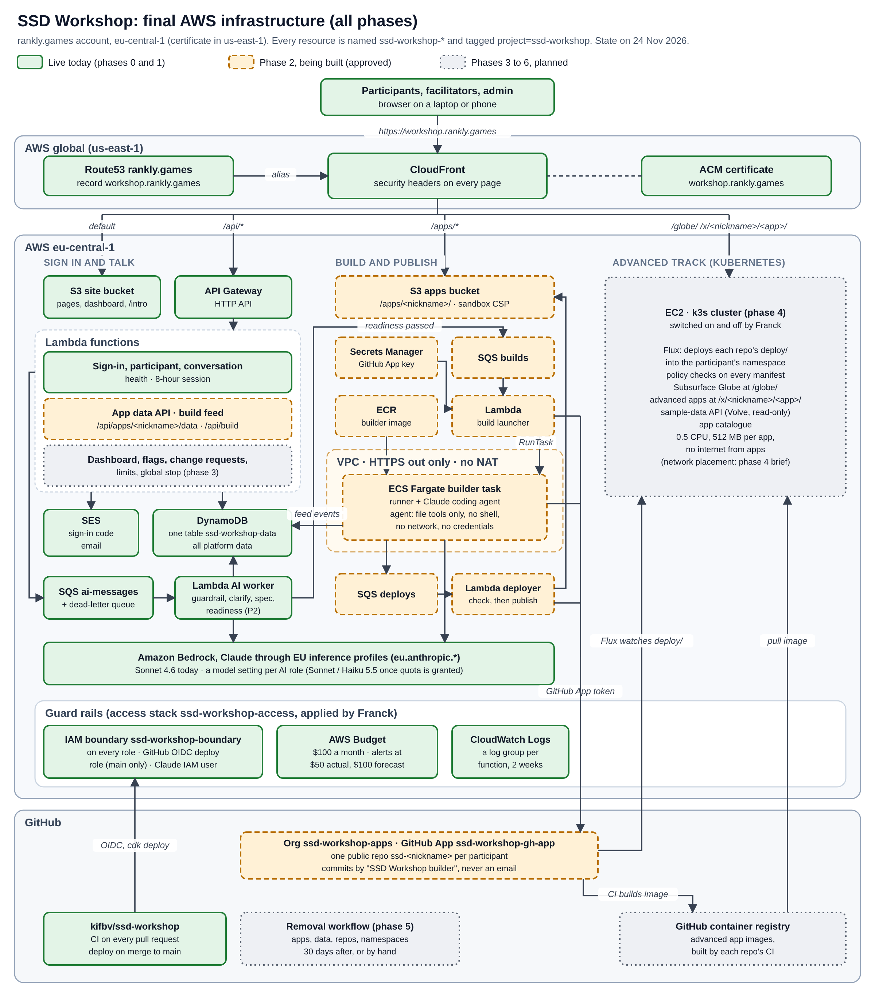
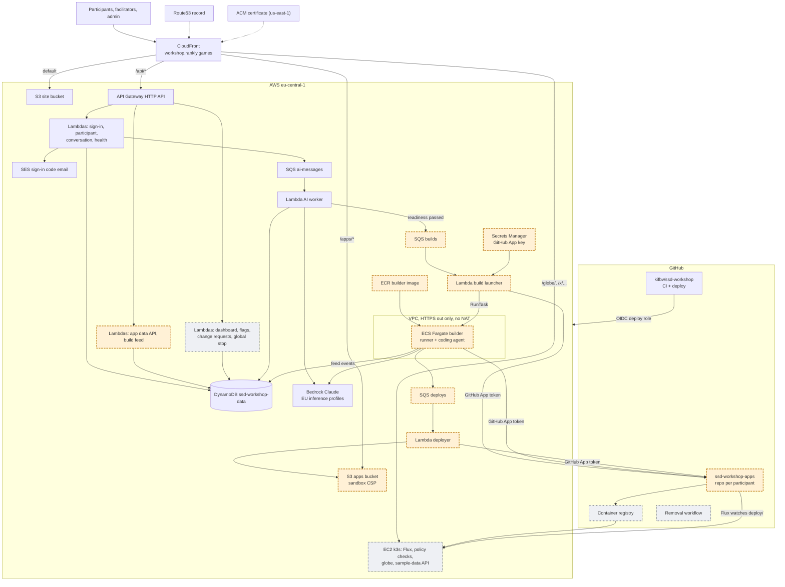

# Final AWS infrastructure

The whole platform once every phase is built (spec sections 5 and 5A, phase briefs 0 to 2).
State on 24 November 2026: green is live, orange dashed is phase 2 (approved, being built),
grey dotted is phases 3 to 6 (in the spec, not yet briefed).

[aws-final.svg](aws-final.svg) is the source (hand-laid SVG, sharp at any zoom); `aws-final.png`
is the same picture at twice the size, for phones.

## How to read it

- **One address.** Everything is served from `workshop.rankly.games` through one CloudFront
  distribution: pages from the site bucket, `/api/*` from the HTTP API, `/apps/*` from the apps
  bucket (sandbox CSP), and `/globe/` and `/x/<nickname>/<app>/` from the k3s cluster. No other
  DNS record is needed.
- **Talk (live).** API Lambdas write to the one DynamoDB table; sign-in codes go out through SES;
  messages to the AI go through SQS to the AI worker, which calls Claude on Bedrock (EU inference
  profiles).
- **Build (phase 2).** After the readiness check, the launcher creates the participant's repository
  in the `ssd-workshop-apps` organization and starts a Fargate builder task. The coding agent has
  file tools and reads public https pages (WebFetch, ticket 2.15), with no shell and no credentials; the runner commits to GitHub, writes feed events and hands the commit to the
  deployer, which checks it and publishes it to the apps bucket. Only the deployer writes there.
- **Advanced (phase 4 and 6).** A k3s cluster on one EC2 instance, switched on by Franck. Each
  participant's repository CI builds an image to the GitHub container registry, and Flux deploys
  the repository's `deploy/` folder into that participant's namespace.
- **Guard rails.** The access stack (boundary on every role, OIDC deploy role for `main` only,
  Claude's IAM user, $100 budget) is applied by Franck alone.

Not drawn: the CDK assets bucket, dead-letter queues other than the AI one, and log groups per
function. Phases 3 and 5 add functions and pages but no new kind of AWS resource; the k3s
cluster's network placement is decided in the phase 4 brief.

## Mermaid version

The same structure as text, for quick edits (GitHub draws it).

