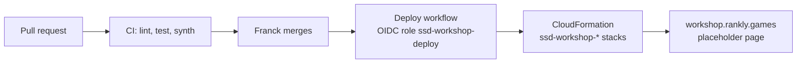

# Phase 0: Foundations

Spec sections: 5 (Architecture, data, hosting and security), 5A "How it runs", 7 (Build phases, row 0), 8 (Way of working). Spec: [AI Workshop Platform: Spec](https://claude.ai/artifact/6mNkKPKQysWNoj7eL6Gyus). Status: draft, questions answered.

Goal: an empty but real platform. `workshop.rankly.games` serves a placeholder page, deployed from `main` by GitHub Actions with the least-privilege role, and Bedrock and SES are proven to work from the account.

## Tickets

### 0.1 Repository conventions

Set up the spec-driven way of working in the repository: `CLAUDE.md` with "How we work" and the Stop-and-ask list from spec section 8, path rules, deny rules for deploys and secrets, a pull request template, an MIT licence and a README that points to the spec. Lay out the monorepo: `infra/` (AWS CDK, TypeScript), `platform/` (API and web, TypeScript), `templates/` (app starters, later phases).

Depends on: none. Areas: repo.

Acceptance criteria (each starts as FAIL):

- WHEN someone opens `CLAUDE.md` THEN it lists the six Stop-and-ask cases from spec section 8 word for word in meaning
- WHEN a Claude session tries `cdk deploy`, `aws iam *` or to read a `.env` file THEN the repository's settings deny it
- WHEN a pull request is opened THEN its description starts from the repository's pull request template
- WHEN `npm ci && npm run lint` runs at the root THEN it succeeds on the empty workspaces

### 0.2 Continuous integration

A GitHub Actions workflow runs on every pull request: install, lint, type check, unit tests, `cdk synth`, and `cfn-lint` on the access stack. It needs no AWS credentials.

Depends on: 0.1. Areas: ci.

Acceptance criteria (each starts as FAIL):

- WHEN a pull request is opened THEN the CI workflow runs lint, type check, tests, `cdk synth` and `cfn-lint`, and reports one check
- WHEN a test fails or `cfn-lint` reports an error THEN the check fails
- WHEN the workflow runs THEN it requests no AWS credentials and no `id-token` permission

### 0.3 Access stack in the repository

Commit the least-privilege access stack (`infra/access/access-stack.yaml`) with a short README on how Franck applies or updates it, and why each permission exists. The stack itself is applied by Franck, never by CI.

Depends on: 0.1. Areas: infra.

Acceptance criteria (each starts as FAIL):

- WHEN `cfn-lint` runs on the template THEN it reports no errors or warnings
- WHEN the deploy policy is read THEN every write permission is limited to `ssd-workshop-*` names, the `project=ssd-workshop` tag, or DNS names `workshop.rankly.games` / `*.workshop.rankly.games`
- WHEN the deploy role tries to update or delete the `ssd-workshop-access` stack THEN AWS refuses (explicit deny)
- WHEN a workshop stack creates an IAM role without the `ssd-workshop-boundary` boundary THEN AWS refuses

### 0.4 CDK app and placeholder site

A CDK app with an assets stack (our own `ssd-workshop-cdk-assets-<account>` bucket, so no account-wide CDK bootstrap is needed), a certificate stack in us-east-1, and a site stack: private S3 bucket, CloudFront with the certificate, and the `workshop.rankly.games` DNS record. Every resource is tagged `project=ssd-workshop`. The page says "SSD Workshop, coming soon".

Depends on: 0.1, 0.3, AWS access. Areas: infra, web.

Acceptance criteria (each starts as FAIL):

- WHEN `https://workshop.rankly.games` is opened THEN it answers 200 over HTTPS with the placeholder page
- WHEN the S3 bucket is requested directly THEN it refuses (only CloudFront can read it)
- WHEN `cdk synth` output is inspected THEN every taggable resource carries `project=ssd-workshop` and every role carries the boundary
- WHEN `http://workshop.rankly.games` is opened THEN it redirects to HTTPS
- WHEN the stacks are deployed THEN no record other than `workshop.rankly.games` and its certificate validation record changed in the rankly.games zone

### 0.5 Deploy from main

A GitHub Actions workflow deploys the CDK app when a pull request is merged to `main`, using OIDC and the `ssd-workshop-deploy` role. No long-lived AWS keys are stored in GitHub.

Depends on: 0.2, 0.4. Areas: ci, infra.

Acceptance criteria (each starts as FAIL):

- WHEN a commit lands on `main` THEN the deploy workflow assumes `ssd-workshop-deploy` through OIDC and runs `cdk deploy --all`
- WHEN the workflow runs from any other branch or a pull request THEN it cannot assume the role
- WHEN the repository's secrets are listed THEN none holds an AWS access key
- WHEN a change to the placeholder text is merged THEN the live page shows it within 10 minutes

### 0.6 Bedrock and SES smoke checks

A small script (`npm run smoke`) proves the account can call Claude Sonnet on Bedrock through the EU inference profile and can send a code email from `ssd-workshop@rankly.games`. It also reports the model's tokens-per-minute quota.

Depends on: 0.1, AWS access. Areas: platform.

Acceptance criteria (each starts as FAIL):

- WHEN `npm run smoke -- bedrock` runs THEN it gets an answer from Claude Sonnet through an `eu.anthropic.*` inference profile and prints the latency
- WHEN `npm run smoke -- quota` runs THEN it prints the current tokens-per-minute and requests-per-minute quotas for that model in eu-central-1
- WHEN `npm run smoke -- ses <address>` runs with a verified address THEN a test email from `ssd-workshop@rankly.games` arrives
- WHEN `npm run smoke -- ses <address>` runs with an unverified address THEN the email still arrives (SES is in production mode)

## Questions for Franck

Answered on 2026-11-22 (see `docs/decisions.md`):

1. The platform (infrastructure, API and web pages) is written in TypeScript; advanced participant apps stay in Python. Answer: yes.
2. Is SES still in sandbox mode? Answer: no, SES is already in production mode for the rankly.games domain, so no request is needed.

## Blocked

- 0.4, 0.5 and 0.6 wait on AWS access: the `ssd-workshop-access` stack applied and the `ssd-workshop-claude` key stored as the network secret.
