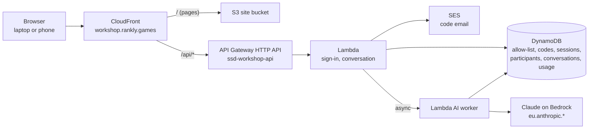

# Phase 1: Sign in and talk

Spec sections: 2 (Users and roles), 3 (Participant journey: sign-in, step 1 Clarify, step 2 Spec), 4 (Guardrails 3, 4 and 6), 5 (Architecture, Data and privacy, Security), 7 (Build phases, row 1). Spec: [AI Workshop Platform: Spec](https://claude.ai/artifact/6mNkKPKQysWNoj7eL6Gyus). Status: draft, questions answered 2026-11-23.

Goal: an allow-listed person opens `workshop.rankly.games`, gets a 6-digit code by email, picks a nickname, describes an app idea, answers the AI's clarifying questions, reads and changes a spec with a diagram, and presses **Approve spec**. Off-path ideas are declined; unusual ones wait for a facilitator. The build itself (step 3) is phase 2, so after approval the page says the build comes next.

The AI replies are asynchronous: API Gateway stops a request after 30 seconds and a spec can take longer, and Lambda response streaming needs function URLs, which the access stack denies. So a message is stored, an AI worker answers it, and the page polls every 2 seconds (the same pattern the spec chose for the build feed, item 10).

## Tickets

### 1.1 Database and API skeleton

A new stack `ssd-workshop-api` (eu-central-1) with one DynamoDB table `ssd-workshop-data` (on demand, point-in-time recovery, retained on stack deletion), an HTTP API `ssd-workshop-api` with `GET /api/health`, and the Lambda that serves it. Shared types for the table's items (allow-list entry, code, session, participant, conversation message, usage) live in `platform/api/`.

Depends on: none. Areas: infra, api.

Acceptance criteria (each starts as FAIL):

- WHEN `cdk synth` output is inspected THEN the table, API, functions and log groups are named `ssd-workshop-*`, tagged `project=ssd-workshop`, and every role has the `/ssd-workshop/` path and the boundary (existing tests extended)
- WHEN the synthesized API is inspected THEN it creates no account-wide CloudWatch role and every Lambda permission names the API's ARN as source
- WHEN `GET /api/health` is called on the deployed API's own endpoint THEN it answers 200 with `{"ok":true}` (post-deploy command in `infra/README.md`)
- WHEN the table is inspected THEN billing is on demand, point-in-time recovery is on, and the removal policy is retain

### 1.2 API under the workshop address

CloudFront sends `/api/*` to the HTTP API, with caching off and cookies, query strings and the body passed through, so pages and API share one origin: no CORS, no new DNS record. The API's id becomes a constant in `infra/lib/config.ts` once 1.1 is deployed (the edge stack in us-east-1 cannot read it across regions).

Depends on: 1.1 merged and deployed. Areas: infra.

Acceptance criteria (each starts as FAIL):

- WHEN `https://workshop.rankly.games/api/health` is opened THEN it answers 200 with `{"ok":true}` (deploy workflow smoke check)
- WHEN the synthesized edge stack is inspected THEN the `/api/*` behaviour uses the managed `CachingDisabled` and `AllViewerExceptHostHeader` policies and allows every HTTP method
- WHEN the deploy runs THEN no record in the rankly.games zone changed (zone snapshot before and after)

### 1.3 Allow-list and import command

The allow-list holds each person's email (lower-cased), group and role (participant, facilitator or admin), as confirmed in spec item 13. Franck loads it with `npm run allowlist -- import <file.csv>` from his own machine; the file never enters the repository, and the command prints counts, never addresses. Franck's address is the first entry.

Depends on: 1.1. Areas: api, tools.

Acceptance criteria (each starts as FAIL):

- WHEN a CSV with `email,group,role` rows is imported THEN each row is stored once, with the email lower-cased and trimmed, and the command prints only how many were added, updated and rejected
- WHEN a row has an invalid email, an unknown role or an empty group THEN it is rejected with its line number, and the other rows are still imported
- WHEN `npm run allowlist -- list` runs THEN it prints counts per group and role, and no email address
- WHEN a CSV path inside the repository is given THEN the command refuses (keeps personal data out of git)

### 1.4 Code request and code email

`POST /api/sign-in/code` takes an email. If it is on the allow-list and under 5 codes in the last hour, a 6-digit code is stored hashed, valid 10 minutes, and emailed; either way the answer is the same neutral message. The email is built to stay out of Junk: sender name "SSD Workshop" `<ssd-workshop@rankly.games>`, subject "Your SSD Workshop sign-in code: 123456", HTML and plain-text parts, one line saying why the person gets it, and a closing line "Questions? Ask your facilitator." No Reply-To: nobody needs to reply, `ssd-workshop@rankly.games` receives no mail, and a Reply-To on another domain than the sender is itself a spam signal.

Depends on: 1.3, 0.6 merged. Areas: api.

Acceptance criteria (each starts as FAIL):

- WHEN an allow-listed email asks for a code THEN one code email is sent and the stored code is a hash with a 10-minute expiry (unit test with SES and DynamoDB mocked)
- WHEN an email that is not on the allow-list asks THEN the answer is byte-for-byte the same as for an allow-listed one, and nothing is sent
- WHEN the same email asks a sixth time within an hour THEN no email is sent and the answer is still the neutral one
- WHEN the email is built THEN it has the "SSD Workshop" display name, the subject with the code, a text and an HTML part with the same code and the explanatory line and the "ask your facilitator" line, and no Reply-To header
- WHEN the function's logs are read after these tests THEN no email address and no code appear in them (log capture test)
- WHEN `npm run -s smoke -- signin <address>` runs against the live site with Franck's address THEN the code email arrives

### 1.5 Code check, session and nickname

`POST /api/sign-in/verify` checks the code (5 attempts, then the code is burned) and starts an 8-hour session in an HttpOnly, Secure, SameSite=Strict cookie whose token is stored hashed. A new person then picks a nickname (3 to 20 letters, digits or dashes, unique regardless of case, not on a short reserved list such as `admin`, `api`, `globe`, `intro`, `apps`, `x`); a returning person goes straight back to their step. Every later API call goes through one session check that returns the caller's own participant record and role.

Depends on: 1.4. Areas: api.

Acceptance criteria (each starts as FAIL):

- WHEN the right code is sent within 10 minutes THEN a session cookie (HttpOnly, Secure, SameSite=Strict, 8 hours) is set and the code can't be used again
- WHEN a wrong code is sent 5 times THEN the code is burned and even the right code is refused
- WHEN a code older than 10 minutes is sent THEN it is refused
- WHEN a nickname breaks the rules, is reserved or is taken in any letter case THEN it is refused with a reason, and a valid one is saved
- WHEN a call to a protected route has no session, an expired one or a forged one THEN the API answers 401
- WHEN a participant asks for another participant's record by id THEN the API answers "not found"

### 1.6 Sign-in screens

The site gets its first real pages, built from TypeScript into `platform/web`: enter email, enter code (with "Not in your inbox? Check your Junk folder" and a resend link), pick a nickname with the rule "No confidential or customer data" shown on screen, then the step 1 screen. A Content-Security-Policy is added now that the pages have scripts.

Depends on: 1.2, 1.5. Areas: web, infra.

Acceptance criteria (each starts as FAIL):

- WHEN the sign-in flow runs in a browser test against a mocked API THEN email, code and nickname screens lead to step 1 (Playwright)
- WHEN the code screen is shown THEN the Junk-folder hint and the resend link are visible
- WHEN the nickname screen is shown THEN the "no confidential or customer data" rule is visible
- WHEN the pages are rendered at 375 px wide THEN nothing scrolls sideways (Playwright, phone viewport)
- WHEN a page is served THEN its responses carry a Content-Security-Policy that allows scripts only from the site itself
- WHEN the email screen gets an address that is not allow-listed THEN it shows the same neutral message as for a listed one

### 1.7 AI conversation engine and guardrail check

One conversation per participant: a message is stored, an AI worker Lambda first runs the guardrail check (on path, decline, or flag), then answers with Claude on Bedrock through an `eu.anthropic.*` profile, and the page polls for the reply. Every prompt and reply is logged per participant, and token use and its cost are added to the participant's usage (enforcement of the $5 cap is phase 3). A flagged message puts the participant in "waiting for your facilitator" until it is approved or rejected.

Depends on: 1.5. Areas: api, infra.

Acceptance criteria (each starts as FAIL):

- WHEN a participant sends a message THEN the API answers at once with a message id, and polling returns the AI's reply when the worker is done (unit test with Bedrock mocked)
- WHEN the guardrail check says "decline" THEN the reply is one polite sentence with an in-scope suggestion, and no answer prompt is sent
- WHEN the guardrail check says "flag" THEN the participant's state is "waiting for your facilitator" and later messages are refused until a decision
- WHEN `npm run flags -- approve|reject <nickname>` runs THEN the waiting message continues or is declined (stand-in for the phase 3 dashboard)
- WHEN a reply is produced THEN the prompt, the reply, the input and output tokens and the cost are stored for that participant
- WHEN a participant polls for another participant's message id THEN the API answers "not found"
- WHEN `npm run eval -- guardrails` runs against Bedrock THEN every off-path example in `platform/api/eval/guardrails.json` (infrastructure, crypto mining, scraping, other people's data, offensive) is declined, every in-scope example passes, and the unusual examples are flagged

### 1.8 Step 1: Clarify

The participant describes their idea; after the guardrail check the AI asks 3 to 5 clarifying questions in plain English, and the participant can answer, change their mind or steer freely. When the AI has enough, it offers to write the spec. A short "behind the scenes" box says what the AI is doing (the diagram-led panels themselves are phase 5).

Depends on: 1.6, 1.7. Areas: api, web.

Acceptance criteria (each starts as FAIL):

- WHEN a participant sends an in-scope idea THEN the first reply holds 3 to 5 numbered questions (`npm run eval -- clarify` over the example ideas: fitness tracker, movies tracker, nutrition calculator)
- WHEN the participant changes their idea mid-conversation THEN the next questions are about the new idea (eval example)
- WHEN the step 1 screen waits for a reply THEN it shows a typing indicator and polls every 2 seconds, and stops polling once the reply has arrived (Playwright, mocked API)
- WHEN the page is reloaded THEN the conversation so far is shown again
- WHEN the participant presses **Write my spec** THEN they move to step 2

### 1.9 Step 2: Spec and approval

The AI writes a short spec (what the app does, its screens, the data it keeps, and a Mermaid diagram), shown rendered on the page. The participant can ask for explanations or changes as often as they like and presses **Approve spec** when happy; each version is kept. After approval the page says the build is coming (phase 2).

Depends on: 1.8. Areas: api, web.

Acceptance criteria (each starts as FAIL):

- WHEN the spec is generated THEN it has the sections "What it does", "Screens", "Data it keeps" and a Mermaid diagram that parses (`npm run eval -- spec` checks structure and parses the diagram)
- WHEN the participant asks a question about the spec THEN the AI answers without changing the spec, and WHEN they ask for a change THEN a new version is saved and shown
- WHEN the spec is shown THEN the diagram is drawn as a picture on laptop and phone widths (Playwright)
- WHEN the participant presses **Approve spec** THEN the approved version is stored, the step becomes "approved", and further change requests to the spec are refused until phase 2's flow takes over
- WHEN a participant asks for another participant's spec THEN the API answers "not found"

## Questions for Franck

Answered on 2026-11-23 (see `docs/decisions.md`):

1. **New paid services** (API Gateway HTTP API, Lambda, DynamoDB on demand; under $2 a month at rest, about $10 to $20 of Bedrock for phase 1's tests). Answer: yes.
2. **Model:** Sonnet 4.6 for phase 1, model id in one config value; Franck requests the Sonnet 5.5 quota if he wants it for the pitch. Answer: yes.
3. **Facilitators see all participants** (spec delta, CHANGED). Answer: yes.
4. **Allow-list** imported by Franck from his machine with a CSV kept outside the repository; admin page in phase 3. Answer: yes.
5. **Reply-To.** `ssd-workshop@rankly.games` receives no mail, and the system expects no replies. Answer: no Reply-To header; the email says "Questions? Ask your facilitator." (A Reply-To on another domain than the sender would look like phishing to spam filters.)

## Blocked

- None of the tickets waits on someone else once the questions are answered. The full allow-list waits on Franck, but his own address is enough to test every ticket.
- Ticket 0.6 (Bedrock and SES smoke checks, pull request #4) is still open, not merged. Ticket 1.4 extends its `npm run smoke` script, so it should be merged first.
- Code emails landing in Junk at the work address also wait on IT allowlisting `ssd-workshop@rankly.games`; ticket 1.4 improves the email itself.
