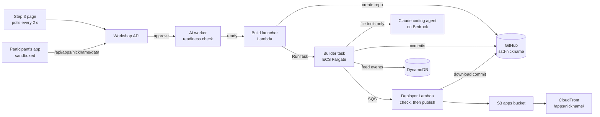

# Phase 2: Build and go live

Spec sections: 3 (Participant journey: step 3 Build, step 4 Live), 4 (Guardrails: fixed template, the coding AI's rights, the pre-deploy check), 5 (Architecture: Builder, Deployer, Code; Data and privacy; Security: secrets), 7 (Build phases, row 2), 10 (items 4, 7, 8, 10). Spec: [AI Workshop Platform: Spec](https://claude.ai/artifact/6mNkKPKQysWNoj7eL6Gyus). Status: questions answered 2026-11-23 (see `docs/decisions.md`); ready for approval.

Goal: after **Approve spec**, an AI readiness check passes, a public GitHub repository is created for the participant, a Claude coding agent in a container writes the app from the template while the page shows a live feed (steps, files, commits), the deployer checks the result and publishes it at `workshop.rankly.games/apps/<nickname>/`, and step 4 shows the address and a QR code. A first build takes under 10 minutes. Change requests, limits, the 15-build queue and the facilitator dashboard are phase 3.

How the pieces hold the spec's rule "the AI that writes code has no AWS credentials": the coding agent gets only file tools (read, write, edit, list) limited to its workspace folder, no shell and no network tool. The runner around it, our own code in the same container, holds the Bedrock right, the build's one-repository GitHub token and the hand-off to the deployer. Only the deployer writes to the apps bucket, and it publishes what GitHub holds at the build's commit, so what is live is exactly what participants can read.

Apps are served from the workshop's own address (spec item 7), so the `/apps/*` responses carry a `Content-Security-Policy: sandbox allow-scripts allow-forms allow-modals allow-popups` header (no `allow-same-origin`): an app runs in an opaque origin, never sees the platform's session cookie and cannot call the platform's API as the person viewing it. The cost is that apps cannot use `localStorage` or cookies; they store data only through the data API (2.4), which answers them with CORS.

Models: each AI role (guardrail, clarify, spec, readiness, build) gets its own model setting with its own price, in one table in `platform/api/settings.ts` (today one `MODEL_ID` serves every role), and every eval takes `--model <id>`, so a cheaper model can be measured on the same examples before it replaces one. Any `eu.anthropic.*` model the account can use is then a one-line change; the coding agent (Claude Agent SDK) runs only Claude models.

Cost of a build (estimate, to be replaced by 2.8's measured numbers): a coding agent takes about 30 to 50 model turns for a small app, re-sending its growing context each time, so roughly 0.5 to 1.5 million input tokens (mostly prompt-cache reads at a tenth of the price) and 20,000 to 40,000 output tokens. At Sonnet 4.6's EU prices ($3.30 / $16.50 per million) that is about $0.50 to $2 per build; phase 2's evals and test builds (about 30) come to $20 to $50.

## Tickets

### 2.1 Build network, cluster and image repository

A new stack `ssd-workshop-builds` (eu-central-1) with a VPC of two public subnets in two zones and no NAT gateway, a security group that allows only outgoing HTTPS, an ECS cluster `ssd-workshop-builds` and an ECR repository `ssd-workshop-builder` (keeps the last 5 images). Build tasks get a public IP, which avoids a NAT gateway (about $40 a month). The subnet ids become constants in `infra/lib/config.ts` once it is deployed, for 2.2.

Depends on: answer to question 1. Areas: infra.

Acceptance criteria (each starts as FAIL):

- WHEN `cdk synth` output is inspected THEN the VPC, subnets, security group, cluster and repository are named `ssd-workshop-*` and tagged `project=ssd-workshop`, and there is no NAT gateway, VPC endpoint or interface endpoint (app test)
- WHEN the security group is inspected THEN its only egress rule is TCP 443 to anywhere and it has no ingress rule
- WHEN the ECR repository is inspected THEN its lifecycle rule keeps at most 5 images and image scanning on push is on
- WHEN the deploy has run THEN `aws ec2 describe-subnets` filtered on the project tag lists exactly two subnets (command in `infra/README.md`)

### 2.2 Access stack: pin build tasks to the workshop subnets (Franck applies)

Closes accepted risk 1 of `infra/access/README.md`: `ecs:RunTask` is denied unless every `ecs:subnet` is one of the two workshop subnets, for both principals and the boundary. Adds what CloudFormation needs to manage a task definition (`ecs:DescribeTaskDefinition`, which AWS offers only on `Resource *`; see question 3) and anything else the 2.3 to 2.9 dry runs show missing. Franck applies the template; nothing in 2.8 deploys before that.

Depends on: 2.1 deployed, answer to question 3. Areas: infra (access).

Acceptance criteria (each starts as FAIL):

- WHEN the access-stack test runs THEN StartTask is denied, every action carrying `ecs:subnet` is denied outside the two subnets, and under the boundary only the launcher role may RunTask
- WHEN `cfn-lint` and the policy size test run THEN they pass, every policy staying under 6,144 characters
- WHEN infra/access/README.md is read THEN risk 1 is marked narrowed with a CloudTrail check and the DescribeTaskDefinition risk is listed with its check
- WHEN the template handed to Franck is diffed with the applied one THEN it holds every change already applied (lesson of 2026-11-23)

Criteria 1 and 3 changed on 2026-11-24 (Franck's answer): IAM has no subnet key on `RunTask`/`StartTask`, see `docs/decisions.md`. They first read "RunTask and StartTask without `ecs:subnet` in the two subnet ids are denied" and "risk 1 is marked closed".

### 2.3 App template and the deploy check

`templates/basic/` becomes the starter every app is built from: `index.html`, `style.css`, `app.js`, a small `workshop-data.js` client for the data API, `SPEC.md` (filled with the approved spec), a README explaining the files, and `AGENTS.md`, the coding agent's instructions (plain HTML, CSS and JavaScript, no frameworks, no outside addresses, no `localStorage`, store data only through `workshop-data.js`, works at 375 px). The deploy check (`platform/api/build/check.ts`) holds the spec's rules: only allowed file types, no address outside the workshop, at most 5 MB.

Depends on: none. Areas: templates, api.

Acceptance criteria (each starts as FAIL):

- WHEN the deploy check runs on the template THEN it passes
- WHEN a build adds a file type outside the list (for example `.php`, `.exe`, `.wasm`, a symlink) THEN the check fails and names the file
- WHEN a file refers to an outside address (`https://`, `//host`, `fetch("http...`) other than the allowed list THEN the check fails and names the file and line
- WHEN the files total more than 5 MB THEN the check fails with the size
- WHEN the template is opened at 375 px under the apps CSP (sandbox) in Playwright THEN it loads with no console error and nothing scrolls sideways
- WHEN `templates/basic/` is searched THEN it holds no email address and no secret (test)

### 2.4 Data API for apps

`GET`, `PUT` and `DELETE /api/apps/<nickname>/data/<key>`: JSON values an app keeps, readable and writable by anyone with the app's address, as the spec says. Limits: 1 MB per app in total, 100 KB per value, 100 keys, keys of letters, digits, dashes and underscores. It answers sandboxed apps with `Access-Control-Allow-Origin: *` and never reads or sets a cookie.

Depends on: none. Areas: api, infra.

Acceptance criteria (each starts as FAIL):

- WHEN an app stores a value and reads it back THEN it gets the same JSON
- WHEN a write would take the app past 1 MB, a value past 100 KB or the app past 100 keys THEN it is refused with 413 and a plain reason, and nothing is stored
- WHEN the nickname has no live app THEN the API answers 404
- WHEN a request comes with the platform's session cookie THEN the answer is the same as without it, and the response sets no cookie
- WHEN a page with an opaque origin calls the API in Playwright THEN the CORS answer lets it read the value
- WHEN the function's logs are read after these tests THEN no stored value appears in them

### 2.5 Apps hosting and the deployer

A bucket `ssd-workshop-apps`, a CloudFront behaviour `/apps/*` (cached, with a new headers policy carrying the sandbox CSP), and the deployer Lambda fed by the queue `ssd-workshop-deploys`. For a build it downloads the repository at the build's commit from GitHub, runs the deploy check, uploads the files to `apps/<nickname>/`, removes files the new version no longer has, invalidates `/apps/<nickname>/*` and records the result on the build.

Depends on: 2.3. Areas: infra, api.

Acceptance criteria (each starts as FAIL):

- WHEN a commit that passes the check is deployed THEN its files are under `apps/<nickname>/` and nothing else, and the build is marked live (unit test with GitHub and S3 mocked)
- WHEN a commit fails the check THEN nothing is uploaded, the live version stays as it was, and the build is marked failed with the check's reasons
- WHEN `/apps/<nickname>/` is served THEN the response carries the sandbox CSP and `X-Content-Type-Options: nosniff` (synth test of the headers policy, live check in `infra/README.md`)
- WHEN the synthesized stacks are inspected THEN only the deployer's role can write to the apps bucket, and the site's `BucketDeployment` cannot remove app files
- WHEN an unknown address under `/apps/` is opened THEN a plain 404 page is shown

### 2.6 GitHub access and the participant's repository

The platform's GitHub credentials live in a Secrets Manager secret `ssd-workshop-github` that Franck fills (CDK creates it empty). The GitHub module creates the public repository `ssd-<nickname>` (see question 2 for where), makes the first commit from the template plus `SPEC.md`, and gives the builder a token that reaches only that repository for one hour. Commits are authored "SSD Workshop builder" with a noreply address: no participant email ever reaches GitHub.

Depends on: 2.3, Franck's GitHub setup (question 2). Areas: api, infra.

Acceptance criteria (each starts as FAIL):

- WHEN a repository is created THEN it is public, named `ssd-<nickname>` in lower case, and its first commit holds the template and the approved spec (unit test, GitHub API mocked)
- WHEN the repository already exists (a rebuild after `conversation reset`) THEN it is reused and a new commit is added, not an error
- WHEN the builder's token is requested THEN it is limited to that one repository with contents write and expires within an hour
- WHEN any commit is built THEN its author, committer and message hold no email address other than the noreply one (test)
- WHEN the logs are read after these tests THEN no token appears in them
- WHEN `npm run -s smoke -- github` runs with Franck's credentials THEN it reports the account the secret reaches and its rights, and prints no token

### 2.7 Readiness check and build start

After **Approve spec**, the AI worker runs the readiness check (prompt `readiness-v1`): does the approved spec leave open questions, and does it fit the template (no server, no login, no outside service, no payments)? If it passes, the step becomes `building`, a build record is written and a job goes to the build launcher; if not, the step goes back to `spec` with the AI's reasons as a reply, so the participant can fix them and approve again. The approved page's text changes from "your facilitator will tell you" to the build starting.

Depends on: 2.6. Areas: api.

Acceptance criteria (each starts as FAIL):

- WHEN `npm run eval -- readiness` runs THEN the three example specs pass, and specs needing a login, a payment, an outside API or leaving a question open fail with a reason naming it
- WHEN the check passes THEN the step is `building` and exactly one build exists for the participant, even if approve is pressed twice
- WHEN the check fails THEN the step is `spec`, the reasons appear in the conversation and a new approve is possible
- WHEN the check's tokens are spent THEN they are added to the participant's usage
- WHEN a participant asks for another participant's build THEN the API answers "not found"

### 2.8 Builder: runner and coding agent

The runner (`platform/builder/`) takes a build, clones the repository, runs the Claude coding agent (Claude Agent SDK on Bedrock, Sonnet 4.6, question 4) with `AGENTS.md` and `SPEC.md`, writes feed events (step, file written, commit) to the build record, commits the agent's work in a few meaningful commits, runs the deploy check, and hands the commit to the deployer. It stops the agent at 12 minutes and marks the build failed with a plain reason. It runs locally against Bedrock for the eval.

Depends on: 2.3, 2.6. Areas: builder.

Acceptance criteria (each starts as FAIL):

- WHEN `npm run eval -- build` runs on the three example specs THEN each result passes the deploy check, loads in Playwright at 375 px under the sandbox CSP with no console error, and shows the screens its spec names (title check); duration and cost are printed
- WHEN the agent tries to read or write a path outside its workspace, run a command or fetch an address THEN the tool call is refused (unit test of the permission hook)
- WHEN the build runs THEN the feed holds the steps in order (preparing, writing, checking, committing, deploying) and every written file, and the repository holds at least two commits
- WHEN 12 minutes pass THEN the agent is stopped and the build is marked failed with "The build took too long."
- WHEN the build's tokens are spent THEN they and their cost are added to the participant's usage
- WHEN the runner's output and the feed are read THEN they hold no token and no email address

### 2.9 Builder container and launcher

The runner is packaged as an image (pushed to `ssd-workshop-builder` by the deploy workflow), with a Fargate task definition `ssd-workshop-builder` (1 vCPU, 2 GB) whose role may only call the Sonnet 4.6 EU profile, update build records and send to `ssd-workshop-deploys`. The build launcher Lambda (queue `ssd-workshop-builds`) creates the repository, mints the token and starts the task in the workshop subnets. `npm run builds -- list | retry <nickname>` is the stand-in for phase 3's dashboard.

Depends on: 2.2 applied, 2.5, 2.7, 2.8. Areas: infra, builder.

Acceptance criteria (each starts as FAIL):

- WHEN the synthesized task definition is inspected THEN its role has the boundary, may invoke only `eu.anthropic.claude-sonnet-4-6` and its foundation models, write only build records and the token counters of participants' usage items (`dynamodb:Attributes`; usage added by Franck's choice in 2.8), and send only to `ssd-workshop-deploys`, and the task has no secret in its environment
- WHEN the launcher starts a task THEN it names the `ssd-workshop-builds` cluster and the two workshop subnets with a public IP
- WHEN a task stops without the build being finished THEN the build is marked failed within 2 minutes (launcher check, unit test)
- WHEN `npm run builds -- retry <nickname>` runs on a failed build THEN a new task starts on the same repository
- WHEN Franck approves a spec on the live site THEN the app is live at `/apps/<nickname>/` within 10 minutes (live check in `infra/README.md`)

From 2.5 (note, see decision "(2.5) Deploy message"): the builder stores the commit it pushed on the build (`pushedCommit`) and the deployer's start condition adds `#pushedCommit = :commit` (a commit SHA alone does not prove it came from the participant's repository); and the launcher's stuck-build check also moves a build left in `deploying` (after its deploy message reached the dead-letter queue) to `failed`.

### 2.10 Step 3: live build feed

The step 3 screen polls `GET /api/build` every 2 seconds and shows the build's steps as a row of stages (the current one highlighted), the files as they appear, and each commit with a link to it on GitHub, plus a "Behind the scenes" box with the same flow as the diagram above. A failed build shows "Something went wrong with your build. Your facilitator can restart it."

Depends on: 2.7. Areas: api, web.

Acceptance criteria (each starts as FAIL):

- WHEN a build is running THEN the page shows its stages, files and commits, and polls every 2 seconds (Playwright, mocked API)
- WHEN the build is live THEN polling stops and the page moves to step 4
- WHEN the page is reloaded mid-build THEN the feed so far is shown again
- WHEN the page is 375 px wide THEN nothing scrolls sideways
- WHEN a commit link is shown THEN it points to `https://github.com/<owner>/ssd-<nickname>/commit/<sha>`

### 2.11 Step 4: Live

The step 4 screen shows "Your app is live", the address as a link, a QR code to open it on a phone (drawn in the page, no outside service), a link to the repository, and a "Behind the scenes" box on how the app got there. Change requests come in phase 3, so the page says they are next.

Depends on: 2.10. Areas: web.

Acceptance criteria (each starts as FAIL):

- WHEN the build is live THEN step 4 shows the address `https://workshop.rankly.games/apps/<nickname>/`, the repository link and a QR code
- WHEN the QR code is decoded in the test THEN it gives exactly the app's address
- WHEN the page is shown at 375 px THEN nothing scrolls sideways and the QR code fits the screen
- WHEN a participant reloads at step 4 THEN they land on step 4 again

## Questions for Franck

1. **(Answered: yes.) New paid services:** ECS Fargate (about $0.01 per 10-minute build), ECR (about $0.10 a month), Secrets Manager ($0.40 a month for one secret) and a public IPv4 address per running build task ($0.005 an hour). At rest under $1 a month more; Bedrock for builds about $0.50 to $2 each, so phase 2's tests and evals about $20 to $50. No NAT gateway. Suggested: yes.
2. **(Answered: yes, Franck creates the organization.) Where participants' repositories live.** The spec says your personal account. A token that can create repositories there can also change every other repository you own, `ssd-workshop` included, and the builder holds a token while an AI writes code. Suggested: a free GitHub organization you own just for the apps (for example `ssd-workshop-apps`, not a company organization) with a GitHub App installed only there; the platform then hands each build a one-hour token for that one repository. You create the organization and the app (about 10 minutes; I write the steps) and put its private key in the secret. This is a spec delta (CHANGED: section 5 "Code" and item 8, repositories in that organization). The alternative is a fine-grained token limited to the same organization; keeping your personal account needs a token on all your repositories.
3. **(Answered: risk accepted.) Access stack for build tasks:** CloudFormation needs `ecs:DescribeTaskDefinition`, which AWS only grants account-wide, so the workshop's principals could read other projects' task definitions (including their environment variables). In return 2.2 pins build tasks to the workshop subnets, closing accepted risk 1. Suggested: yes, as a new accepted risk with a CloudTrail check.
4. **(Answered: yes, spec delta approved.) Builder's AWS rights and the coding agent** (spec delta, CHANGED: section 5 "Builder ... has no AWS rights"). The container must call Claude on Bedrock. Suggested: the coding agent (Claude Agent SDK, the engine behind Claude Code) gets only file tools inside its workspace, no shell and no network, and holds no credentials; the runner around it holds a role that can only call the Sonnet 4.6 EU profile, write its build's records and hand off to the deployer. New wording: "The coding agent holds no AWS rights; the builder task may only call Claude, report progress and hand the result to the deployer."
5. **(Answered: sandboxed.) Apps run sandboxed** on `workshop.rankly.games/apps/<nickname>/`: no cookies and no `localStorage`, storage only through the data API, which anyone with the app's address can read and write (as the spec says). Suggested: yes. The alternative, a separate address such as `apps.workshop.rankly.games`, needs a DNS record and a spec delta.

## Blocked

- 2.6, and so 2.7 and 2.9, wait on Franck loading the GitHub App's private key into `ssd-workshop-github` once 2.6 creates it (organization `ssd-workshop-apps` and app `ssd-workshop-gh-app` exist since 2026-11-23).
- 2.9 waits on Franck applying the 2.2 access stack update.
- For the workshop day (phase 3, not this phase): Sonnet 4.6 allows 50 requests a minute in this account, and 15 coding agents at once would need more. Raising the quota is Franck's AWS request; phase 3's 15-build queue will be sized on the phase 2 measurements.
- Not in this phase: change requests, limits and the 15-build queue, the facilitator dashboard and retry button (phase 3), diagram-led explainer panels (phase 5), repository removal (phase 5).
