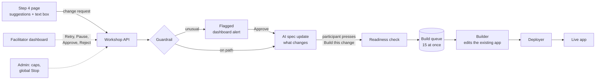
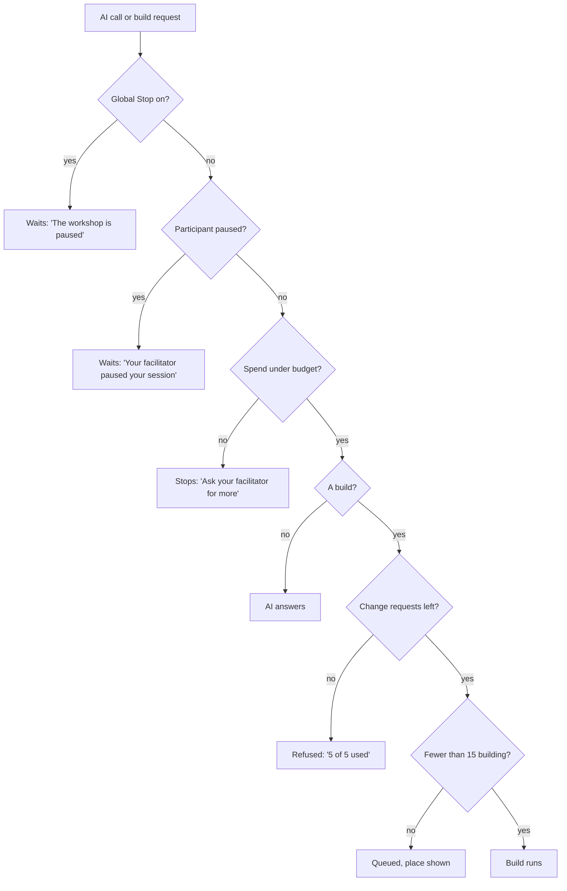

# Phase 3: Iterate and supervise

Spec sections: 2 (Users and roles: facilitator, admin), 3 (step 4 Live: change requests, editing the spec on GitHub), 4 (Guardrails: flagged requests; Limits per participant; global Stop; Facilitator dashboard), 5 (Security: every call checks own data and own group), 7 (Build phases, row 3), 10 (items 5, 13, 14). Spec: [AI Workshop Platform: Spec](https://claude.ai/artifact/6mNkKPKQysWNoj7eL6Gyus). Status: draft, waiting for Franck's answers.

Goal: once an app is live, the participant sees a few suggested changes and can send up to 5 change requests in plain English; each one goes through the guardrail, a short spec update they can read, and a rebuild that edits their existing app. Every participant has an AI budget of about $5. At most 15 builds run at once and the others wait in a queue the page shows. Facilitators get a dashboard (nickname, step, time in step, stuck and failed builds highlighted, Retry and Pause, flagged requests with Approve and Reject at the top), and the admin gets caps and a global Stop button. Ready for the pitch.

What exists already and is reused: the flags store and `npm run flags` (approve or reject a held message), `npm run builds -- list | retry` (stand-in for Retry), the participant's `USAGE` item (every AI call and build adds its tokens and cost to it, tickets 1.7 and 2.8), the build queue `ssd-workshop-builds.fifo` and its launcher with its stuck-build check (2.9), the step 3 feed (2.10) and step 4 screen (2.11). None of them enforces a limit yet: the launcher's Lambda concurrency of 5 limits launches, not running builds.

How the limits work together:

## Tickets

### 3.1 Sessions follow the allow-list, and sign-out

Before any role sees other people's data, every protected call re-reads the caller's allow-list entry: a removed person is signed out at their next call, and a changed role or group applies at once (closes accepted risk "(1.5) sessions not re-checked"). A sign-out route deletes the session and its cookie, and the page gets a small "Sign out" link. The sign-in screen also gets the hint "No code after a minute? Check your Junk or Spam folder." (open item from phase 0).

Depends on: none. Areas: api, web.

Acceptance criteria (each starts as FAIL):

- WHEN a signed-in person's allow-list entry is removed THEN their next protected call answers 401 and the session item is deleted (test)
- WHEN a person's role or group changes in the allow-list THEN their next call uses the new role and group (test)
- WHEN `POST /api/sign-out` is called THEN the session item is deleted, the cookie is cleared, and the old cookie answers 401 (test)
- WHEN the sign-in screen asks for a code THEN it shows the Junk hint (Playwright, 375 px)
- WHEN the API logs a refused or signed-out call THEN no email address is in the log line (test)

### 3.2 Workshop settings and per-person limits

One `SETTINGS` item holds the caps the admin sets: AI budget per person ($5), change requests per person (5), builds at once (15) and the global Stop switch; each participant's record gains `extraBudget` (dollars granted by a facilitator), `paused`, `changeRequestsUsed` and `stepSince`. `GET` and `PUT /api/admin/settings` (admin only) read and change the caps. Shared types, defaults and every participant-facing text for phase 3 live here so later tickets reuse them.

Depends on: 3.1. Areas: shared, api, infra.

Acceptance criteria (each starts as FAIL):

- WHEN no `SETTINGS` item exists THEN the API reads the defaults $5, 5 and 15 with Stop off (test)
- WHEN an admin sends `PUT /api/admin/settings` with valid values THEN they are stored, and WHEN a participant or facilitator sends it THEN the answer is 404 and nothing changes (test)
- WHEN a value is out of range (budget not between $0 and $50, changes not 0 to 20, builds at once not 1 to 30) THEN the answer is 400 (test)
- WHEN a participant's step changes THEN `stepSince` is set to that time (test)
- WHEN the synthesized stack is inspected THEN only the API role may write `SETTINGS`, and only the attributes named in `config.ts` (synth test)

### 3.3 AI budget enforced

Before each AI call (guardrail, clarify, spec, readiness, suggestions) and before a build is queued, the platform compares the participant's spend with the budget plus their extra budget. At or over it, the AI does not run and the page says "You've used your AI budget for today. Your facilitator can add more."; a build already running always finishes, so spend can pass the cap by at most one build (about $0.40 to $1.60). The participant's `GET` answers carry `budgetLeft` so the page can show it.

Depends on: 3.2. Areas: api, worker.

Acceptance criteria (each starts as FAIL):

- WHEN a participant's spend is at or over budget plus extra budget THEN a new message gets the budget answer, no Bedrock call is made, and no build is queued (tests with the fakes)
- WHEN a facilitator adds $2 extra budget THEN the next message is answered (test)
- WHEN a build is running as the cap is passed THEN it is not stopped (test)
- WHEN the eval or a test reads the budget answer THEN it holds no amount of another participant and no email (test)

### 3.4 Build queue: at most N builds at once

The launcher claims a build slot (a conditional counter, so two launchers never pass the cap) before it starts a task, and frees it when the build is live or failed; a build that finds no slot stays `queued` and its message comes back after 30 seconds. Step 3 shows "Your build is in the queue: 3 builds ahead of you." The stuck-build check repairs the counter from the real number of running builds every minute. A `npm run eval -- load --builds <n>` command starts n eval builds at once (no participant, no GitHub repository) and prints throttling, time and cost, so the cap can be set to what Bedrock's quota carries.

Depends on: 3.2. Areas: launcher, builder, api, web, infra.

Acceptance criteria (each starts as FAIL):

- WHEN 16 builds are queued with the cap at 15 THEN 15 start and the 16th starts only after one finishes (test with the fakes)
- WHEN two launchers claim the last slot at the same time THEN one gets it (test of the conditional update)
- WHEN a build ends live, failed or stuck THEN its slot is freed, and WHEN the counter is wrong THEN the minute check sets it to the number of builds in `building` or `deploying` (tests)
- WHEN a participant's build is queued behind others THEN step 3 shows how many are ahead (Playwright, mocked API)
- WHEN Bedrock throttles the coding agent THEN the build retries with backoff and does not fail before its 12-minute limit (test of the proxy)
- WHEN `npm run eval -- load --builds 5` runs THEN it prints each build's time, cost and throttled calls (run once live, output in the pull request)

### 3.5 Global Stop

The admin's Stop sets the switch in `SETTINGS`: the AI worker leaves new messages pending, the launcher leaves builds queued, and running builder tasks are stopped and put back in the queue, so they start again from the beginning on Resume. Every participant page shows "The workshop is paused for a moment." while Stop is on, and Resume clears it.

Depends on: 3.2, 3.4. Areas: api, worker, launcher, web, infra.

Acceptance criteria (each starts as FAIL):

- WHEN Stop is on THEN no Bedrock call is made by the worker and no task is started by the launcher (tests)
- WHEN Stop is pressed with builds running THEN each running task gets `ecs:StopTask` within a minute and its build is back to `queued` with its slot freed (test with the fakes)
- WHEN Resume is pressed THEN pending messages are answered and queued builds start (test)
- WHEN Stop is on THEN the participant page shows the paused banner (Playwright, mocked API)
- WHEN a non-admin calls Stop or Resume THEN the answer is 404 (test)

### 3.6 Change requests: API and spec update

Once the app is live, step 4 has a change conversation. A sent change goes through the guardrail (decline, flag or on path), then the AI writes the next spec version and a short "What changes" list; the participant presses **Build this change** (or **Not this one**), the readiness check runs, and a build is queued as a change build. A change counts against the 5 when it is built, not when it is sent; declined, rejected and abandoned ones do not count, and a facilitator's retry of a failed change build does not count again. When the app first goes live, the AI suggests three small changes that fit its spec.

Depends on: 3.3, 3.4. Areas: api, worker.

Acceptance criteria (each starts as FAIL):

- WHEN a participant with changes left sends an on-path change THEN a new spec version and its "What changes" list are stored and returned (test)
- WHEN they press Build this change THEN the readiness check runs and one build of kind `change` is queued, and `changeRequestsUsed` goes up by one (test)
- WHEN all 5 are used THEN sending a change answers "You've used your 5 changes." and nothing is queued (test)
- WHEN a change is declined or flagged THEN the guardrail answers as in step 1 and the count does not change (test)
- WHEN a change build is retried by a facilitator THEN the count does not change (test)
- WHEN the app first goes live THEN three suggestions are stored, each under 80 characters (eval `npm run eval -- suggestions` on the three example specs)
- WHEN another participant's id is used on any change route THEN the answer is 404 (test)

### 3.7 Builder: change builds edit the existing app

A change build starts from the repository's current `main`, not the template: the coding agent gets the new spec, the "What changes" list and the existing files, edits only what the change needs, and commits "Change 2: add a weekly chart" with the updated `SPEC.md`. The deploy check and deployer are unchanged.

Depends on: 3.6. Areas: builder, launcher.

Acceptance criteria (each starts as FAIL):

- WHEN a change build starts THEN the workspace holds the repository's `main` files, not the template (test)
- WHEN the change build finishes THEN the repository has a new commit whose message starts "Change <n>:" and whose `SPEC.md` is the new spec version (test with the fakes)
- WHEN `npm run eval -- change` runs a "add a weekly chart" change on the fitness example THEN the result passes the deploy check, loads in Playwright at 375 px with no console error, and the previous screens are still there (eval; time and cost printed)
- WHEN a change build fails THEN the live app stays as it was (test)

### 3.8 Step 4: change requests on the page

Step 4 keeps the address, QR code and repository link, and adds "Changes left: 3 of 5", the three suggestions as buttons that fill the text box, the text box with **Send**, and the spec update with its "What changes" list and the two buttons. During a change build the page shows the step 3 feed for that build, then returns to step 4 with the new version live. A "Behind the scenes" box shows the change loop diagram above.

Depends on: 3.6, 3.7. Areas: web.

Acceptance criteria (each starts as FAIL):

- WHEN the app is live with changes left THEN step 4 shows the count, three suggestions and the text box (Playwright, mocked API)
- WHEN a suggestion is tapped THEN its text fills the box and nothing is sent until Send (Playwright)
- WHEN a spec update comes back THEN its "What changes" list and both buttons are shown, and Build this change moves to the build feed (Playwright)
- WHEN the change build is live THEN the page returns to step 4 with the count one lower (Playwright)
- WHEN the page is 375 px wide THEN nothing scrolls sideways (Playwright)

### 3.9 Rebuild from the spec edited on GitHub

For advanced participants: after editing `SPEC.md` in their repository, they press **Rebuild from my repository** on step 4. The platform reads `SPEC.md` from `main` (through the GitHub App), and if it differs from the stored spec, runs it through the guardrail and the readiness check and queues a change build that counts against the 5. See question 3 for the alternative, a GitHub webhook.

Depends on: 3.6, 3.7. Areas: api, web.

Acceptance criteria (each starts as FAIL):

- WHEN `SPEC.md` on `main` differs from the stored spec THEN pressing the button stores it as a new spec version and queues a change build (test with the GitHub fakes)
- WHEN it is the same THEN the page says "Your repository's spec has not changed." and nothing is queued (test)
- WHEN the edited spec is off path or not ready THEN the guardrail or readiness answer is shown and nothing is queued (test)
- WHEN `SPEC.md` is over 20 KB THEN it is refused without an AI call (test)

### 3.10 Facilitator API: dashboard data and actions

`GET /api/facilitator/participants` answers one row per participant of the caller's scope (see question 1): nickname, group, step, time in step, build status, spend, changes used, paused, and the open flags with their text. Actions: Retry (a failed or stuck build is queued again, and the conversation's `updatedAt` moves so the page picks it up), Pause and Resume, Add budget ($2 a press), Approve and Reject a flag (replacing `npm run flags`), and reading a participant's conversation log. No answer holds an email address.

Depends on: 3.2, 3.4. Areas: api, infra.

Acceptance criteria (each starts as FAIL):

- WHEN a facilitator asks for the list THEN each row has the fields above and no email or participant id appears in the answer (test)
- WHEN a participant calls any facilitator route THEN the answer is 404 (test)
- WHEN a facilitator acts on someone outside their scope THEN the answer is 404 and nothing changes (test; depends on question 1)
- WHEN Retry is pressed on a build that is `building` for over 15 minutes THEN its task is stopped and a new build is queued on the same repository (test)
- WHEN Approve is pressed on a flag THEN the held message or change continues exactly as `npm run flags -- approve` did, and Reject declines it (tests reusing the flags tests)
- WHEN Pause is on THEN the participant's next message and build wait with the paused text, and Resume releases them (test)
- WHEN the synthesized stack is inspected THEN the facilitator routes' role can read participants, builds and flags and write only the attributes the actions need (synth test)

### 3.11 Facilitator dashboard page

A page at `workshop.rankly.games/facilitator/`, for facilitators and the admin, polls the list every 5 seconds. Flags sit at the top as alerts with Approve and Reject; then one row per participant, with rows stuck over 15 minutes in Build or failed in red, and Retry, Pause or Resume, Add $2 and View conversation. Works on a phone, since facilitators walk around the room.

Depends on: 3.10. Areas: web.

Acceptance criteria (each starts as FAIL):

- WHEN the list holds a build over 15 minutes in Build or a failed build THEN its row is highlighted (Playwright, mocked API)
- WHEN a flag is open THEN it appears above the rows with Approve and Reject, and pressing one calls the route and removes the alert (Playwright)
- WHEN a participant opens `/facilitator/` THEN they see "This page is for facilitators." and no data (Playwright)
- WHEN the page is 375 px wide THEN nothing scrolls sideways (Playwright)
- WHEN the page polls THEN it does so every 5 seconds and stops while the tab is hidden (Playwright)

### 3.12 Admin page: caps and global Stop

The dashboard gains an admin section, shown only to the admin: the three caps with Save, and a large Stop button (Resume while stopped) with a confirmation. The allow-list stays on Franck's command line (question 4).

Depends on: 3.5, 3.11. Areas: web.

Acceptance criteria (each starts as FAIL):

- WHEN the admin opens the dashboard THEN the caps and the Stop button are shown, and WHEN a facilitator opens it THEN they are not (Playwright)
- WHEN the admin saves new caps THEN `PUT /api/admin/settings` is called with them (Playwright, mocked API)
- WHEN Stop is pressed and confirmed THEN the page shows "Workshop paused" and a Resume button (Playwright)

### 3.13 Cost and abuse safety nets (only if question 5 is yes)

An AWS WAF web ACL on the CloudFront distribution with one per-IP rate rule (for example 1,000 requests per 5 minutes on `/api/*`) and AWS Cost Anomaly Detection on the workshop's tag with an email to Franck, so a public-API abuse or a runaway build is cut off or noticed within hours. Both in CDK; the WAF ACL lives in `us-east-1`.

Depends on: none. Areas: infra (and access stack, Franck applies).

Acceptance criteria (each starts as FAIL):

- WHEN the synthesized edge stack is inspected THEN the distribution has the web ACL with one rate rule on `/api/*` and the ACL is tagged `project=ssd-workshop` (synth test)
- WHEN one address sends more than the limit THEN it gets 403 until the window passes (live check in `infra/README.md`)
- WHEN the synthesized stack is inspected THEN a cost anomaly monitor on `project=ssd-workshop` with a subscription to Franck's alert address exists (synth test; the address is a deploy setting, not in the repository)

### 3.14 Auto-stop for build tasks outside the build subnets (only if question 6 is yes)

An EventBridge rule on ECS task state changes in the builds cluster calls a small Lambda that stops any task not in the two build subnets, closing the narrowed risk 1 from 2.2 instead of relying on the CloudTrail check.

Depends on: none. Areas: infra, launcher (and access stack, Franck applies).

Acceptance criteria (each starts as FAIL):

- WHEN a task in the builds cluster runs in another subnet THEN the Lambda stops it and logs its id (test with the fakes)
- WHEN a task runs in a build subnet THEN nothing happens (test)
- WHEN the synthesized stack is inspected THEN the rule matches only the builds cluster and the Lambda may stop only tasks there (synth test)

## Decisions taken in this brief (please veto)

- A change goes through a spec update that the participant sees and confirms with **Build this change**, so they see the spec-to-code link each time (spec: "a short spec update and a rebuild").
- A change counts when its build is queued; declined, rejected, abandoned and retried ones do not count.
- Global Stop stops running builds and puts them back in the queue (spec: "pauses every AI call and build at once").
- Pause holds the participant's next AI call and build; a build already running finishes.
- Facilitators add budget in steps of $2; there is no upper limit for them, and the admin sees every grant on the dashboard.
- The dashboard polls every 5 seconds; alerts are on the page only (no email or push).
- Facilitators' sign-in code reset (accepted risk 1.5) stays out: a locked-out person waits up to an hour or Franck clears the code item.

## Questions for Franck

1. **Who sees whom on the dashboard.** The spec says both "see their group's dashboard" (section 2) and "Global view" (section 4), and section 5 says "facilitators only see their own group". Suggested: global view for every facilitator, with a Group column and a filter that starts on their own group, so the three facilitators can cover for each other; this is a spec delta (CHANGED: section 2 facilitator row and section 5 "facilitators only see their own group" become "facilitators see every participant"). The alternative keeps each facilitator to their own group, and only the admin sees everyone.
2. **The $5 budget counts builds too.** A first build now costs about $0.40 to $0.60 (thinking off), clarify and spec about $0.30 to $1, so a first build plus 5 changes fits in $5 for most people. Suggested: yes, all AI spend counts, checked before each AI call and before a build is queued; a running build always finishes.
3. **Rebuild from GitHub: a button or a webhook.** Suggested: a **Rebuild from my repository** button on step 4 (no public webhook, no new secret, nothing for you to set up). Spec delta: CHANGED, section 3 step 4, "edit the spec file there to trigger a rebuild" becomes "edit the spec file there and press Rebuild from my repository". The alternative is a GitHub App webhook (a new public route with a signing secret you set in the App's settings) that rebuilds on every push to `SPEC.md`.
4. **Allow-list management stays on your command line.** Spec section 2 says the admin manages the allow-list; an admin page would show participants' email addresses on a web page. Suggested: keep `npm run allowlist -- import` on your machine (emails never shown on a page), and put only caps and Stop on the admin page.
5. **Safety nets before the dry-run (ticket 3.13), a new paid service.** AWS WAF with one rate rule costs about $6 to $8 a month; Cost Anomaly Detection is free. Suggested: yes, both (proposed as a follow-up in 2.4, not yet approved). Without it, the $20 Budgets alert stays the only safety net.
6. **Auto-stop for tasks outside the build subnets (ticket 3.14).** About $0 (EventBridge and one Lambda), needs one access-stack update you apply. Suggested: yes.
7. **Bedrock quota for 15 builds at once.** Sonnet 4.6 allows 50 requests a minute in this account; one coding agent sends roughly 15 to 30 a minute, so about 2 to 3 builds can run at full speed today. Suggested: ticket 3.4's load test (about $5 to $15 of Bedrock) measures it, then you request a raise of the Sonnet 4.6 EU requests-per-minute quota to the number it gives (I write the request text); until it is granted, builds at once starts at the measured safe number instead of 15, and the admin page can change it.

## Blocked

- 3.13 waits on question 5, and 3.14 on question 6; each needs Franck to apply the access stack after its merge.
- Running 15 builds at once on the workshop day waits on the Bedrock quota raise (question 7); everything else in this phase works with a lower cap.
- Not in this phase: diagram-led explainer panels, intro pages, idea cards, removal workflow (phase 5), read-only app data after the workshop (phase 5), the advanced track (phase 4).
