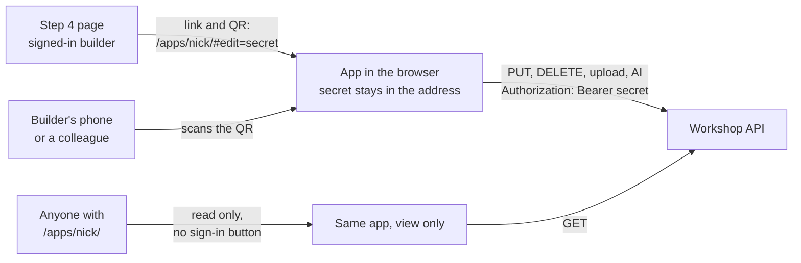

# Phase 3c: One edit link per app

Spec sections: 5 (Security: who can save in an app), and the phase 3b decisions "(3.24)" and "(3.25)" with
questions 11 to 13 of `docs/phases/phase-3b.md`. Spec: [AI Workshop Platform: Spec](https://claude.ai/artifact/6mNkKPKQysWNoj7eL6Gyus).
Status: questions answered 2026-11-27 (all as suggested, except question 2: no admin switch; see `docs/decisions.md`); ready for approval.

Goal: saving in an app needs no sign-in step. The builder opens their app from the workshop page (link or QR
code) and can save at once, on the computer and on the phone. Anyone holding that link or QR code can save
too. Anyone who has only the app's plain address can look but not save, and sees no sign-in button.

Why: Franck's test user `francky` built a drawing gallery (2026-11-27) and was asked to sign in again and
again. The app's code was right; the sign-in flow of 3.24/3.25 was the problem (logs 08:43 to 08:44 UTC):

1. Step 4's link and QR code are the plain address, so every opening starts signed out.
2. "Sign in to save" opens a new tab. Only that tab can save; the tab you were in stays signed out and keeps
   its half-filled form. `francky` got a token, uploaded a photo, got AI tags, signed in again 15 s later in
   another tab and never reached a save.
3. The token lives in memory only: a reload, reopening the app, or a phone dropping the tab while the camera
   is open signs you out.
4. On a phone the QR code also means signing in with an email code first.

Franck chose (2026-11-27 09:02 UTC, decision card in the project thread) "One edit link per app" over
"keep personal sign-in, fix the flow" and "give each app its own address".

How it works after this phase:

- The secret travels in the fragment (after `#`): browsers never send it to a server or in a referrer, so it
  is in no server log. Unlike 3.25, `workshop-data.js` leaves it in the address, so a reload, a bookmark or a
  home-screen icon keeps the right to save.
- A sandboxed app cannot see the workshop's sign-in (opaque origin: no cookies, no storage; a workshop frame
  inside the app gets no `SameSite` cookie and Safari blocks it anyway), so the address is the only way to
  carry the right to save without a separate address per app.
- One secret per app, made when the app first goes live, shown only to its builder. "New edit link" ends the
  old one at once.

## Spec delta (needs Franck's yes, question 1)

- CHANGED, section 5 Security (the text approved in phase 3b question 12). Old: "... visible to anyone with
  the app's URL; saving, uploading and AI tasks need the workshop's own sign-in (the same allow-listed email
  code). Apps have no logins of their own and no private per-person data." New: "... visible to anyone with
  the app's URL. Saving, uploading and AI tasks need the app's edit link, which its builder gets on the
  workshop page as a link and a QR code and may share: anyone holding the edit link can save. Apps have no
  logins and no private per-person data."
- CHANGED, phase 3b question 11. Old: "any signed-in workshop participant may save in any app". New:
  "anyone holding the app's edit link may save in it"; who saved is recorded as the app's builder (question 4).
- REMOVED, 3.24/3.25: the per-person app write token, the hand-off page `/app-sign-in/`, and the
  "Sign in to save" button (`data-workshop-sign-in`) with its floating fallback.

## Tickets

### 3.26 Edit links in the API

Each live app gets one edit secret (32 random bytes, base64url, like the 3.24 token), kept so step 4 can
show it again, with only its SHA-256 used by the write check. Every write route (data `PUT`/`DELETE`, media,
AI tasks) accepts it as `Authorization: Bearer`, with the app's builder as the writer; the per-person tokens,
`POST /api/app-tokens` and their revocation on sign-out go. The builder can ask for a new one, and
`npm run participant -- reset` deletes the secret.

Depends on: none. Areas: api, infra (IAM for the new items), platform CLI.

Acceptance criteria (each starts as FAIL):

- WHEN a request to an app's data, media or AI route carries that app's edit secret THEN it is accepted and the writer is the app's builder's nickname (unit tests per route).
- WHEN it carries no secret, another app's secret or an old secret replaced by "New edit link" THEN the route answers 401 with "This link is view only." and stores nothing, while `GET` still answers (unit tests).
- WHEN the signed-in builder asks `GET /api/build` THEN the answer holds `editUrl` = `/apps/<nick>/#edit=<secret>`, and no other participant's request ever holds it (unit test, access review).
- WHEN the builder asks for a new edit link THEN a new secret is made, the old one answers 401 at once, and `GET /api/build` gives the new `editUrl` (unit test).
- WHEN `npm run participant -- reset <nick> --yes` runs THEN the app's edit secret is deleted (unit test).
- WHEN a secret is checked or made THEN no log line holds the secret or its hash (unit test on the log entries).

### 3.27 The workshop page gives the edit link

Step 4 shows the edit link and its QR code instead of the plain address, with a line saying that anyone who
has this link or QR code can save, a "Copy view-only link" for sharing to look only, and a "New edit link"
button (with a short confirmation) that ends the old one. Every other link the platform shows the builder to
their own app carries the edit link too. `/app-sign-in/` goes (its address redirects to the home page).

Depends on: 3.26. Areas: web, infra (the `/app-sign-in*` behaviour).

Acceptance criteria (each starts as FAIL):

- WHEN the builder reaches step 4 THEN the link and the QR code both hold `editUrl`, and decoding the QR gives exactly that address (Playwright with jsQR).
- WHEN the builder presses "New edit link" and confirms THEN the link and QR change to the new secret (Playwright, fake API).
- WHEN the builder presses "Copy view-only link" THEN the copied address has no fragment (Playwright).
- WHEN anyone opens `/app-sign-in/?app=<nick>` THEN they land on the home page (synth test of the site function).
- WHEN step 4 is shown at 375 px THEN nothing scrolls sideways (Playwright).

### 3.28 Apps use the edit link

`workshop-data.js` reads `#edit=<secret>` and keeps it in the address, sends it on every write, and adds
`workshopData.canSave()` (true with a secret). Without one it never shows a sign-in button (old apps'
`data-workshop-sign-in` elements stay hidden) and a refused save says "This link is view only.".
`AGENTS.md`, the builder's prompts and the build eval drop the sign-in rule for "hide saving controls when
`canSave()` is false" (question 3); live apps get the new file through `npm run apps -- refresh`.

Depends on: 3.26. Areas: templates, builder prompts, eval.

Acceptance criteria (each starts as FAIL):

- WHEN the template opens with `#edit=<secret>` in Chromium under the sandbox CSP THEN saves carry `Authorization: Bearer <secret>`, `canSave()` is true, and after a reload saving still works (Playwright).
- WHEN it opens without a secret THEN reads work, `canSave()` is false, no sign-in element or floating button is visible, and a save shows "This link is view only." and writes nothing (Playwright).
- WHEN an app built before this phase (with `data-workshop-sign-in` buttons) runs with the new file THEN those buttons stay hidden with and without a secret (Playwright, shape apps of `template.test.ts`).
- WHEN `npm run eval -- build` runs THEN every example passes, and with no secret no saving control is visible (live eval).
- WHEN the deployer publishes any app THEN it ships the new `workshop-data.js` (existing unit test, updated bytes).

## Questions for Franck

1. Approve the spec delta above (anyone holding an app's edit link can save in it; the plain address is view only; per-person sign-in to save and `/app-sign-in/` are removed). Suggested: yes.
2. How long an edit link lasts. Suggested: it does not expire by itself. The builder's "New edit link" ends the old one, `npm run participant -- reset` deletes it, and a new admin switch "Apps are read-only" (off by default) stops every app write at once: you turn it on after the workshop, until phase 5 removes the apps. **Answered:** yes, but no admin switch.
3. What visitors with the plain address see. Suggested: apps hide their Add, Save and Delete controls when `workshopData.canSave()` is false and may show a small "View only" line (new `AGENTS.md` rule, checked by the build eval). Apps already live keep their buttons visible; pressing one says "This link is view only.".
4. Who saved. Everyone using the edit link saves as the app's builder: "Last saved by" shows the builder's nickname, `whoAmI()` gives it, and app AI use counts against the builder's $1 a day. An app that wants each person's name asks them to type it (a plain field, not checked). Suggested: yes.
5. Residual risk (Stop-and-ask 6). The edit link sits in the address bar, in the browser's history (synced history too) and in any photo of the QR code. Whoever holds it can save, upload and use the builder's AI allowance in that one app until "New edit link". The caps you already accepted still bound it (50 MB of writes and 500 MB of uploads per app a day, $1 of AI per builder and $10 for all apps a day, the WAF and throttles; under a flood about $24 a day, as in "(3.18) Cost"). Strangers with only the plain address still cannot write, so the stranger-flood case removed by 3.24 stays removed. Suggested: accept.
6. Switch-over. Per-person tokens stop working at the deploy of 3.26; 3.26 and 3.28 merge together (or 3.28 right after), then you run `AWS_PROFILE=franck npm run -s apps -- refresh` once. Suggested: yes.

## Blocked

- All three tickets wait on the merge of this brief.
