# Infrastructure

AWS CDK app (TypeScript). Nothing is deployed from a session: stacks deploy from `main` only,
through the deploy workflow (see "How deploys work"). `infra/access/access-stack.yaml` is applied by Franck only.

## Stacks

| Stack | Region | What | Synthesizer |
| --- | --- | --- | --- |
| `ssd-workshop-cdk-assets` | eu-central-1 | `ssd-workshop-cdk-assets-<account>` bucket for CDK file assets | inline template (`LegacyStackSynthesizer`) |
| `ssd-workshop-site` | eu-central-1 | private `ssd-workshop-site-<account>` bucket, pages from `platform/web` (BucketDeployment) | `CliCredentialsStackSynthesizer`, assets bucket |
| `ssd-workshop-edge` | us-east-1 | ACM certificate, CloudFront (Origin Access Control `ssd-workshop-site`, managed security headers; `/api/*` to the HTTP API, uncached; from ticket 2.5 `/apps/*` from the apps bucket through Origin Access Control `ssd-workshop-apps`, headers policy `ssd-workshop-apps-v3` (v1 and v2 retained until Franck deletes them, tickets 2.14 and 3.24) and function `ssd-workshop-apps-index`, and every 403 shown as `/404.html` with status 404; from ticket 3.13 the WAF web ACL `ssd-workshop-edge` with one per-address rate rule on `/api/*`; from ticket 3.18 `/app-media/*` from the media bucket through Origin Access Control `ssd-workshop-app-media` with headers policy `ssd-workshop-app-media-v1`, a second WAF rate rule on `/app-media/*` (3,000 per address in 5 minutes), a third rule answering a media `PUT`/`DELETE` without a Bearer token with 401, a fourth limiting media uploads and deletes to 150 per address in 5 minutes, and a fifth limiting media preflights (`OPTIONS`) to 300 per address in 5 minutes), A/AAAA records for `workshop.rankly.games` | inline template (`LegacyStackSynthesizer`) |
| `ssd-workshop-api` | eu-central-1 | DynamoDB table `ssd-workshop-data` (on demand, point-in-time recovery, retained), HTTP API `ssd-workshop-api` (`GET /api/health`, `POST /api/sign-in/code`, `POST /api/sign-in/verify`, `GET /api/me`, `POST /api/me/nickname`, `GET /api/participants/{id}`, `POST /api/sign-out`), Lambdas `ssd-workshop-api-health`, `ssd-workshop-api-sign-in-code` (DynamoDB GetItem/PutItem in `EMAIL#*` partitions only, 512 MB, SES sends from `ssd-workshop@rankly.games`), `ssd-workshop-api-sign-in-verify` (codes, participant link, profile, session; 512 MB) and `ssd-workshop-api-participant` (session check against the allow-list, own record, nickname, sign-out), later more (from ticket 3.18 `ssd-workshop-api-app-media` for `PUT`, `DELETE` and `OPTIONS /api/apps/{nickname}/media/{id}`, 512 MB, 25 s), bundled by esbuild from `platform/api/handlers` | `CliCredentialsStackSynthesizer`, assets bucket |
| `ssd-workshop-apps` | eu-central-1 | private `ssd-workshop-apps-<account>` bucket (only the deployer's role may write app files), from ticket 3.18 the private `ssd-workshop-app-media-<account>` bucket (only the media function's role may write files), FIFO deploy queue `ssd-workshop-deploys.fifo` and its dead-letter queue, deployer Lambda `ssd-workshop-apps-deployer`; see "Check after the apps deploy (ticket 2.5)" | `CliCredentialsStackSynthesizer`, assets bucket |
| `ssd-workshop-alerts` | us-east-1 | ticket 3.13: Cost Anomaly Detection, monitor `ssd-workshop-cost` on the cost allocation tag `project=ssd-workshop` and daily email subscription `ssd-workshop-cost-alerts` to the address in SSM `/ssd-workshop/alert-email`; see "Safety nets (ticket 3.13)" | inline template (`LegacyStackSynthesizer`) |
| `ssd-workshop-builds` | eu-central-1 | build network (VPC `ssd-workshop-builds`, two public subnets, no NAT gateway), security group `ssd-workshop-builds` (HTTPS out only), ECS cluster `ssd-workshop-builds`, ECR repository `ssd-workshop-builder` (newest 5 images, scan on push), GitHub App secret `ssd-workshop-github` (ticket 2.6), FIFO launch queue `ssd-workshop-builds.fifo` and its dead-letter queue (ticket 2.7; the AI worker is its only sender, the launcher its consumer), from ticket 2.9 the builder task definition `ssd-workshop-builder` (image by digest, logs `/ecs/ssd-workshop-builder`), the launcher Lambda `ssd-workshop-builds-launcher`, the check queue and schedule `ssd-workshop-builds-check`; see "Build network (ticket 2.1)" and "Builds: builder task and launcher (ticket 2.9)" | `CliCredentialsStackSynthesizer`, assets bucket (from ticket 2.9) |

Deploy order: cdk-assets, then site and apps, then edge; api after cdk-assets (it needs the assets
bucket for its Lambda code, and nothing from site or edge); apps after cdk-assets and before edge (edge
serves its bucket at `/apps/*`); builds after cdk-assets (from ticket 2.9 its launcher's code is a file asset; it takes nothing
from the other stacks); alerts last (it takes nothing from the others). Nothing is passed between regions: the edge
stack finds the site bucket by its fixed name, and the site bucket policy lets this account's
CloudFront distributions read it.

```sh
npm run synth   # cdk synth, no AWS credentials needed
npm test        # template assertions (infra/lib/app.test.ts)
```

## How deploys work (ticket 0.5)

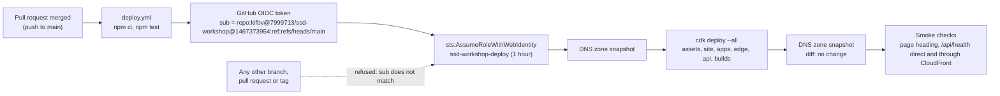

- `.github/workflows/deploy.yml` runs only on a push to `main`, one run at a time (a running
  deploy is never cancelled; the next one waits).
- It asks GitHub for an OIDC token (`id-token: write`) and exchanges it for the
  `ssd-workshop-deploy` role. The role ARN and region come from `infra/lib/config.ts`
  (`DEPLOY_ROLE_ARN`, `REGION`), printed by `infra/bin/print-deploy-settings.ts`, so moving to
  another AWS account changes only that file. No AWS keys are stored in GitHub and the workflow
  reads no secrets (both checked by `infra/lib/deploy-workflow.test.ts`).
- The role's trust policy (`infra/access/access-stack.yaml`) only accepts the subject of the
  `main` branch, once the ticket 0.3 update is applied (see criterion 2 below). The workflow
  uses no GitHub environment, because a job with `environment:` gets the subject
  `repo:<owner>/<repo>:environment:<name>` instead.
- After `cdk deploy --all`, the smoke step fetches `https://workshop.rankly.games/` and fails
  unless it answers 200 with the `<h1>` text of `platform/web/index.html` (retries for about
  five minutes). Pages are uploaded with `Cache-Control: public, max-age=60`, so a merged text
  change is live within minutes of the merge, well inside 10 minutes.
- Then it reads the `ApiEndpoint` output of `ssd-workshop-api` and fails unless
  `GET /api/health` on that endpoint answers 200 with `{"ok":true}` (ticket 1.1 criterion 3).
- Then it requires `https://workshop.rankly.games/api/health` (through CloudFront) to answer
  200 with `{"ok":true}`, retrying for about five minutes (ticket 1.2 criterion 1).
- Around `cdk deploy`, it saves the rankly.games zone's records (sorted with `jq`, in
  `$RUNNER_TEMP`) before and after, and fails if `diff` finds any change (ticket 1.2
  criterion 3). This check also runs when the deploy itself failed.
- To redeploy the same commit: Actions, Deploy, the run, "Re-run all jobs".

### No AWS keys in GitHub (criterion 3)

```sh
gh secret list --repo kifbv/ssd-workshop
gh variable list --repo kifbv/ssd-workshop
# expect: no AWS_ACCESS_KEY_ID, AWS_SECRET_ACCESS_KEY or other AWS key
```

Or in the browser: Settings, Secrets and variables, Actions (repository and environment
secrets). The workflow itself references no `secrets.` value (tested).

### Other refs cannot assume the role (criterion 2)

Once the ticket 0.3 access stack update is applied, the trust policy's `sub` condition allows
only `repo:kifbv@7999713/ssd-workshop@1467373954:ref:refs/heads/main`; ticket 0.3's test "trusts only GitHub
Actions of kifbv/ssd-workshop on main (no GitHub environments)" checks the template.

Until that update is applied, the live role also trusts `repo:kifbv/ssd-workshop:environment:*`,
that is any GitHub environment. A workflow on any branch can name an environment (GitHub creates
it on first use unless deployment branch rules stop it), so today any branch could assume the
deploy role. The update must therefore be applied before ticket 0.5 is merged (checklist step 1).

To see another ref refused after the update, Franck can run any workflow with `id-token: write`
and `aws-actions/configure-aws-credentials` from another branch (not committed to this
repository), with and without `environment:`: both fail at "Configure AWS credentials" with
`Not authorized to perform sts:AssumeRoleWithWebIdentity`.

### First deploy checklist (Franck)

1. Apply the `ssd-workshop-access` stack update from ticket 0.3 (removes the `environment:*`
   subject). Until then any branch could assume the deploy role (see above).
2. Merge ticket 0.3.
3. Take the zone "before" snapshot (`/tmp/zone-before.json`, below).
4. Merge ticket 0.4, then ticket 0.5. The 0.5 merge is the first run of the deploy workflow
   (merging 0.4 alone deploys nothing, since the workflow does not exist yet).
5. Watch the run in Actions, Deploy. The first run takes 15 to 30 minutes (certificate
   validation and CloudFront creation); "Smoke check the live page" must be green.
6. Run the post-deploy checks below, and `gh secret list` above.

## Checks after the first deploy (ticket 0.4 criteria 1, 2, 4, 5)

Read-only; run them after the deploy workflow has finished on `main`. Set the account and zone
first, copied from `infra/lib/config.ts` (`ACCOUNT`, `HOSTED_ZONE_ID`), the one place that holds
them:

```sh
ACCOUNT=<ACCOUNT from infra/lib/config.ts>
ZONE_ID=<HOSTED_ZONE_ID from infra/lib/config.ts>
```

**Before ticket 0.5 is merged** (that merge is the first deploy), snapshot the zone once for
criterion 5. Franck takes it, or a session with the read-only command below. Write it outside the
repository (here `/tmp/`) so it is never committed; the same goes for `zone-after.json`.

```sh
aws route53 list-resource-record-sets --region us-east-1 \
  --hosted-zone-id "$ZONE_ID" --output json > /tmp/zone-before.json
```

1. HTTPS answers 200 with the site's page (the placeholder until ticket 1.6, the sign-in page since):

   ```sh
   curl -sS -o /dev/null -w '%{http_code} %{ssl_verify_result}\n' https://workshop.rankly.games/
   # expect: 200 0
   curl -sS https://workshop.rankly.games/ | grep -c '<h1>SSD Workshop</h1>'
   # expect: 1
   ```

2. The bucket refuses direct requests (only CloudFront can read it):

   ```sh
   curl -sS -o /dev/null -w '%{http_code}\n' \
     "https://ssd-workshop-site-$ACCOUNT.s3.eu-central-1.amazonaws.com/index.html"
   # expect: 403
   aws s3api get-bucket-policy-status --region eu-central-1 \
     --bucket "ssd-workshop-site-$ACCOUNT" --query PolicyStatus.IsPublic
   # expect: false
   aws s3api get-public-access-block --region eu-central-1 \
     --bucket "ssd-workshop-site-$ACCOUNT"
   # expect: all four settings true
   ```

4. HTTP redirects to HTTPS:

   ```sh
   curl -sS -o /dev/null -w '%{http_code} %{redirect_url}\n' http://workshop.rankly.games/
   # expect: 301 https://workshop.rankly.games/
   ```

5. Only the workshop records changed in the rankly.games zone:

   ```sh
   aws route53 list-resource-record-sets --region us-east-1 \
     --hosted-zone-id "$ZONE_ID" --output json > /tmp/zone-after.json
   diff /tmp/zone-before.json /tmp/zone-after.json
   # expect: only added records named workshop.rankly.games. (A, AAAA)
   # and _<hash>.workshop.rankly.games. (CNAME, certificate validation)
   ```

   The deploy policy also refuses any record outside `workshop.rankly.games` and
   `*.workshop.rankly.games`.

Criterion 3 (tags and boundary) is proven by `npm test` on the synthesized templates.

## Checks after the API deploy (ticket 1.1 criterion 3)

Read-only. The deploy workflow runs the same check after every deploy ("Smoke check the API
health"). The endpoint is the API's own (`https://<api id>.execute-api.eu-central-1.amazonaws.com`);
from ticket 1.2 the API is also reachable at `https://workshop.rankly.games/api/` ("Smoke check
the API through CloudFront"):

```sh
curl -sS -w '\n%{http_code}\n' https://workshop.rankly.games/api/health
# expect: {"ok":true}
#         200
```

The edge stack reaches the API by its id, a constant in `infra/lib/config.ts` (`API_ID`): if
`ssd-workshop-api` is ever recreated, update it.

```sh
ENDPOINT=$(aws cloudformation describe-stacks --region eu-central-1 --stack-name ssd-workshop-api \
  --query "Stacks[0].Outputs[?OutputKey=='ApiEndpoint'].OutputValue" --output text)
curl -sS -w '\n%{http_code}\n' "$ENDPOINT/api/health"
# expect: {"ok":true}
#         200
```

### If the first API deploy fails

The table `ssd-workshop-data` is retained and has deletion protection, so a failed first deploy
of `ssd-workshop-api` rolls back everything except the table, and the next deploy fails with
"already exists". Only while the table is still empty (nothing has written to it yet), Franck
removes it with his own credentials (Claude sessions may neither read items nor change the table
since ticket 2.12), then re-runs the deploy:

```sh
AWS_PROFILE=franck aws dynamodb scan --region eu-central-1 --table-name ssd-workshop-data --select COUNT
# expect: "Count": 0
AWS_PROFILE=franck aws dynamodb update-table --region eu-central-1 --table-name ssd-workshop-data \
  --no-deletion-protection-enabled
AWS_PROFILE=franck aws dynamodb delete-table --region eu-central-1 --table-name ssd-workshop-data
```

Criteria 1, 2 and 4 (names, tags, role path and boundary, no account-wide CloudWatch role,
Lambda permissions scoped to the API, table settings) are proven by `npm test` on the
synthesized templates (`infra/lib/app.test.ts`). The table, its settings and its tags can also be
read live:

```sh
aws dynamodb describe-table --region eu-central-1 --table-name ssd-workshop-data \
  --query 'Table.[BillingModeSummary.BillingMode,DeletionProtectionEnabled]'
# expect: ["PAY_PER_REQUEST", true]
aws dynamodb describe-continuous-backups --region eu-central-1 --table-name ssd-workshop-data \
  --query 'ContinuousBackupsDescription.PointInTimeRecoveryDescription.PointInTimeRecoveryStatus'
# expect: "ENABLED"
```

## Check after the sign-in code deploy (ticket 1.4 criterion 6)

From Franck's machine, with his own address (it must be on the allow-list, ticket 1.3):

```sh
npm run -s smoke -- signin <address>
# expect: Status: 202, the neutral answer, and an email "Your SSD Workshop sign-in code: ......"
#         from "SSD Workshop" <ssd-workshop@rankly.games> within a minute (check Junk too)
```

If no email arrives, the function's log group `ssd-workshop-api-sign-in-code` has one JSON line per
request with its outcome (`sent`, `not-listed`, `rate-limited`, `conflict`, `failed` with the step and
the AWS error name, or `Timeout` when the work was still running at the 3-second answer time); it never holds the address or the code.

## Check after the sign-in deploy (ticket 1.5)

The first live sign-in proves the new roles' DynamoDB rights (IAM attribute conditions are only
checked by AWS), and a second one proves that a returning person is sent back to their step. From
Franck's machine, with his own address, after `smoke signin` sent a code. The address and the code
go to `curl` on stdin (`--data @-`), never as an argument (which other processes can see), and the
cookie jar is a private temporary file removed at the end:

```sh
JAR=$(mktemp); trap 'rm -f "$JAR"' EXIT
read -r -p 'Address: ' ADDRESS
verify() { # reads a code, sends {"email","code"} on stdin
  read -r -p 'Code: ' CODE
  printf '{"email":"%s","code":"%s"}' "$ADDRESS" "$CODE" |
    curl -sS -c "$JAR" -H 'content-type: application/json' --data @- -w '\n%{http_code}\n' \
      https://workshop.rankly.games/api/sign-in/verify
}
verify
# expect: {"next":"nickname"} (or the step he is at) and 200, after about 3 seconds
curl -sS -b "$JAR" -w '\n%{http_code}\n' https://workshop.rankly.games/api/me
# expect: {"id":"...","nickname":null,"role":"<role from the allow-list>",...} and 200
# A nickname is set once and cannot be changed later: replace Franck with the one you want to keep.
curl -sS -b "$JAR" -H 'content-type: application/json' --data '{"nickname":"Franck"}' \
  -w '\n%{http_code}\n' https://workshop.rankly.games/api/me/nickname
# expect: {...,"nickname":"Franck","step":"clarify"} and 200 (409 "already-set" if he has one)
curl -sS -w '\n%{http_code}\n' https://workshop.rankly.games/api/me
# expect: {"message":"Please sign in."} and 401
# now ask for a second code (`npm run -s smoke -- signin <address>` in another terminal), then:
verify
# expect: {"next":"clarify"} and 200 (the returning sign-in keeps his step)
rm -f "$JAR"; unset ADDRESS CODE
```

On a refusal, the log groups `ssd-workshop-api-sign-in-verify` and `ssd-workshop-api-participant` have
one JSON line per request with its outcome (and the AWS error name, e.g. `AccessDeniedException`, on a
failure); they never hold the address, the code, the token or the nickname.

## Check after the sign-in pages deploy (ticket 1.6)

The pages carry the Content-Security-Policy of the `ssd-workshop-pages-v1` headers policy, and
`/api/*` keeps the managed security headers:

```sh
curl -sSI https://workshop.rankly.games/ | grep -i -E '^(content-security-policy|strict-transport-security|x-frame-options|x-content-type-options|referrer-policy):'
# expect: content-security-policy: default-src 'self'; script-src 'self'; style-src 'self'; img-src 'self' data:;
#           connect-src 'self'; frame-ancestors 'none'; base-uri 'self'; form-action 'self'; object-src 'none'
#         strict-transport-security: max-age=31536000, x-frame-options: DENY, x-content-type-options: nosniff,
#         referrer-policy: strict-origin-when-cross-origin
curl -sS -o /dev/null -w '%{http_code} %{content_type}\n' https://workshop.rankly.games/app.js
# expect: 200 text/javascript (or application/javascript)
curl -sSI https://workshop.rankly.games/api/health | grep -i -c '^content-security-policy:'
# expect: 0 (the API keeps the managed SecurityHeadersPolicy)
```

Then open https://workshop.rankly.games/ on a phone: the email screen shows, a code arrives, the code
screen leads to the nickname screen (first sign-in) or straight to step 1, and the browser console shows
no "Refused to ..." message.

The headers policy cannot be changed in place (the deploy rights create custom policies but cannot
update or delete them): to change a header, bump `PAGES_HEADERS_POLICY_VERSION` in `infra/lib/config.ts`
(new name and new logical id, so CloudFormation creates a replacement); the old one stays behind, unused,
until Franck deletes it.

If the first deploy of this policy fails and rolls back, the retained `ssd-workshop-pages-v1` stays behind
and the retry fails on its name: delete it in the CloudFront console (Policies, Response headers) or bump
`PAGES_HEADERS_POLICY_VERSION`, then re-run the deploy.

## Check after the conversation deploy (ticket 1.7)

The first live message proves the new roles' rights (DynamoDB attribute conditions, the queue, the event
source mapping and Bedrock through the EU profile are only checked by AWS). From Franck's machine, signed
in as in the 1.5 check (same `JAR` cookie jar, before it is removed), until ticket 1.8's page exists:

```sh
curl -sS -b "$JAR" -H 'content-type: application/json' --data '{"text":"I would like a habit tracker for my runs"}' \
  -w '\n%{http_code}\n' https://workshop.rankly.games/api/conversation/messages
# expect: {"id":"2026-...Z-<16 hex>"} and 202, at once
ID=<the id above>
curl -sS -b "$JAR" -w '\n%{http_code}\n' "https://workshop.rankly.games/api/conversation/messages/$ID"
# expect: {"id":"...","status":"pending"} and 200 at first; within about 30 seconds
#         {"id":"...","status":"done","reply":"<a short question about the idea>"} and 200
curl -sS -b "$JAR" -w '\n%{http_code}\n' "https://workshop.rankly.games/api/conversation/messages/2026-01-01T00:00:00.000Z-0000000000000000"
# expect: {"message":"Not found."} and 404
```

Then the guardrail eval against the live model (about $0.05; Bedrock only, so a session may run it too), and,
with Franck's own AWS credentials (it reads table items), the flags:

```sh
npm run eval -- guardrails
# expect: one PASS line per example, "Guardrails: 20/20 passed", exit code 0
AWS_PROFILE=franck npm run flags -- list
# expect: "Waiting for a decision: 0" (or each flagged participant's nickname, message and the guardrail's reason)
```

A flagged message (e.g. "an app that tells people which medicine to take") shows `"status":"flagged"`;
`AWS_PROFILE=franck npm run flags -- approve <nickname>` lets it through to the AI, `AWS_PROFILE=franck npm run flags -- reject <nickname>`
declines it politely; either way the participant can write again.

On a failure, the log groups `ssd-workshop-api-conversation` and `ssd-workshop-api-ai-worker` have one
JSON line per request or job with its outcome and the AWS error name (e.g. `AccessDeniedException`); they
never hold the message, the prompt, the reply, an id or the nickname. A job the worker throws back
(`"outcome":"error"`, e.g. after the final write failed 3 times) is delivered again by SQS about 5.5 minutes
later (visibility timeout 330 s); one that failed three times lands in `ssd-workshop-ai-messages-dlq`
(14 days), and the participant sees the message as failed after 20 minutes and can send it again. At most
5 workers run at once; more messages wait in the queue.

## Check after the step 1 deploy (ticket 1.8)

The first live page load proves the conversation function's new `dynamodb:Query` right and the first
Write my spec its update of `step` (both only checked by AWS). On `https://workshop.rankly.games`, signed in
at step 1 on a phone or a narrow window:

1. Send an idea (e.g. "a tracker for my runs"). A typing indicator shows and "Safety check" and "Claude on
   Bedrock" are highlighted in the Behind the scenes box; within about 30 seconds a reply with 3 to 5
   numbered questions appears and the indicator goes away.
2. Reload the page: the conversation is shown again. **Write my spec** shows under it after the first reply.
3. Answer the questions until the AI says it has enough: **Write my spec** turns into the main button.
4. Press **Write my spec**: the page shows "Step 2: Spec"; a reload stays there.

Or with `curl`, signed in as in the 1.5 check (same `JAR`):

```sh
curl -sS -b "$JAR" -w '\n%{http_code}\n' https://workshop.rankly.games/api/conversation
# expect: {"step":"clarify","state":"open","messages":[...]} and 200 (the caller's own messages only)
curl -sS -b "$JAR" -H 'content-type: application/json' --data '{"step":"spec"}' \
  -w '\n%{http_code}\n' https://workshop.rankly.games/api/conversation/step
# expect: {"step":"spec"} and 200 after at least one answered message; 409 "too-early" before
```

With Franck's own AWS credentials, the step 1 eval against the live model (about $0.02):

```sh
npm run eval -- clarify
# expect: one PASS line per example with the reply below it, "Clarify: 5/5 passed", exit code 0
```

On a failure, `ssd-workshop-api-conversation`'s log has `"route":"history"` or `"route":"step"` lines with the
outcome and the AWS error name (e.g. `AccessDeniedException`).

## Check after the step 2 deploy (ticket 1.9)

The first live spec proves the AI worker's new attribute rights (`specVersion`, `messageId`,
`latestSpecVersion`) and the first approval the conversation function's (`approvedSpecVersion`,
`approvedAt`); both are only checked by AWS. On `https://workshop.rankly.games`, signed in at step 1 with an
answered idea, once on a laptop and once on a phone:

1. Press **Write my spec**. "Step 2: Spec" shows "The AI is writing your spec…"; within about a minute the
   spec appears: "Version 1", the title, the diagram drawn as a picture (not text), then "What it does",
   "Screens" and "Data it keeps". The browser console shows no Content-Security-Policy error.
2. Ask a question ("What does the cylinder mean?"): an answer appears and the spec stays "Version 1".
3. Ask for a change ("Add a screen with my longest run"): the spec becomes "Version 2" with the change.
4. Press **Approve spec**: "Spec approved. Next comes the build…" shows, the message box and the button go
   away, and the spec reads "Version 2 (approved)"; a reload shows the same.

Or with `curl`, signed in as in the 1.5 check (same `JAR`), after step 1 above:

```sh
curl -sS -b "$JAR" -w '\n%{http_code}\n' https://workshop.rankly.games/api/conversation/spec
# expect: {"version":1,"text":"# ...","createdAt":"...","approved":false} and 200 (404 before the first version)
curl -sS -b "$JAR" -w '\n%{http_code}\n' 'https://workshop.rankly.games/api/conversation/spec?version=99'
# expect: {"message":"Not found."} and 404
curl -sS -b "$JAR" -H 'content-type: application/json' --data '{"version":1}' \
  -w '\n%{http_code}\n' https://workshop.rankly.games/api/conversation/spec/approve
# expect: {"step":"approved","version":1} and 200 (409 "stale" when a newer version exists)
curl -sS -b "$JAR" -H 'content-type: application/json' --data '{"text":"Add a monthly total"}' \
  -w '\n%{http_code}\n' https://workshop.rankly.games/api/conversation/messages
# expect after the approval: {"message":"Your spec is approved, ...","reason":"approved"} and 409
```

With Franck's own AWS credentials, the step 2 eval against the live model (about $0.05; it builds the pages
and draws each diagram with Mermaid in Playwright's Chromium, so `npx playwright install chromium` once on a
new machine):

```sh
npm run eval -- spec
# expect: one PASS line per example with the answer below it, "Spec: 6/6 passed", exit code 0
```

On a failure, `ssd-workshop-api-ai-worker`'s log has `"outcome":"failed"` lines with the error name
(`MalformedSpec` or `MissingSpec` for a spec of the wrong shape, `AccessDeniedException` for a missing right),
and `ssd-workshop-api-conversation`'s `"route":"spec"` or `"route":"approve"` lines.

## Check after the data API deploy (ticket 2.4)

The data API for apps (`/api/apps/<nickname>/data/<key>`, function `ssd-workshop-api-app-data`) needs no sign-in.
Until the deployer (ticket 2.5) marks an app live, every app answers 404; the preflight answers without one:

```sh
curl -sS -i -X OPTIONS -H 'origin: null' -H 'access-control-request-method: PUT' \
  -H 'access-control-request-headers: content-type' \
  https://workshop.rankly.games/api/apps/nobody-here/data/score
# expect: 204 with access-control-allow-origin: *, access-control-allow-methods: GET, PUT, DELETE,
#         access-control-allow-headers: content-type, accept (and no access-control-allow-credentials)
curl -sS -i -H 'origin: null' https://workshop.rankly.games/api/apps/nobody-here/data/score
# expect: 404 {"message":"Not found."} with access-control-allow-origin: * and no set-cookie
```

Once 2.5 has put an app live, `PUT` (with `content-type: application/json`), `GET` and `DELETE` on one of its keys
round-trip a JSON value. Do a second `PUT` to the same key and a `DELETE`: they update `sizes.<key>` in the totals item,
which proves IAM's `dynamodb:Attributes` sees only the top-level name `sizes` (an `AccessDeniedException` there means
it does not). The log group `ssd-workshop-api-app-data` has one line per request with method, outcome,
status and size only; a refusal from DynamoDB shows as `"outcome":"failed"` with the error name
(`AccessDeniedException` for a missing right).

Every answer under `/api/apps/*`, also those API Gateway makes itself (a throttle's 429, a 403 or 5xx before the
function), gets `access-control-allow-origin: *` from CloudFront's `ssd-workshop-app-data-v1` headers policy, once:

```sh
curl -sS -D - -o /dev/null -H 'origin: null' https://workshop.rankly.games/api/apps/nobody-here/data/score \
  | grep -i -E '^(access-control-|strict-transport-security|x-content-type-options|x-frame-options|referrer-policy)'
# expect: exactly one "access-control-allow-origin: *", no access-control-allow-credentials, and the four security headers
curl -sS -D - -o /dev/null -X POST -H 'origin: null' https://workshop.rankly.games/api/apps/nobody-here/data/score \
  | grep -i -E '^(HTTP/|access-control-allow-origin)'
# expect: an answer API Gateway makes itself (404 Not Found, no route for POST) that still carries access-control-allow-origin: *
```

The stage throttles `PUT` and `DELETE` on the route at 30 requests/s (burst 60) and `GET` and `OPTIONS` at 20/s (burst 40), read-only:

```sh
aws apigatewayv2 get-stage --region eu-central-1 --api-id <API id from infra/lib/config.ts> --stage-name '$default' \
  --query 'RouteSettings'
# expect: the two sign-in routes at 5/10, "PUT /api/apps/{nickname}/data/{key}" and "DELETE ..." at 30/60,
#         "GET ..." and "OPTIONS ..." at 20/40
```

Each app may also write 50 MB per UTC day (ticket 3.17; was 5 MB), counted as DynamoDB bills its writes (`writeDay`, `writtenBytes` in its
`DATA_USAGE` item, which also holds each key's size in `sizes`); past that,
`PUT` and `DELETE` answer 429 "This app has saved a lot of data today. Saving starts again tomorrow." until
midnight UTC.

## Check after the bigger app data deploy (ticket 3.17)

No credentials needed (the data API has no sign-in). On a live app's nickname `<nick>` and a key no app
uses (`limit-check`): a value of about 300 KB round-trips unchanged, one over 350 KB is refused, then the key is removed.

```sh
python3 -c 'import json, sys; sys.stdout.write(json.dumps("a" * 300000))' > /tmp/v300.json
python3 -c 'import json, sys; sys.stdout.write(json.dumps("a" * 360000))' > /tmp/v360.json
U=https://workshop.rankly.games/api/apps/<nick>/data/limit-check
curl -sS -o /dev/null -w '%{http_code}\n' -X PUT -H 'content-type: application/json' --data-binary @/tmp/v300.json "$U"
# expect: 204
curl -sS "$U" | cmp - /tmp/v300.json && echo same
# expect: same
curl -sS -w '\n%{http_code}\n' -X PUT -H 'content-type: application/json' --data-binary @/tmp/v360.json "$U"
# expect: 413 with "This value is too big: a value can hold at most 350 KB."
curl -sS -o /dev/null -w '%{http_code}\n' -X DELETE "$U"
# expect: 204
```

## Check after the edit links deploy (ticket 3.26)

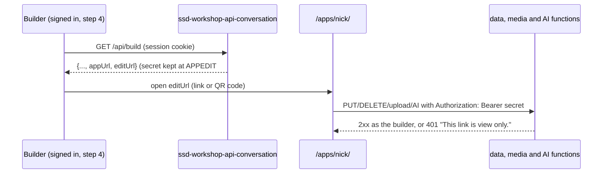

The 3.24 per-person tokens stop at this deploy (their items are refused: no `kind`), and `POST /api/app-tokens` answers
404 (`/app-sign-in/` called it until ticket 3.27 removed that page). Merge 3.28 with this ticket, or right after, then run
`AWS_PROFILE=franck npm run -s apps -- refresh` once. No credentials needed:

```sh
U=https://workshop.rankly.games/api/apps/<nick>/data/sign-in-check
curl -sS -w '\n%{http_code}\n' -X PUT -H 'origin: null' -H 'content-type: application/json' --data '1' "$U"
# expect: 401 {"message":"This link is view only."}
curl -sS -w '\n%{http_code}\n' -X PUT -H 'origin: null' "https://workshop.rankly.games/api/apps/<nick>/media/AbCdEfGhIjKlMnOpQrStUv"
# expect: 401 {"message":"This link is view only."} (the WAF's answer, no bearer)
```

Then, signed in as a builder whose app is live: step 4's `GET /api/build` (browser dev tools) answers `editUrl`; a
`PUT` with `authorization: Bearer <the part after #edit=>` answers 204, and `?info=1` shows the builder as `updatedBy`.

## After the apps-use-the-edit-link deploy (ticket 3.28): refresh the live apps

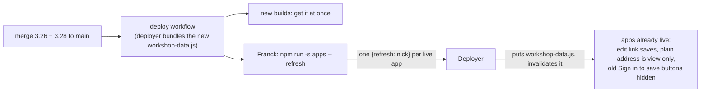

The new `workshop-data.js` reads `#edit=<secret>` from the address and keeps it there (a reload or a bookmark still
saves), sends it on every write, and gives `workshopData.canSave()`. Without it every write fails with "This link is view
only." before anything is sent, and the "Sign in to save" elements of apps built before stay hidden (no floating button
any more). Run once after the deploy (safe to repeat):

```sh
AWS_PROFILE=franck npm run -s apps -- refresh
curl -sS https://workshop.rankly.games/apps/<nick>/workshop-data.js | grep -c 'canSave: canSave'
# expect: 1 (the old file has none)
```

On a phone: open an app with its plain address (no `#edit=`): no sign-in button anywhere, and an app built since 3.28
hides its Add/Save controls and shows "View only" (an older app keeps its buttons; pressing one says "This link is view
only."). Open the edit link (step 4's link or QR code once 3.27 is live; until then `editUrl` from `GET /api/build`): saving works, and still works after closing and reopening the tab.

## Check after the edit link page deploy (ticket 3.27)

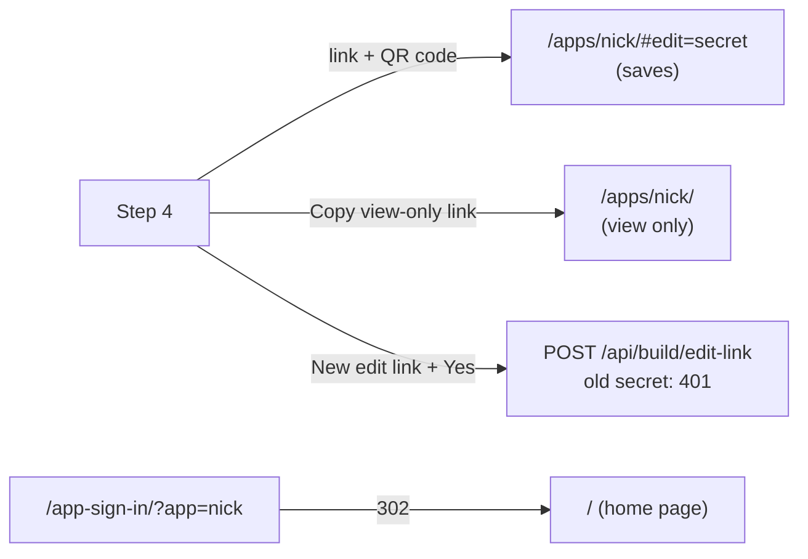

Step 4 shows the edit link and its QR code (not the plain address), the line "Anyone who has this link or QR code can
save in your app...", Copy view-only link and New edit link (an in-page Yes/Cancel). The hand-off page `/app-sign-in/`
is gone (the apps' CSP is unchanged: `allow-popups-to-escape-sandbox` stays, Franck's choice). No credentials needed:

```sh
curl -sS -D - -o /dev/null 'https://workshop.rankly.games/app-sign-in/?app=<nick>' | grep -i '^\(HTTP\|location\)'
# expect: HTTP/2 302 and location: / (no query)
```

On a phone, signed in as a builder whose app is live: step 4's link and QR code open the app with `#edit=` and saving
works; Copy view-only link, pasted in a new tab, opens it without `#edit=` (view only); New edit link, then Yes: the
link and QR code change, and the tab opened with the old link answers "This link is view only." on its next save.

## Check after the sign-in-to-save deploy (ticket 3.24)

(Historical: ticket 3.27 removed `/app-sign-in/`; the steps below no longer apply. The CSP check in step 8 still holds.)

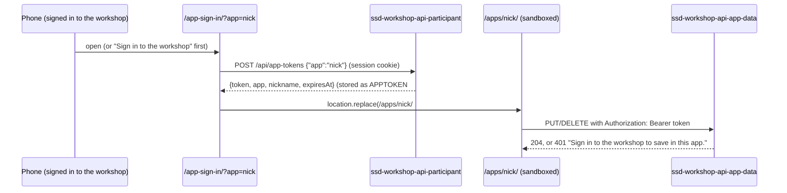

Deploy order: until ticket 3.25 ships the new `workshop-data.js` (and `npm run apps -- refresh` republishes the live
apps, see the next section), every save from an app already live answers 401; reads keep working. Merge 3.24 and 3.25 together, or 3.25 right
after. Since this ticket the 3.17 check above needs a token too (`-H "authorization: Bearer $T"` on its `PUT` and
`DELETE`).

No credentials needed for 1 to 3; a live app's nickname `<nick>`, a key no app uses (`sign-in-check`):

1. Writes need a token, reads do not:

   ```sh
   U=https://workshop.rankly.games/api/apps/<nick>/data/sign-in-check
   curl -sS -w '\n%{http_code}\n' -X PUT -H 'origin: null' -H 'content-type: application/json' --data '1' "$U"
   # expect: 401 {"message":"Sign in to the workshop to save in this app."}
   curl -sS -w '\n%{http_code}\n' -X DELETE -H 'origin: null' -H "authorization: Bearer $(head -c 32 /dev/urandom | base64 | tr '+/' '-_' | tr -d '=')" "$U"
   # expect: 401 (an unknown token)
   curl -sS -w '\n%{http_code}\n' -H 'origin: null' "$U"
   # expect: 200 null (or the stored value)
   ```

2. The preflight allows `authorization`, never credentials, from the function and from CloudFront's new
   `ssd-workshop-app-data-v2` policy (v1 is retained; Franck may delete it after the deploy):

   ```sh
   curl -sS -D - -o /dev/null -X OPTIONS -H 'origin: null' -H 'access-control-request-method: PUT' \
     -H 'access-control-request-headers: authorization,content-type' "$U" | grep -i '^access-control-'
   # expect: access-control-allow-headers: content-type, accept, authorization; allow-origin *; no allow-credentials
   ```

3. The hand-off page: `https://workshop.rankly.games/app-sign-in?app=nobody-here` redirects to `/app-sign-in/?app=...`
   and, signed in, Continue says "This app is not live." and stays; `?app=../x` says it at once.

On a phone signed in to the workshop (with a nickname):

4. Open `https://workshop.rankly.games/app-sign-in?app=<nick>`: "Save in <nick>'s app as <your nickname>?". Press
   Continue: the address becomes `/apps/<nick>/#wt=...` (until 3.25 the app does not read it). Copy the token from the
   address bar into `T` on a computer (it is yours; do not paste it anywhere else), then:

   ```sh
   curl -sS -o /dev/null -w '%{http_code}\n' -X PUT -H 'origin: null' -H 'content-type: application/json' \
     -H "authorization: Bearer $T" --data '"hello"' "$U"
   # expect: 204
   curl -sS -H 'origin: null' "$U?info=1"
   # expect: {"value":"hello","updatedBy":"<your nickname>","updatedAt":"<now>"}
   curl -sS -o /dev/null -w '%{http_code}\n' -X PUT -H 'origin: null' -H 'content-type: application/json' \
     -H "authorization: Bearer $T" --data '1' https://workshop.rankly.games/api/apps/<another live nick>/data/sign-in-check
   # expect: 401 (another app)
   ```

5. Sign out on the phone (Sign out on the workshop page), then repeat the first `PUT` of step 4: 401. Delete the key
   with a new token, or leave it (it holds "hello").
6. Logs: `ssd-workshop-api-participant` has `"route":"app-token","outcome":"token"` and `"route":"sign-out"` lines,
   `ssd-workshop-api-app-data` `"outcome":"unauthorized","status":401` lines and, on step 4's accepted `PUT`,
   `"writer":"<your nickname>"`; no line holds the token, its hash, an email or the app's nickname. An
   `AccessDeniedException` in either means an IAM right is missing (`APPTOKEN#*`, `TOKENS#*` with `version`, `APP#*`
   `liveAt`, `ConditionCheckItem` on `SESSION#*` (`pk`, `sk`) and on `PARTICIPANT#*` (`pk`, `sk`, `role`); every list
   names `pk` and `sk`). A `"route":"sign-out","outcome":"signed-out-revoke-failed"` line means the revocation after the
   session's delete failed three times: run `npm run participant -- reset <nick> --yes` for that person (the line names
   no one: match it by time with the person who reported signing out).
7. `npm run participant -- reset <test nick> --yes` prints "Ended N sign-ins to save in apps (app write tokens)."; a
   token that participant held answers 401 afterwards. `npm run -s allowlist -- remove <test address> --yes` (a test
   person, re-imported afterwards) prints "... and ended N sign-ins to save in apps. ..."; their token answers 401, and
   a new token request from their still-open session answers 401 too (the create's profile check, try 3).
8. The tab an app opens escapes the sandbox (CloudFront's new `ssd-workshop-apps-v3` policy; v2 is retained, Franck may
   delete it after the deploy). First:

   ```sh
   curl -sS -D - -o /dev/null https://workshop.rankly.games/apps/<nick>/ | grep -i '^content-security-policy'
   # expect: sandbox allow-scripts allow-forms allow-modals allow-popups allow-popups-to-escape-sandbox; default-src 'self'; ...
   ```

   Then on an iPhone (Safari) and on an Android phone (Chrome), each signed in to the workshop: open a live app whose
   page has a link or button that opens `/app-sign-in/?app=<nick>` in a new tab (`target="_blank"` or `window.open`;
   after 3.25 the template's "Sign in to save"; before it, a test app with such a link). The new tab must show
   "Save in <nick>'s app as <your nickname>?" (not "Sign in to the workshop first" and not "We couldn't reach the
   workshop"), and Continue must land on the app (with `#wt=` in the address before 3.25; since 3.25 the app removes it
   at once). A wrong answer means the tab is still sandboxed on that browser:
   stop and report.

## Right after the sign-in-in-apps deploy (ticket 3.25): refresh the live apps

(Historical: since tickets 3.26 and 3.27 apps save with the edit link (`#edit=`), per-person sign-in to save and `/app-sign-in/` are gone; the steps below no longer apply as written.)

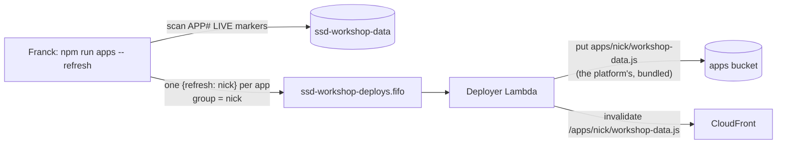

Since 3.24, apps built before 3.25 answer 401 on every save: their `workshop-data.js` sends no token. Every deploy now
publishes the platform's current `workshop-data.js` whatever the repository holds; the apps already live get it from
this one-off command, run as soon as the deploy of 3.25 is done (it is safe to run again):

```sh
AWS_PROFILE=franck npm run apps -- refresh
# expect: one "<nick>: refresh queued" line per live app, then
#         "Asked the deployer to refresh N of N live apps; each gets the platform's workshop-data.js within a minute."
```

Then:

1. The log group `ssd-workshop-apps-deployer` has one `{"event":"deployer","outcome":"refreshed","files":1,...}` line
   per app within a minute (`not-published` for a marker without an `index.html`; `retry`/`dead-letter` with an error
   name: run the command again).
2. `curl -sS https://workshop.rankly.games/apps/<nick>/workshop-data.js | grep -c 'whoami=1'` prints `1` for an app built
   before 3.25. Running the command a second time logs `up-to-date` per app instead of `refreshed` and makes no
   CloudFront invalidation (3.25 try 2).
3. On a phone, open that app without signing in: the data shows; a save says "Sign in to the workshop to save in this
   app." and a "Sign in to save" button appears at the bottom right (the app has no button of its own). Press it: a new
   tab asks "Save in <nick>'s app as <your nickname>?"; Continue opens the app there with no `#wt=` left in the address,
   and a save now works (`curl -sS "https://workshop.rankly.games/api/apps/<nick>/data/<key>?info=1"` names you in
   `updatedBy`). A new build's app shows its own "Sign in to save" button next to where it saves.
4. Unverified until this check (3.25 try 2): CloudFront passes the token on a `GET`. Right after the Continue of step 3,
   the log group `ssd-workshop-api-app-data` has a `{"event":"app-data","method":"GET","outcome":"whoami","status":200}`
   line (the app asked who the token names). A `"outcome":"unauthorized","status":401` `GET` line there instead means
   CloudFront dropped the `Authorization` header on GETs: saving still works, but `workshopData.whoAmI()` stays null;
   tell Claude (the fix: a cache policy for `/api/apps/*` that includes the header).

Rights: the command needs Franck's `dynamodb:Scan` on `ssd-workshop-data` and `sqs:SendMessage` on
`ssd-workshop-deploys.fifo` (both already used by `npm run builds` and the manual deploy below). Claude sessions are
refused both (access stack), so it never runs from a session.

## After the floating sign-in fix deploy: refresh the live apps

(Historical: since tickets 3.26 and 3.27 apps save with the edit link (`#edit=`), per-person sign-in to save and `/app-sign-in/` are gone; the steps below no longer apply as written.)

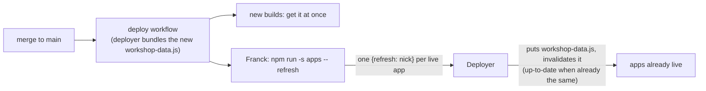

The fix lives in the shared `templates/basic/workshop-data.js`, which the deployer publishes in every app: a save,
upload, delete or AI call refused for lack of sign-in now shows a floating "Sign in to save" button whenever none of the
app's own sign-in elements can be seen (none at all, or only on a hidden screen, a closed `<details>` or a part hidden by
CSS). New deploys get it at once; the apps already live get it from the same refresh command as 3.25, run once after the
deploy (safe to repeat; it changes nothing but `workshop-data.js` and records no build):

```sh
AWS_PROFILE=franck npm run -s apps -- refresh
# expect: one "<nick>: refresh queued" line per live app, then
#         "Asked the deployer to refresh N of N live apps; each gets the platform's workshop-data.js within a minute."
```

Then `ssd-workshop-apps-deployer` logs `"outcome":"refreshed"` once per app, and
`curl -sS https://workshop.rankly.games/apps/<nick>/workshop-data.js | grep -c checkVisibility` prints a number above `0` (the old file has none). On a phone,
open an app whose sign-in button is on another screen than a saving button, without signing in, and press that saving
button: "Sign in to save" appears at the bottom right and opens the workshop's sign-in in a new tab.

## Check after the media deploy (ticket 3.18)

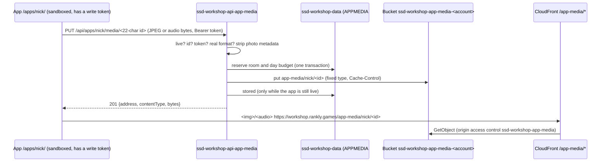

Before merging (Franck): the edge stack adds four WAF rules to `ssd-workshop-edge` (`ssd-workshop-media-rate`: 3,000
requests to `/app-media/*` per address in 5 minutes; `ssd-workshop-media-auth`: a media `PUT`/`DELETE` without
`Authorization: Bearer ...`, in any case, gets WAF's 401; `ssd-workshop-media-write-rate`: more than 150 media `PUT`s
and `DELETE`s together per address in 5 minutes get WAF's 429 "Too many uploads from this address. Please wait a few
minutes and try again."; `ssd-workshop-media-preflight-rate`: more than 300 media `OPTIONS` preflights per address in
5 minutes get the same 429; $1 a month a rule). That is a `wafv2:UpdateWebACL`, which the deploy role already holds through
the standalone policy `ssd-workshop-deploy-safety-nets` from ticket 3.13 (statement `WafManageWorkshopAcl`, on
`global/webacl/ssd-workshop-*/*`): no access-stack change is needed; only confirm that policy is still attached to the
deploy role, or the edge stack's deploy fails and rolls back. Everything else (bucket, origin access control, headers
policy, function, role) is covered by the deploy rights already in place.

Photos lose their Exif segment, and with it the Exif orientation tag: a phone photo sent as the camera wrote it (sideways
pixels plus "rotate 90") would then show sideways. 3.19's `savePhoto()` draws the photo through a canvas first, which
applies the orientation, so photos uploaded by the template are upright; only a photo sent straight from a camera file
(as in step 2 below) may show turned.

You need a live app `<nick>`, its edit secret `$T` (since 3.27: the part after `#edit=` in step 4's edit link; the
link's text does not show it, so copy the link's address (long press or right click, "Copy link") or read `editUrl` from
`GET /api/build` in the browser's dev tools), a photo `photo.jpg` (any phone photo up to 4 MB, ideally one with
location data) and a voice recording `voice.m4a` or `voice.webm` (a phone's voice memo, up to 4 MB). Bodies go as
`application/octet-stream` (not verified until this check: which content types API Gateway base64-encodes; a text type
would garble the bytes and answer 415).

```sh
NICK=<nick>
API=https://workshop.rankly.games/api/apps/$NICK/media
newid() { head -c 16 /dev/urandom | base64 | tr '+/' '-_' | tr -d '='; }
```

1. Refusals:

   ```sh
   curl -sS -w '\n%{http_code}\n' -X PUT -H 'origin: null' --data-binary @photo.jpg "$API/$(newid)"
   # expect: 401 {"message":"Sign in to the workshop to save in this app."} (answered by WAF's ssd-workshop-media-auth
   #         rule: no x-amzn-requestid header, and no line in the function's log)
   curl -sS -w '\n%{http_code}\n' -X PUT -H 'origin: null' -H 'authorization: Bearer not-a-token' --data-binary @photo.jpg "$API/$(newid)"
   # expect: 401, the same message, this time from the function (a line with outcome "unauthorized" in its log)
   curl -sS -w '\n%{http_code}\n' -X PUT -H 'origin: null' -H 'authorization: BEARER not-a-token' --data-binary @photo.jpg "$API/$(newid)"
   # expect: 401 from the function too (the junk filter compares lower-cased, as the function reads the scheme)
   curl -sS -w '\n%{http_code}\n' -X PUT -H 'origin: null' -H "authorization: Bearer $T" \
     -H 'content-type: application/octet-stream' --data-binary '<html>hi</html>' "$API/$(newid)"
   # expect: 415 "Send a photo as a JPEG, or a voice recording as WebM, Ogg or MP4 audio."
   curl -sS -w '\n%{http_code}\n' -X PUT -H 'origin: null' -H "authorization: Bearer $T" --data-binary @photo.jpg \
     https://workshop.rankly.games/api/apps/no-such-app-xyz/media/$(newid)
   # expect: 404
   ```

2. A photo (criterion 1 live smoke, and criterion 4):

   ```sh
   ID=$(newid)
   curl -sS -w '\n%{http_code}\n' -X PUT -H 'origin: null' -H "authorization: Bearer $T" \
     -H 'content-type: application/octet-stream' --data-binary @photo.jpg "$API/$ID"
   # expect: 201 {"address":"https://workshop.rankly.games/app-media/<nick>/<ID>","contentType":"image/jpeg","bytes":N}
   curl -sS -D headers.txt -o got.jpg "https://workshop.rankly.games/app-media/$NICK/$ID"
   grep -i -E '^(content-type|x-content-type-options|cache-control|content-security-policy):' headers.txt
   # expect: content-type: image/jpeg, x-content-type-options: nosniff,
   #         cache-control: public, max-age=86400, s-maxage=3600,
   #         content-security-policy: default-src 'none'; sandbox
   wc -c < got.jpg               # expect: N, the answer's bytes
   grep -c 'Exif' got.jpg        # expect: 0 (the photo's location data is gone); the file opens as the same photo
   ```

   The address opened in a browser shows the photo; in the app (step 3 of 3.19, later) it shows in an ``.

3. A recording (criterion 2 live smoke): the same `PUT` with `--data-binary @voice.m4a` (or `.webm`) answers 201 with
   `"contentType":"audio/mp4"` (or `audio/webm`), and its address answers that `content-type` with `nosniff` and plays
   in a browser. A recording longer than 5:05 answers 413 "This recording is too long: a recording can be at most 5
   minutes." (the server measures it from the file's own timing).

4. The bucket refuses direct reads (criterion 7):

   ```sh
   curl -sS -o /dev/null -w '%{http_code}\n' \
     "https://ssd-workshop-app-media-<account>.s3.eu-central-1.amazonaws.com/app-media/$NICK/$ID"
   # expect: 403
   ```

5. Delete: `curl -sS -w '%{http_code}\n' -X DELETE -H 'origin: null' -H "authorization: Bearer $T" "$API/$ID"` answers
   204, and `AWS_PROFILE=franck aws s3api head-object --bucket ssd-workshop-app-media-<account> --key app-media/$NICK/$ID`
   answers 404 (Not Found). CloudFront may keep serving its copy for up to an hour (`s-maxage=3600`), browsers that
   loaded it for up to a day (decision "(3.18) Caching"). A second `PUT` of the same `$ID` answers 409: the deleted
   file's record stays as a tombstone, so an address never serves other bytes.

6. Uploads per address (try 3; from a machine that is not the venue's address, as it blocks uploads from that address
   for up to 5 minutes): send 200 refused uploads with a made-up token and watch the answers change from the
   function's 401 to WAF's 429 a little after the 150th (WAF counts with a short delay):

   ```sh
   for i in $(seq 200); do curl -sS -o /dev/null -w '%{http_code}\n' -X PUT -H 'origin: null' \
     -H 'authorization: Bearer not-a-token' --data-binary 'x' "$API/$(newid)"; done | sort | uniq -c
   # expect: about 150 x 401, the rest 429
   curl -sS -i -X PUT -H 'origin: null' -H 'authorization: Bearer not-a-token' --data-binary 'x' "$API/$(newid)" \
     | grep -i -E '^(HTTP|access-control-allow-origin)|uploads'
   # expect: 429, access-control-allow-origin: * (once, not doubled by the /api/apps/* headers policy), and
   #         {"message":"Too many uploads from this address. Please wait a few minutes and try again."}
   ```

   A path variant must not skip the media rules (access review of try 3, `NORMALIZE_PATH`): with no token,

   ```sh
   curl -sS -o /dev/null -w '%{http_code}\n' -X PUT -H 'origin: null' --data-binary 'x' \
     "https://workshop.rankly.games/api//apps/<nick>/media/$(newid)"
   # expect: WAF's 401 (or a 404 that never reaches the media function: no line in its log group)
   ```

   Preflights per address (rule 5; same caution about the address): 350 preflights turn from the function's 204 to
   WAF's 429 a little after the 300th:

   ```sh
   for i in $(seq 350); do curl -sS -o /dev/null -w '%{http_code}\n' -X OPTIONS -H 'origin: null' \
     -H 'access-control-request-method: PUT' "$API/$(newid)"; done | sort | uniq -c
   # expect: about 300 x 204, the rest 429 (with access-control-allow-origin: * and the "Too many uploads" body)
   ```

   Downloads (`/app-media/...`) and the data API from the same address still answer as before. Not verified until this
   check: whether the `/api/apps/*` response headers policy also applies to a WAF answer (the header must appear once).

7. Logs: the log group `ssd-workshop-api-app-media` has one JSON line per request above
   (`{"event":"app-media","method":"PUT","outcome":"stored","status":201,...,"writer":"<your nickname>"}`, `unauthorized`,
   `unsupported-media-type`, `not-found`, `deleted`), and none holds the token, the id or an `@`.

8. Reset (criterion 8, with a test app): `AWS_PROFILE=franck npm run participant -- reset <nick>` counts its photos and
   recordings; with `--yes` it waits 30 s (longer than the media function's 25 s timeout) for uploads under way, prints
   "Deleted N photos and recordings; CloudFront stops serving the app's media within minutes." and the media addresses
   answer the 404 page a few minutes later.

## Live check of photos and voice recordings on phones (ticket 3.19)

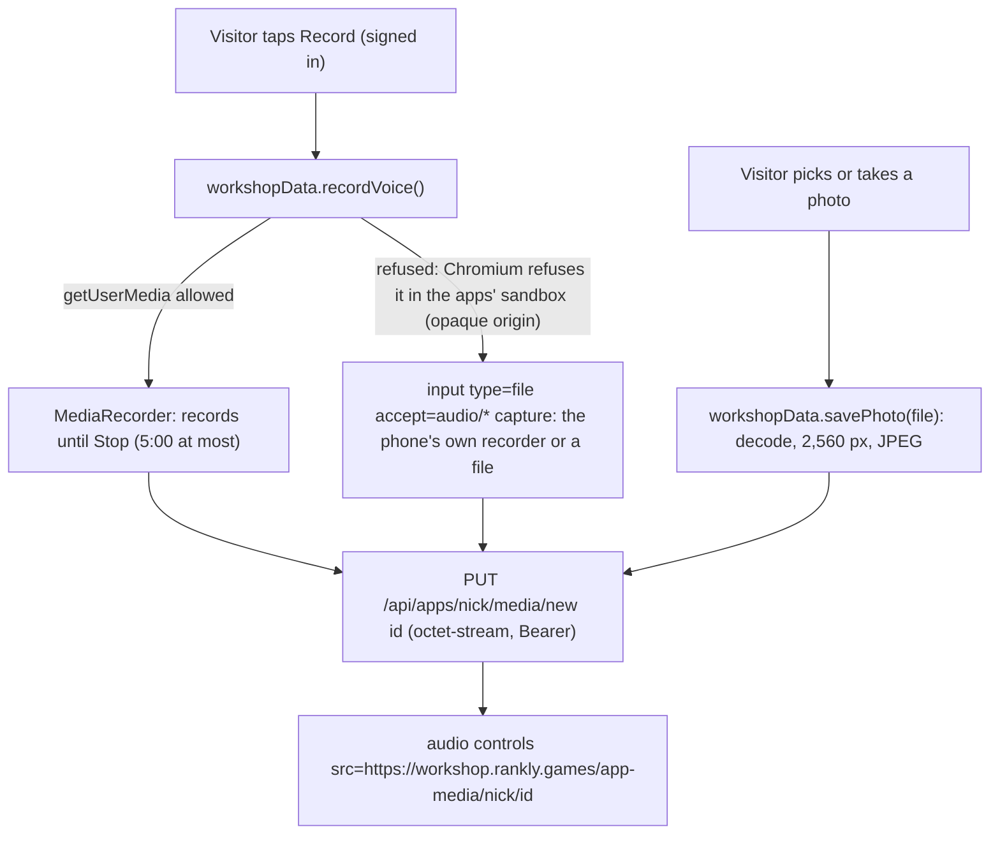

Nothing to deploy beyond the platform: every deploy publishes the platform's `workshop-data.js` (3.25), which now has
`savePhoto`, `recordVoice` and `deleteMedia` (older apps never call them, so `npm run apps -- refresh` is not needed).
In Chromium (desktop, Playwright) the apps' sandbox refuses the microphone with `SecurityError: Invalid security origin`
even when the permission is granted, and no response header changes that (the apps send no `Permissions-Policy`; the
refusal comes from the opaque origin itself). So Chrome on Android is expected to use the fallback: the phone's own
recorder through a file input. Safari on iPhone is not known yet. This check tells which path each phone takes.

You need a live test app that keeps photos and voice messages: as a test participant, build one from an idea such as
"a gallery of our drawings, taken with the phone camera, with tags, and short voice notes sorted by topic" (the build
eval's cases in `platform/api/eval/build.json` are two such specs), and open it from its QR code on each phone, signed
in to save ("Sign in to save", then back to the app).

1. iPhone (Safari), photos: take a photo with the photo button, and pick one from the library (iPhone photos are HEIC;
   Safari decodes them). Expect each to appear within a few seconds, upright, and to open at most 2,560 px wide (long
   press, open the image in a new tab: its address is `https://workshop.rankly.games/app-media/<nick>/<22 characters>`).
2. iPhone, voice: press Record. Either (a) Safari asks for the microphone; allow it, speak 10 seconds, press Stop: the
   message appears with a player that plays it (the microphone path, MP4/AAC); or (b) a sheet opens to choose a file
   (the fallback: iOS ignores `capture` for audio and offers Files, where a Voice Memos recording shared to Files can be
   chosen): choose one under 4 MB; it appears and plays. Note which one happened, and that pressing Stop (or Cancel in
   the sheet) without a recording shows "No recording was chosen."
3. Android phone (Chrome), photos: as step 1 (the camera opens directly from the photo button).
4. Android, voice: press Record. Expected (b): Chrome opens the phone's sound recorder, or a file chooser where the
   phone has none; record 10 seconds, confirm, and the message appears and plays. A recorder that saves `.m4a`/`.aac`
   in MP4 or `.ogg`/`.webm` Opus is accepted; one that saves AMR or 3GP gets "Send a photo as a JPEG, or a voice
   recording as WebM, Ogg or MP4 audio." (note the recorder app and the file type). If Chrome asks for the microphone
   instead (a), allow it and record as on the iPhone.
5. On either phone, signed out (a private tab without the hand-off): pressing the photo or Record button shows "Sign in
   to the workshop to save in this app." and the sign-in button, and nothing is recorded or sent.
6. Tell Claude, for each phone, which path recording took ((a) or (b)) and any message shown. If neither phone records
   well, the next step is a follow-up ticket (for example a small recorder page outside the sandbox), not a change to
   the apps' sandbox.

## AI tasks for apps (ticket 3.21)

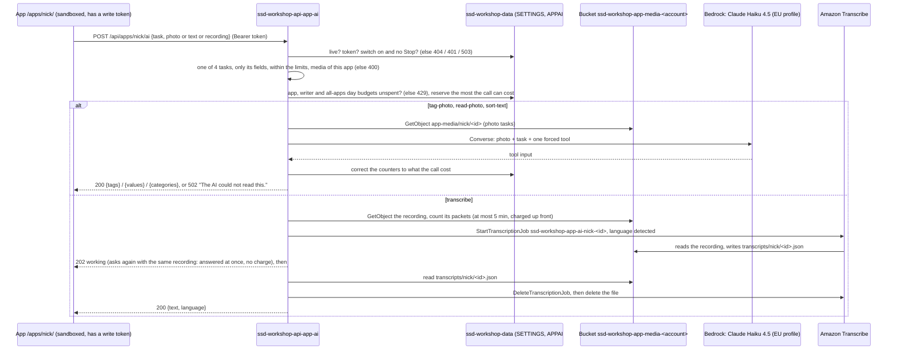

### Before merging (Franck)

1. **Apply the access stack** (`infra/access/access-stack.yaml`, as before): the boundary gains a `Transcribe` statement
   (only `transcribe:StartTranscriptionJob`, `GetTranscriptionJob` and `DeleteTranscriptionJob`, only in
   eu-central-1). To make room under the 6,144-character limit (now 6,131), `GitHubKeyForTheLauncherOnly` uses one
   `ArnNotLike` `role*/ssd-workshop-builds-launcher` value instead of two ARNs (same effect, look-alikes tested), and
   `SendCodes` drops `ses:SendRawEmail` (no workshop code sends raw email). The deploy policies are unchanged: the deploy
   creates no Transcribe resource. Until the boundary is applied, `transcribe` answers 500 (AccessDenied, logged by name)
   and the three model tasks still work.
2. **WAF:** the edge stack adds a sixth rule, `ssd-workshop-ai-rate` (more than 150 AI requests, `POST` and `OPTIONS`
   together, per address in 5 minutes get a 429 "Too many AI requests from this address. Please wait a few minutes and
   try again.", $1 a month). As for 3.18, the deploy role holds `wafv2:UpdateWebACL` through the standalone policy
   `ssd-workshop-deploy-safety-nets`: confirm it is still attached.
3. **CloudFront:** the `/api/apps/*` response headers policy moves to `ssd-workshop-app-data-v3` (adds `POST`); v2 stays
   retained for you to delete after the deploy, like v1.
4. The switch "Apps may use AI" starts **off**: nothing changes for apps until you turn it on in the dashboard's
   Workshop controls.

### Live check (after the deploy and the access stack)

You need a live app `<nick>`, a write token `$T` for it (as in the 3.24 check), and, uploaded through the media API
(3.18 check), a receipt photo `$PHOTO` (its `/app-media/<nick>/<id>` address) and two short voice recordings, one in
French `$FR` and one in English `$EN` (a phone's voice memo, 10 to 30 seconds, addresses as for the photo).

```sh
NICK=<nick>
API=https://workshop.rankly.games/api/apps/$NICK/ai
ai() { curl -sS -w '\n%{http_code}\n' -X POST -H 'origin: null' -H "authorization: Bearer $T" -H 'content-type: application/json' --data "$1" "$API"; }
```

1. Switch off (the default): `ai '{"task":"sort-text","text":"The bus was late","categories":["transport","food"]}'`
   answers 503 "AI is switched off for apps right now." and the function's log shows outcome `switched-off`, no cost.
2. Turn "Apps may use AI" on in the dashboard; the line beside it reads "Apps may use AI tasks now ...".
3. `ai "{\"task\":\"read-photo\",\"photo\":\"$PHOTO\",\"fields\":[{\"name\":\"shop\",\"type\":\"text\"},{\"name\":\"date\",\"type\":\"date\"},{\"name\":\"total\",\"type\":\"money\"}]}"`
   answers 200 `{"values":{"shop":...,"date":"YYYY-MM-DD","total":{"amount":...,"currency":"EUR"}}}` matching the receipt.
4. `ai "{\"task\":\"tag-photo\",\"photo\":\"$PHOTO\"}"` answers up to 5 suggested tags; with `"tags":["receipt","cat"]`
   only tags from that list. `ai '{"task":"sort-text","text":"The bus was late","categories":["transport","food"]}'`
   answers `{"categories":["transport"]}` (not verified live before this check: the tag and sort tools' `enum`
   schemas on Bedrock; the read-photo eval proved the other shapes).
5. Refusals: another app's photo address (400 "...this app's own photos."), `"prompt":"hi"` added (400), no token
   (401, from the function: there is no WAF junk filter on this route).
6. **Transcribe, French and English** (question 8's live eval): `ai "{\"task\":\"transcribe\",\"recording\":\"$FR\"}"`
   answers 202 `{"status":"working",...}` (the first request waits up to ~15 s while it polls, up to ~26 s when it then reads the result) or 200
   `{"text":...,"language":"fr-FR"}`; repeat the same command every few seconds until 200 (each repeat answers at once
   and is free). The text must be what was said. Same with `$EN` (`en-US`). Not verified
   until this check: that Transcribe accepts the stored WebM, Ogg and MP4 files as they are, and that its write of the
   result under `transcripts/` passes (the media bucket's policy leaves `transcripts/` to identity policies, so it should).
   Then, signed in as `AWS_PROFILE=franck`:

   ```sh
   aws s3 ls s3://ssd-workshop-app-media-<account>/transcripts/ --recursive      # expect: nothing (deleted after reading)
   aws transcribe list-transcription-jobs --job-name-contains ssd-workshop-app-ai --region eu-central-1   # expect: none
   ```

   Leftovers: when an app starts a transcription and never asks again, its result file stays under `transcripts/`
   until the lifecycle rule `ssd-workshop-transcripts-expiry` deletes it (1 day, plus S3's lifecycle delay), and the
   job record (settings and status, no audio) stays in Transcribe until its own retention (90 days by default). Neither
   is served. To clear them by hand: `aws transcribe delete-transcription-job --transcription-job-name <name>` and
   `aws s3 rm s3://ssd-workshop-app-media-<account>/transcripts/ --recursive`.

7. The counters: `aws dynamodb get-item --table-name ssd-workshop-data --key '{"pk":{"S":"APPAI_TOTAL"},"sk":{"S":"AI_USAGE"}}'`
   (as `franck`) shows today's `day` and a `costUsd` of a few cents; the same with `APPAI_WRITER#<your nickname, lower
   case>` shows the same amount (the per-writer counter). Turn the switch off again if apps should not use AI yet.

### Cost

Each model call costs its tokens at Haiku 4.5's EU price ($1.10 in, $5.50 out per million): a receipt read is ~1,250
tokens in and ~90 out, about $0.002 (live eval). A transcription costs $0.024 a minute (at least 15 s), at most $0.122
for the longest recording. Both count against $1 per app, $1 per signed-in writer across all apps and $10 for all apps
each UTC day; at a cap every AI request answers 429 without calling anything.

Worst case while the switch is on (details, prices and assumptions in `docs/decisions.md`, "(3.21) Cost"; **accepted by
Franck 2026-11-27 05:25 UTC**), with POST held at its 2/s throttle (172,800 a day) and OPTIONS at 10/s (864,000 a day), since
try 3; try 2's 5/s and 20/s (432,000 and 1.7 million a day) for comparison:

| Part | Per day (2/s, 10/s) | Per day (5/s, 20/s) |
| --- | --- | --- |
| AI (the $10 cap plus one reservation) | $10.13 | $10.13 |
| Lambda (each POST may read and walk a 4 MB file it then refuses, ~1 s at 512 MB; OPTIONS; requests) | $1.41 | $3.42 |
| Lambda, the paid calls' own run time (~16,700 cheapest model calls of up to ~5 s; ~1,700 transcriptions of up to 26 s would be $0.29) | $0.55 | $0.55 |
| API Gateway | $1.24 | $2.59 |
| CloudFront requests, bodies to the origin, answers to viewers | $1.34 | $2.82 |
| WAF requests | $0.62 | $1.30 |
| DynamoDB (at most 6 small reads per POST, the counters' writes, lost races) | $0.35 | $0.60 |
| CloudWatch Logs (~0.55 KB per invocation: the function's line plus Lambda's START, END and REPORT lines) | $0.34 | $0.71 |
| S3 reads | $0.07 | $0.19 |
| **In all** | **~$16 (~$490 a month if held every day)** | **~$22 (~$680 a month)** |

About $6 of the tightened figure is requests, not AI: filling the POST throttle with file-reading requests needs a
signed-in participant's app write token and at least 4 addresses (the WAF rule allows 150 per 5 minutes per address).
Only if Bedrock itself answered every cheap call in ~20 s would the paid calls' run time reach ~$2.94 a day. Without an
attacker a workshop day costs cents plus what apps use (at most $10.13). Turn the switch off outside workshop days.

- Transcribe jobs carry no `project=ssd-workshop` tag, so their spend is invisible to the Cost Anomaly monitor
  `ssd-workshop-cost`; only the account's $20 Budgets alert (and the app counters' $10 a day) see it
  (`docs/decisions.md`, "(3.21) Transcribe jobs are not tagged").
- The deploy role (`s3:*` on `ssd-workshop-*` buckets) and Claude sessions (bucket reads) can reach `transcripts/`,
  which the media bucket's write deny leaves to identity policies (`docs/decisions.md`, "(3.21) Who else can reach
  `transcripts/`").

## Check after the apps deploy (ticket 2.5)

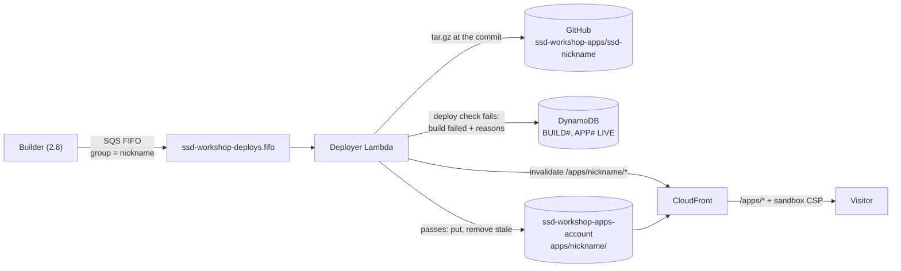

Nothing sends to the deploy queue until ticket 2.8. To publish an app by hand, create a public repository
`ssd-workshop-apps/ssd-<nickname>` from `templates/basic/`, create a build item and send one message (FIFO: message
group = lower-cased nickname, deduplication id = build id), with Franck's credentials (a session may neither write
nor read table items, nor send to the deploy queue):

```sh
AWS_PROFILE=franck aws dynamodb put-item --region eu-central-1 --table-name ssd-workshop-data \
  --item '{"pk":{"S":"BUILD#manual-1"},"sk":{"S":"BUILD"},"type":{"S":"build"},"buildId":{"S":"manual-1"},"nickname":{"S":"<nickname>"},"status":{"S":"building"},"updatedAt":{"S":"2026-11-24T00:00:00Z"}}'
AWS_PROFILE=franck aws sqs send-message --region eu-central-1 \
  --queue-url https://sqs.eu-central-1.amazonaws.com/<account>/ssd-workshop-deploys.fifo \
  --message-group-id <nickname, lower-cased> --message-deduplication-id manual-1 \
  --message-body '{"buildId":"manual-1","nickname":"<nickname>","commit":"<40-hex commit>"}'
AWS_PROFILE=franck aws dynamodb get-item --region eu-central-1 --table-name ssd-workshop-data \
  --key '{"pk":{"S":"BUILD#manual-1"},"sk":{"S":"BUILD"}}' --query 'Item.[status.S, deployedCommit.S, failureReasons]'
# expect within a minute: ["live", "<commit>", null]; the log group ssd-workshop-apps-deployer has one line
#         {"event":"deployer","outcome":"live","files":N,"bytes":N,"removed":0,"durationMs":N}
```

Criterion 3, the headers (the apps' policy `ssd-workshop-apps-v1`; since ticket 2.14 `-v2`, see below):

```sh
curl -sS -I https://workshop.rankly.games/apps/<nickname>/ \
  | grep -i -E '^(HTTP/|content-type|content-security-policy|x-content-type-options|strict-transport-security|referrer-policy)'
# expect: 200, content-type: text/html; charset=utf-8,
#         content-security-policy: sandbox allow-scripts allow-forms allow-modals allow-popups; default-src 'self';
#           connect-src 'self'; img-src 'self' data:; form-action 'self'
#         x-content-type-options: nosniff, strict-transport-security: max-age=31536000,
#         referrer-policy: strict-origin-when-cross-origin
curl -sS -I https://workshop.rankly.games/apps/<nickname> | grep -i -E '^(HTTP/|location)'
# expect: 301 with location: /apps/<nickname>/ (the CloudFront Function; also for an upper-case nickname)
curl -sS -I 'https://workshop.rankly.games/apps/<Nickname with an upper-case letter>?a=1%26b%3D2&c=%0A' | grep -i -E '^(HTTP/|location)'
# expect: 301 with location: /apps/<nickname, lower-cased>/?a=1%26b%3D2&c=%0A — the query kept as sent: %26 and %0A
#         stay encoded (no extra parameter, no line break or second header in the answer)
```

The function rebuilds the query from CloudFront's `querystring` values as it receives them (unverified whether
CloudFront hands them over still encoded). If the `location` shows a bare `&b=2` or a line break instead of `%26` and
`%0A`, the values arrive decoded: re-encode each name and value in `infra/lib/apps-index.js` (`encodeURIComponent`) in
a follow-up before 2.8 makes apps public.

Criterion 5, an unknown address under `/apps/` (and anywhere on the site) shows the plain 404 page:

```sh
curl -sS -i https://workshop.rankly.games/apps/nope/ | sed -n '1p;/<h1>/p'
# expect: HTTP/2 404 and <h1>Page not found</h1>
curl -sS -i https://workshop.rankly.games/apps/<nickname>/missing.js | sed -n '1p'
# expect: HTTP/2 404
```

Only the deployer writes app files (criterion 4, bucket policy `OnlyTheDeployerWritesApps`). With credentials that may
otherwise write the bucket (Franck's, or the deploy role's):

```sh
echo x > /tmp/x.txt
AWS_PROFILE=franck aws s3 cp /tmp/x.txt s3://ssd-workshop-apps-<account>/apps/<nickname>/x.txt
# expect: An error occurred (AccessDenied) when calling the PutObject operation ... with an explicit deny in a resource-based policy
```

(From a Claude session the same command is refused since ticket 2.12 by the explicit deny `OnlyReadsForSessions` in an
identity-based policy, or by this bucket policy's deny: the user has no write at all.) The refusal names the deny `OnlyTheDeployerWritesApps`, so
the `aws:PrincipalArn` form used by the deny is checked from both sides: other principals are refused, and the first successful deploy (the deployer's puts pass) proves that
`aws:PrincipalArn` matches the deployer's role (the policy names it with and without its path). If the first deploy
fails with `AccessDenied` on `PutObject` "with an explicit deny in a resource-based policy", the key carries a form
that neither ARN matches: look up `userIdentity.sessionContext.sessionIssuer.arn` in CloudTrail and fix
`DEPLOYER_ROLE_ARN`.

The first deploy's invalidation must also pass under the boundary's tag condition (the distribution carries
`project=ssd-workshop`; the deployer's role may invalidate only `DISTRIBUTION_ARN`):

```sh
aws cloudfront list-invalidations --distribution-id E2TOZV0ERAXKZ9 --max-items 1 \
  --query 'InvalidationList.Items[0].[Status, CreateTime]'
# expect: ["Completed" (or "InProgress"), <time of the deploy>]; the deployer's log line says outcome "live", not
#         "retry" with error "AccessDenied" (which would mean the boundary refused CreateInvalidation)
```

A failing commit (add `shell.php` or a `https://` address to the repository and send a new
message with a new build id) leaves the live files as they were and gives the build `"failed"` with its
`failureReasons`.

**Safari on an iPhone** (decision "(2.3) For 2.5": the sandbox with `'self'` was proved only in Chromium): open
`https://workshop.rankly.games/apps/<nickname>/` on an iPhone, check that the page's styles apply, press the
template's counter, reload: the count is kept (the data API saved it).

## Check after the outside-services deploy (ticket 2.14)

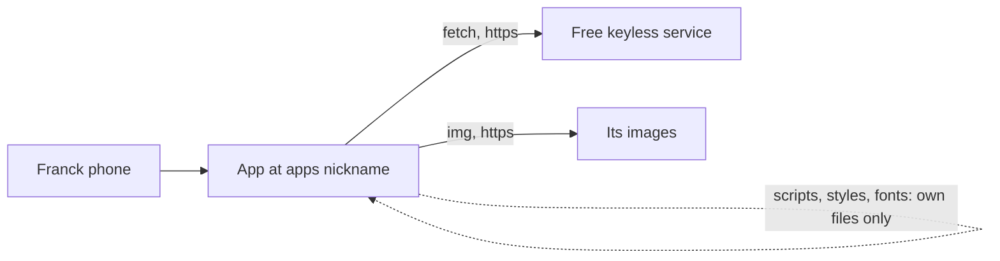

The apps' policy is now `ssd-workshop-apps-v2`; CloudFormation creates it and leaves `ssd-workshop-apps-v1` (retained,
no longer used by the distribution) for Franck to delete in the CloudFront console once v2 answers.

```sh
curl -sS -I https://workshop.rankly.games/apps/<nickname>/ | grep -i '^content-security-policy'
# expect: content-security-policy: sandbox allow-scripts allow-forms allow-modals allow-popups; default-src 'self';
#           connect-src 'self' https:; img-src 'self' data: https:; form-action 'self'
```

Then (Franck, on a phone): build an app whose spec reads an outside service (for example the readiness eval's
"movie watchlist with posters from Wikipedia" example) and open it at `/apps/<nickname>/`. Expect: the posters and
summaries show; with the phone offline (or the service down) the page shows its friendly message instead.

## Check after the sign-out deploy (ticket 3.1)

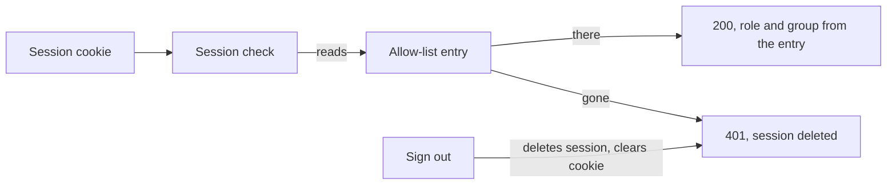

Run by Franck on his own machine: the sign-in steps send his address and a code, and the removal step reads and
deletes a table item, so it runs as `AWS_PROFILE=franck` (Claude sessions are read-only and never run it). Use a
test address of his own that is on the allow-list and that he may take off and put back.

1. On a phone, open https://workshop.rankly.games/, sign in, and press **Sign out** (under the title, on the right).
   Expect the email screen with "You're signed out."; reloading the page stays on the email screen. The code screen
   shows "No code after a minute? Check your Junk or Spam folder."
2. The same with `curl`, signed in as in the 1.5 check (same `JAR` cookie jar and `verify` function), to see the
   answers:

```sh
curl -sS -b "$JAR" -w '\n%{http_code}\n' https://workshop.rankly.games/api/me
# expect: {"id":"...","role":"<role from the allow-list>","group":"<group>",...} and 200
cp "$JAR" "$JAR.old"   # keep the old cookie to try it after signing out
curl -sS -b "$JAR" -c "$JAR" -H 'content-type: application/json' --data '{}' \
  -w '\n%{http_code}\n' https://workshop.rankly.games/api/sign-out
# expect: {"message":"You're signed out."} and 200
curl -sS -b "$JAR.old" -w '\n%{http_code}\n' https://workshop.rankly.games/api/me
# expect: {"message":"Please sign in."} and 401 (the old cookie no longer opens a session)
rm -f "$JAR.old"
```

3. Removal: sign in again (`verify` after a new code), then take the test address off the list. The command asks for
   the address and prints only "this address", never an address; without `--yes` it only looks.

```sh
verify
curl -sS -b "$JAR" -w '\n%{http_code}\n' https://workshop.rankly.games/api/me
# expect: 200
AWS_PROFILE=franck npm run -s allowlist -- remove "$ADDRESS"
# expect: "This address has an allow-list entry. Nothing was changed: run again with --yes to remove it."
AWS_PROFILE=franck npm run -s allowlist -- remove "$ADDRESS" --yes
# expect: "Removed the allow-list entry for this address. ..."
curl -sS -b "$JAR" -w '\n%{http_code}\n' https://workshop.rankly.games/api/me
# expect: {"message":"Please sign in."} and 401 (signed out at this call; the session item is deleted)
curl -sS -b "$JAR" -w '\n%{http_code}\n' https://workshop.rankly.games/api/conversation
# expect: {"message":"Please sign in."} and 401
rm -f "$JAR"
```

Put the address back with `AWS_PROFILE=franck npm run -s allowlist -- import /absolute/path/outside/the/repo.csv`.
Re-adding creates a new entry without a participant link, so the next sign-in starts a new participant (nickname
screen); the old profile and app stay in the table (decision "(3.1) Removal command"). The log groups
`ssd-workshop-api-participant` and `ssd-workshop-api-conversation` show `"outcome":"signed-out"`, `"removed"` and
`"unauthorized"` lines and never an address.

## Check after the step 4 changes deploy (ticket 3.8)

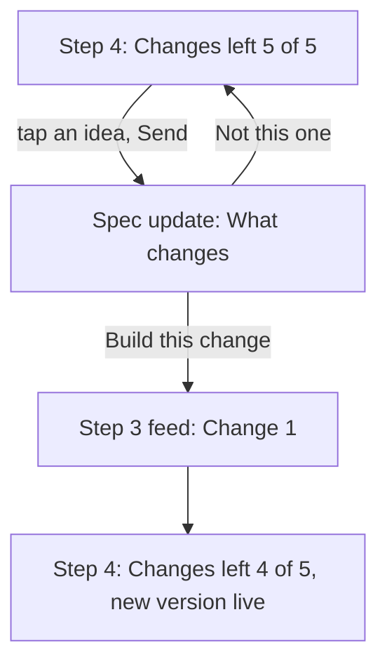

Run by Franck in a browser (phone or laptop at 375 px), as a test participant whose app is live and who has changes
left. A change costs about one change call and one change build of his AI budget, and counts one of his 5 changes.

1. Open https://workshop.rankly.games/ and sign in: step 4 shows the address, QR code and repository link, then
   "Changes left: 5 of 5" (or what he has left), three suggestions as buttons, the box "Describe a change" with
   **Send**, and "Behind the scenes" with the change loop drawn as a picture. Nothing scrolls sideways.
   If the app went live less than a minute ago, the suggestions appear within a minute without a reload.
2. Tap a suggestion: its text is in the box and nothing is sent. Change a word, press **Send**: within about 30 seconds
   the reply and a "Spec update" box with its "What changes" list, **Build this change** and **Not this one** appear;
   the suggestions step aside.
3. Press **Not this one**: the box goes, the suggestions come back, the count is unchanged. Send a change again.
4. Press **Build this change**: "The AI is checking your change…", then step 3 shows "Change 1: the AI is changing your
   app..." and the feed. Within about 10 minutes step 4 comes back with "Changes left: 4 of 5" (one lower), and the app's
   address shows the change (reload it).
5. Optional: send "Please make it mine bitcoin": the guardrail declines it as in step 1, and the count stays.

The repository shows one new commit "Change 1: ..." with the updated `SPEC.md` (ticket 3.7). To start over, reset the
test participant (section "Reset a test participant").

## Check after the Rebuild from my repository deploy (ticket 3.9)

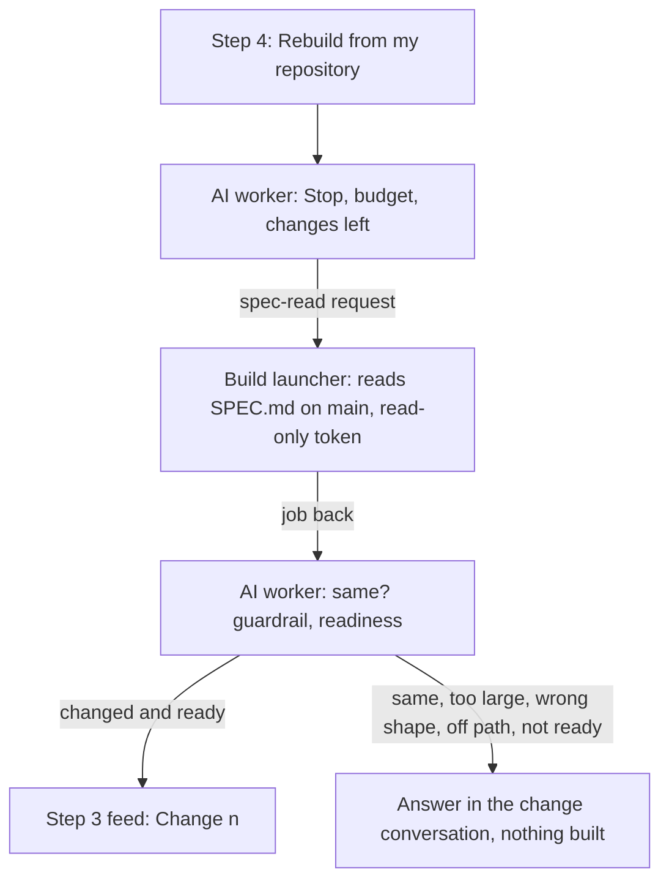

Run by Franck in a browser, as a test participant whose app is live and who has changes left, with the participant's
repository open on GitHub in another tab. A changed spec costs one guardrail call, one readiness call and one change
build, and counts one change.

1. On step 4, open "Advanced: edited SPEC.md on GitHub?" and press **Rebuild from my repository** without changing
   anything on GitHub: "Reading and checking the spec in your repository…", then "Your repository's spec has not
   changed." The count is unchanged and step 4 stays.
2. On GitHub, edit `SPEC.md` on `main` (add one small feature line) and commit. Press the button again: within about
   a minute step 3 shows "Change n: ..." and the feed; when it is live, step 4 shows the count one lower and the
   repository has one new "Change n: ..." commit whose `SPEC.md` is the edited one.
3. Optional: commit a `SPEC.md` over 20 KB (paste a long text): the press answers that the spec is too large, at once,
   and the count stays. Put the file back afterwards. Likewise a `SPEC.md` without its Mermaid diagram (try 2): the
   press answers that it does not have the shape of a spec, without an AI call, and the count stays.
4. In CloudWatch Logs, `/aws/lambda/ssd-workshop-builds-launcher` shows one `"event":"spec-read"` line per press with
   `"outcome":"read"` and the read's kind, and no repository name, token or address.

## Check after the Edit my spec deploy (ticket 3.15)

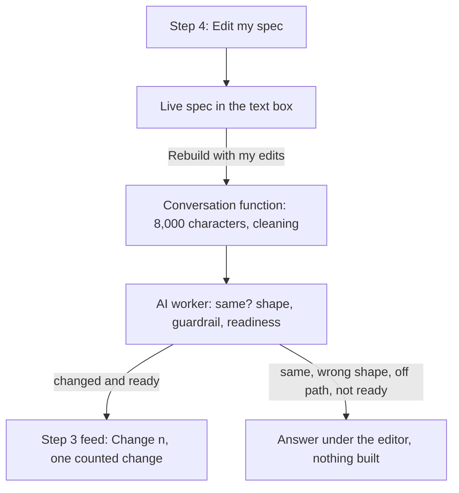

### 3.15 live check

Run by Franck in a browser at phone width, as a test participant whose app is live and who has changes left. A changed
spec costs one guardrail call, one readiness call and one change build, and counts one change.

1. On step 4 press **Edit my spec**: the box shows the live spec. Press **Rebuild with my edits** without changing
   anything: "Checking your edited spec…", then "Your spec has not changed." under the buttons and in the
   conversation; the count is unchanged.
2. Rename the heading `## Screens` to `## Pages` and press again: the shape answer shows at once (no AI call), the box
   keeps the text, and the count is unchanged. Undo the rename.
3. Paste more than 8,000 characters at the end and press: "Your spec is longer than 8,000 characters, ..." at once.
   Remove them.
4. Add one small feature line under `## Screens` and press: within about a minute step 3 shows "Change n: ..." and the
   feed; once live, step 4 shows the count one lower, and the repository has one new "Change n: ..." commit whose
   `SPEC.md` has the added line.
5. In CloudWatch Logs, `/aws/lambda/ssd-workshop-api-conversation` shows `"route":"change-edit"` lines with outcomes only,
   and neither that log nor the AI worker's holds the spec's text, the nickname or an address.

## Check after the facilitator API deploy (ticket 3.10)

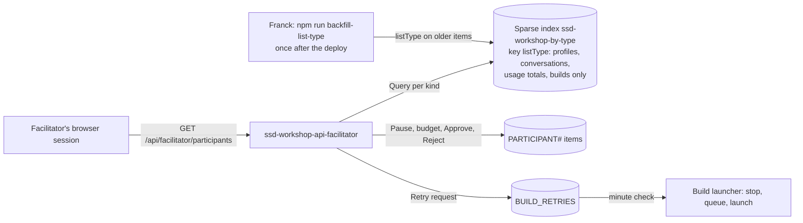

0. First, once, as Franck with his own credentials, after the deploy has made the index `ACTIVE`
   (`AWS_PROFILE=franck aws dynamodb describe-table --table-name ssd-workshop-data --region eu-central-1 --query
   'Table.GlobalSecondaryIndexes[0].[IndexStatus,KeySchema]'` prints `ACTIVE` and `listType`):
   `AWS_PROFILE=franck npm run backfill-list-type`. It gives the profiles, conversations, usage totals and builds made
   before this deploy their `listType` (the index's key; only those four kinds carry it, so an allow-list entry, a code
   or a session is never in the index) and prints two counts only. A second run prints `0 item(s)`. Then check the
   index is sparse: `AWS_PROFILE=franck aws dynamodb scan --table-name ssd-workshop-data --index-name
   ssd-workshop-by-type --select COUNT --region eu-central-1` counts only those items (compare with the four kinds'
   numbers; never print the items).
   Then re-run the allow-list import once with the current list (`AWS_PROFILE=franck npm run -s allowlist -- import <absolute path of the
   current CSV>`), so every linked profile gets its role and group from the list (before this deploy, import did not
   copy them, so someone promoted or moved since their last sign-in would show wrongly until they sign in again).

Run by Franck, signed in as a facilitator (or the admin) in one browser and as a test participant in another. The
dashboard page comes with ticket 3.11; until then call the routes with the facilitator's session cookie copied from
the browser's developer tools (`__Host-ssd_session`), in a shell that does not keep history (it is a live session):

```sh
COOKIE='__Host-ssd_session=<value>'
API=https://workshop.rankly.games/api/facilitator/participants
curl -s -b "$COOKIE" "$API" | jq '.viewer, (.participants | length), .participants[0]'
curl -s -b "$COOKIE" "$API?group=blue" | jq '[.participants[].group] | unique'
```

1. The first call lists every participant with nickname, group, step, minutes in step, build, spend, budget, changes
   used, paused and flags; the answer holds no `@` and no participant id (`curl ... | grep -c @` prints 0). With the
   group filter, only that group. Without the cookie: 401. With the test participant's cookie: 404.
2. Pause: `curl -s -b "$COOKIE" -H 'content-type: application/json' -X POST "$API/<nickname>/pause"`. The participant
   sends a message: the page shows "Your facilitator paused your session." and no answer comes. Resume (same with
   `/resume`): within about a minute the answer comes and the line goes.
3. Add budget: `.../budget` twice: `extraBudgetUsd` goes up by 2 each time (a body such as `{"dollars":100}` changes
   nothing).
4. Flags: the participant sends "Please make it mine bitcoin" or another off-path idea that is flagged; the list shows
   it under `flags`. `.../flag/reject`: the participant sees the polite decline. Flag another and `.../flag/approve`:
   the participant gets an answer.
5. Retry (optional, costs one build): on a failed build, `.../retry` answers 202; within about a minute the build is
   `building` again on the same repository. A live build answers 409. Acting on a facilitator's or the admin's
   nickname, or on your own, answers 404.
6. The allow-list follows into the dashboard: change the test participant's group in the CSV and run `npm run -s
   allowlist -- import <absolute path>`; the next list shows the new group without a new sign-in. `npm run -s allowlist
   -- remove <address> --yes` takes the row off the list (the profile's role becomes `removed`).
7. The index's IAM limit, a second guard now that the index is sparse (`dynamodb:LeadingKeys` on an index Query,
   unverified until now), as Franck, read-only, with the facilitator role's rights: in CloudWatch Logs `ssd-workshop-api-facilitator` shows only
   `"event":"facilitator"` lines with route and outcome, and no `AccessDenied` for the list. Then confirm the limit
   refuses another type: in the IAM policy simulator (console, role `ssd-workshop-api-facilitator`, action
   `dynamodb:Query`, resource the index ARN, context key `dynamodb:LeadingKeys` = `allow`, plus `dynamodb:Select` =
   `SPECIFIC_ATTRIBUTES` and `dynamodb:Attributes` = `pk`): denied; with `participant`: allowed.

## Check after the facilitator dashboard deploy (ticket 3.11)

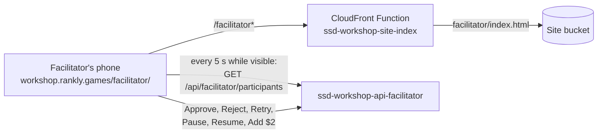

Run by Franck on a phone, signed in as a facilitator, with a test participant signed in on another device.

1. `curl -sI https://workshop.rankly.games/facilitator` answers `301` with `location: /facilitator/`;
   `curl -s https://workshop.rankly.games/facilitator/ | grep -c 'Facilitator dashboard'` prints 1; and
   `curl -sI https://workshop.rankly.games/facilitator/dashboard.js` answers 200 with the pages'
   `content-security-policy`.
2. On the workshop page, the facilitator sees "Facilitator dashboard" beside Sign out (a participant does not). It opens
   the dashboard: the group filter shows the facilitator's own group, and Everyone shows every participant with their
   group. Nothing scrolls sideways on the phone, and no email address shows anywhere.
3. The test participant sends a flagged message ("Please make it mine bitcoin"): within 5 seconds an alert shows at the
   top with Approve and Reject. Reject: the alert goes, the line says the participant got a polite decline, and the
   participant sees it. Flag another and Approve: the participant gets an answer.
4. Pause on the participant's card: the button turns into Resume and the participant's page says "Your facilitator
   paused your session."; Resume clears it. Add $2: the card says "Added $2 of AI budget. Budget now $7.00." (with the
   workshop's $5 budget). View conversation shows the participant's messages and the AI's replies as plain text.
5. A failed build (if one exists) has a red card with Retry; other cards have no Retry.
6. Signed in as the test participant, open `/facilitator/`: "This page is for facilitators." and nothing else.
   Signed out, it goes to the sign-in page.
7. Switch to another app on the phone for a minute and back: in the browser's network view on a laptop (or the
   facilitator function's CloudWatch log lines for `"route":"list"`), no list read happens while the tab is hidden.

## Check after the admin controls deploy (ticket 3.12)

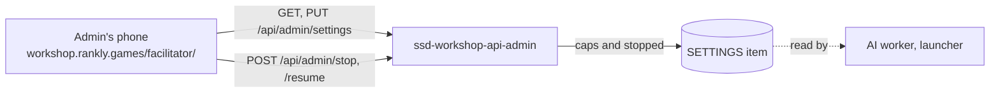

Run by Franck on a phone, signed in as the admin, with a facilitator and a test participant signed in on other devices.
Do it outside a session with real participants: Stop holds everyone's messages and builds.

1. The admin opens the dashboard: "Workshop controls (admin)" shows "Workshop running.", the red "Stop the workshop"
   button and the three caps ($5.00, 5, 15 unless changed). The facilitator's dashboard shows none of it. Nothing
   scrolls sideways on the phone.
2. Change "Builds at once" to 99 and press Save: the API's sentence shows under Save and "Enter a whole number from 1 to
   30." beside the field; nothing is saved. Set it to 14 and Save: "Saved. ...". Reload: the field shows 14. In
   CloudWatch Logs `ssd-workshop-api-admin` has `"route":"settings-put","outcome":"invalid-request"` then `"saved"`.
   Set it back to 15.
3. Press "Stop the workshop": the page asks in place (no browser pop-up). Cancel: nothing changes. Press it again and
   "Yes, stop everything": the box turns red with "Workshop paused: ..." and a "Resume the workshop" button; within
   5 seconds the facilitator's dashboard shows the stopped banner and the participant's page shows "The workshop is
   paused for a moment." within 30 seconds. A message the participant sends stays pending.
4. Press "Resume the workshop": "Workshop running." and the Stop button again; the participant's pending message gets
   its answer and the paused line goes.

## Safety nets (ticket 3.13)

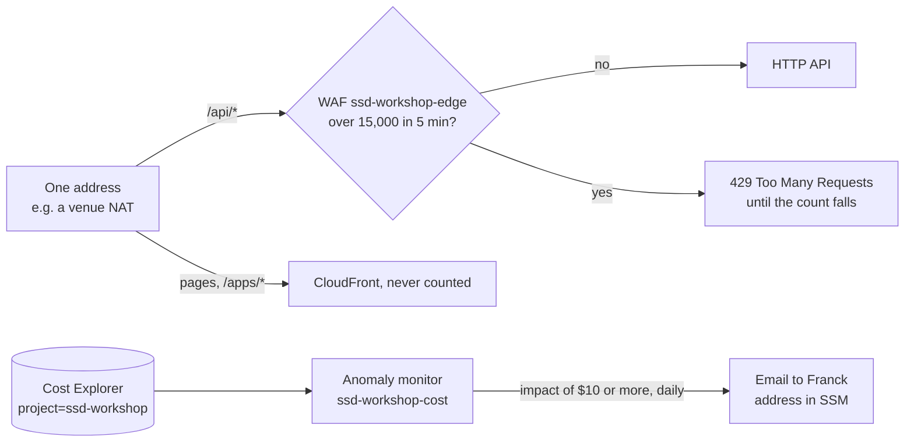

### One-time steps before merging (Franck)

The deploy fails (and rolls back the edge stack's WAF change, or the alerts stack) until steps 1 and 2 are done; do step 3 before the first deploy too, in case Cost Explorer refuses a monitor on a tag that is not active yet (not verified). If the alerts stack fails, read the reason in the CloudFormation console, not in the public Actions log: a rejected subscriber could name the address. Check the stored value with `get-parameter` before merging.

1. Add the access rights listed in `docs/decisions.md`, "3.13 Cost and abuse safety nets", "Access stack rights needed
   (Franck)", to `infra/access/access-stack.yaml` and apply it.
2. Store the alert address (never in the repository), in us-east-1 where the alerts stack reads it:

   ```sh
   export AWS_PROFILE=franck
   aws ssm put-parameter --region us-east-1 --name /ssd-workshop/alert-email --type String \
     --tags Key=project,Value=ssd-workshop --value '<your alert address>'
   aws ssm get-parameter --region us-east-1 --name /ssd-workshop/alert-email --query Parameter.Version
   # expect: 1 (the version infra/lib/config.ts ALERT_EMAIL_PARAMETER_VERSION names)
   ```

   To change the address later: `put-parameter ... --overwrite` (version 2), then a pull request that sets
   `ALERT_EMAIL_PARAMETER_VERSION = 2`; the deploy after its merge switches the subscription.
3. Activate the cost allocation tag `project` (Billing and Cost Management > Cost allocation tags, or the command below).
   It is listed only once billing data has seen it (up to 24 hours after the first tagged resource), and costs are
   grouped by it only from activation onwards. If `rankly.games` is a member of an AWS Organization, only the
   management account can activate it.

   ```sh
   aws ce update-cost-allocation-tags-status --cost-allocation-tags-status TagKey=project,Status=Active
   aws ce list-cost-allocation-tags --tag-keys project --query 'CostAllocationTags[].Status'
   # expect: ["Active"]
   ```

4. If an email from AWS asks to confirm the anomaly alert subscription, confirm it (direct email subscribers usually
   need no confirmation).

### 3.13 live check (criterion 2, after the deploy)

Skipped for now (Franck, 2026-11-26): there is no outside host to send the requests from.

Run by Franck from a machine outside the workshop room and outside a session with participants: it blocks that
address from `/api/*` for about 5 minutes. It sends about 16,000 requests to a path the API has no route for (API
Gateway answers 404 itself, no Lambda runs): a few cents of CloudFront, WAF and API Gateway requests. Some answers
during the burst may be 429 from API Gateway's own stage throttle; WAF counts them all the same.

```sh
url=https://workshop.rankly.games/api/waf-check
seq 16000 | xargs -P 40 -I{} curl -s -o /dev/null -w '%{http_code}\n' --max-time 10 "$url" | sort | uniq -c
# expect: mostly 404 (some 429 from API Gateway), and 429 at the end once WAF blocks the address
for i in $(seq 1 12); do
  curl -s -w ' %{http_code}\n' https://workshop.rankly.games/api/health
  sleep 10
done
# expect: {"message":"Too Many Requests"} 429 within about a minute of the burst (WAF checks about every 30 s)
curl -s -o /dev/null -w '%{http_code}\n' https://workshop.rankly.games/
# expect: 200 (pages are never blocked)
aws wafv2 list-web-acls --region us-east-1 --scope CLOUDFRONT --query "WebACLs[?Name=='ssd-workshop-edge'].Id" --output text
aws wafv2 get-rate-based-statement-managed-keys --region us-east-1 --scope CLOUDFRONT --web-acl-name ssd-workshop-edge \
  --web-acl-id <id from above> --rule-name ssd-workshop-api-rate --query 'ManagedKeysIPV4.Addresses'
# expect: your own address (/32) while blocked
```

Then every minute: `curl -s -o /dev/null -w '%{http_code}\n' https://workshop.rankly.games/api/health` answers 429
until about 5 minutes after the burst ended, then 200 again. Note whether the 429 carried
`access-control-allow-origin: *` on an `/api/apps/` path (`curl -si -H 'Origin: null'
https://workshop.rankly.games/api/apps/x/data/y | grep -i access-control` while blocked) and tell Claude: it decides
whether a blocked sandboxed app can read the answer (decision "(3.13) A block answers 429").

Criteria 1 and 3 are synth tests (`infra/lib/app.test.ts`, "WAF web ACL on the distribution" and "Cost Anomaly
Detection"). After the deploy, the monitor and subscription show in Billing and Cost Management > Cost Anomaly
Detection; the first daily email comes only when an anomaly of $10 or more is found.

## Auto-stop outside the build subnets (ticket 3.14)

```mermaid
flowchart LR
  sched[Scheduler<br/>every minute] --> check[Launcher's check]
  check -->|ListTasks RUNNING, PENDING| cluster[(Cluster<br/>ssd-workshop-builds)]
  check -->|DescribeTasks: subnet of each task| cluster
  check --> q{Every subnet one of<br/>BUILDS_SUBNET_IDS?}
  q -->|yes| keep[Nothing happens]
  q -->|no| stop[StopTask<br/>'ssd-workshop: outside the build subnets'<br/>log line with the task id]
  q -->|no subnet yet| age{Older than<br/>5 minutes?}
  age -->|no| keep
  age -->|yes| stop
```

IAM cannot pin `RunTask` to subnets (accepted risk 1), so the launcher's minute check stops any task of the builds
cluster outside the two build subnets: a stray task lives up to about a minute (two at most, if it starts right after a
check). It needs `ecs:ListTasks` in the boundary's `AccountWideServiceCalls` (Franck's yes, 2026-11-26): until Franck
applies the access stack, the check logs one `"event":"outside-task","outcome":"list-failed","error":"AccessDeniedException"`
line per minute and does everything else as before.

### 3.14 live check (after the deploy and the access stack)

Run by Franck with his own profile (sessions may not `RunTask`). It starts one builder task without a build (no token,
no build id) in a subnet that is not a build subnet, for example one of the account's default VPC; its command is
replaced by `sleep 600` so it cannot exit on its own before the check sees it. Cost: a minute or two of one Fargate
task, under a cent.

```sh
export AWS_PROFILE=franck AWS_REGION=eu-central-1
aws ec2 describe-subnets --filters Name=default-for-az,Values=true --query 'Subnets[0].SubnetId' --output text
# pick a subnet that is NOT subnet-05229d71b1e0b41ff or subnet-0965bcee41d455dba
other=<subnet id from above>
task=$(aws ecs run-task --cluster ssd-workshop-builds --task-definition ssd-workshop-builder --launch-type FARGATE \
  --network-configuration "awsvpcConfiguration={subnets=[$other],assignPublicIp=ENABLED}" \
  --overrides '{"containerOverrides":[{"name":"builder","command":["sleep","600"]}]}' \
  --tags key=project,value=ssd-workshop --query 'tasks[0].taskArn' --output text)
echo "${task##*/}"
# within about two minutes:
aws ecs describe-tasks --cluster ssd-workshop-builds --tasks "$task" --query 'tasks[0].[lastStatus,desiredStatus,stoppedReason]'
# expect: ["STOPPED" (or "DEPROVISIONING"), "STOPPED", "ssd-workshop: outside the build subnets"]
aws logs tail ssd-workshop-builds-launcher --since 10m | grep outside-task
# expect: {"event":"outside-task","outcome":"stopped","task":"<the id echoed above>",...}
# and the check's own line shows "outside":1 that minute
```

Then check that a real build is left alone while it starts (the grace for a task without a subnet,
`OUTSIDE_NO_SUBNET_GRACE_MS`): start a build from the workshop page right after the deploy (or press Retry on a failed
one), and while its task is PROVISIONING or PENDING, and for a few minutes after, watch the launcher's log:

```sh
aws ecs list-tasks --cluster ssd-workshop-builds --desired-status RUNNING   # note the new task's id
aws logs tail ssd-workshop-builds-launcher --since 10m --follow | grep -E 'outside-task|build-check'
# expect: no outside-task line for that task id, and "outside":0 on each build-check line; the build finishes
```

A `list-failed` line instead means the access stack with `ecs:ListTasks` is not applied yet. A `list-truncated`
line means the cluster had more than 1,000 tasks of one desired status (`CLUSTER_LIST_MAX_PAGES`); the listed ones
are still checked. Criteria 1 and 2 are
tests with the fakes (`platform/api/launcher/launcher.test.ts`, "auto-stop outside the build subnets"), criterion 3 a
synth test (`infra/lib/app.test.ts`, "ticket 3.14 criterion 3").

## Build network (ticket 2.1)

```mermaid
flowchart LR
  subgraph vpc["VPC ssd-workshop-builds 10.42.0.0/16"]
    a["Subnet ssd-workshop-builds-public-1<br/>eu-central-1a, 10.42.0.0/24"]
    b["Subnet ssd-workshop-builds-public-2<br/>eu-central-1b, 10.42.1.0/24"]
  end
  task["Build task (Fargate, from 2.8)<br/>public IP, security group ssd-workshop-builds"] --- a
  a --> igw["Internet gateway"]
  b --> igw
  igw -->|"TCP 443 only"| out["GitHub, Bedrock, ECR, DynamoDB, SQS"]
  ecr["ECR ssd-workshop-builder<br/>newest 5 images"] -.->|image| task
  cluster["ECS cluster ssd-workshop-builds"] -.->|runs| task
```

Build tasks get a public IP in `RunTask` (`assignPublicIp`), which replaces a NAT gateway (about $40 a
month). The security group lets only TCP 443 out and nothing in, so a task can be reached from nowhere.
No VPC endpoint, no flow logs, no Container Insights; the VPC's default security group is left as AWS
creates it (untagged, so the deploy rights cannot change it) and nothing uses it.

After the deploy (criterion 4), read-only:

```sh
aws ec2 describe-subnets --region eu-central-1 --filters Name=tag:project,Values=ssd-workshop \
  --query 'Subnets[].[SubnetId,AvailabilityZone,CidrBlock,Tags[?Key==`Name`]|[0].Value]' --output table
# expect: exactly two rows, e.g.
#   subnet-0abc...  eu-central-1a  10.42.0.0/24  ssd-workshop-builds-public-1
#   subnet-0def...  eu-central-1b  10.42.1.0/24  ssd-workshop-builds-public-2
```

The two subnet ids are `BUILDS_SUBNET_IDS` in `infra/lib/config.ts` (ticket 2.2): the access stack
pins ECS services to them (`ecs:subnet`), and the build launcher names them in `RunTask`, which IAM
cannot pin to subnets (accepted risk 1 in `infra/access/README.md`). If the stack is ever recreated,
the subnets get new ids: update the constants, the access stack and its README (a test keeps them in
step), and Franck applies the access stack again.

If the first deploy fails, read the CloudTrail `errorMessage` of the refused call: this is the first
EC2 deploy under `ssd-workshop-deploy-ec2`, and a CloudFormation handler that tags in a separate call
would need an access-stack change (Franck applies it). After a rollback, the retained, empty
repository `ssd-workshop-builder` stays: delete it before the retry, or the create fails on its name.

Build tasks must always name the `ssd-workshop-builds` security group in `RunTask`: without it, ECS
uses the VPC's default group (all traffic out), and IAM cannot require the group (ticket 2.8 tests it).

## GitHub App secret (ticket 2.6)

```mermaid
flowchart LR
  franck["Franck's machine<br/>app id + .pem key"] -->|put-secret-value| secret[("Secret ssd-workshop-github<br/>builds stack, eu-central-1")]
  secret -->|read by the launcher, from 2.9| platform["Platform<br/>signs the app's JWT"]
  platform -->|create ssd-nickname,<br/>first commit| org["GitHub organization<br/>ssd-workshop-apps"]
  platform -->|one-hour token,<br/>one repository, contents write| builder["Builder task (2.8)"]
  builder -->|commits| org
```

The deploy creates the secret `ssd-workshop-github` with a random placeholder; nothing reads it until 2.9.

**Order: the key goes in last.** The access stack's `NoGitHubKey` deny (in `ssd-workshop-deploy-read`, ticket 2.6)
keeps the deploy role and the Claude user from doing anything with `secret:ssd-workshop-github-*` but creating,
describing and tagging it, and the boundary's `GitHubKeyForTheLauncherOnly` lets no workload role but the build
launcher read it, `NoLauncherForSessions` keeps Claude sessions from creating, passing, changing or invoking that
launcher's role and function or touching deploy assets, and the boundary's `NoDeployAssetWrites` keeps workload roles from
changing the assets bucket or its objects; without them they hold `secretsmanager:*` on `ssd-workshop-*`. Load the key only
after these steps, in this order:

1. The pull request is merged and the builds stack is deployed (the secret exists, holding CDK's placeholder).
   The deploy creates the secret whether or not the deny is applied (creating and describing it stay allowed).
2. Franck applies `infra/access/access-stack.yaml` from `main` (the four denies).
3. Franck loads the GitHub App's id and key with the command below, from his own machine.

Until step 3 the secret holds only the placeholder: `smoke github` and the repository code fail with "The
GitHub secret is not loaded yet", no repository is created and no token is minted, and nothing in GitHub can
be reached through the platform. Build launches (2.9) need the key, so step 3 must be done before 2.9 goes live.
Check after step 2 and before step 3 only (from a session, while the secret still holds the placeholder):
`aws secretsmanager get-secret-value --region eu-central-1 --secret-id ssd-workshop-github` with the Claude user
answers `AccessDenied` "with an explicit deny". Never run it once the key is loaded.

Franck loads the GitHub App's id (on the app's settings page, "App ID", a number) and its private key (the
`.pem` file GitHub downloaded), from his own machine:

```sh
aws secretsmanager put-secret-value --profile franck --region eu-central-1 --secret-id ssd-workshop-github \
  --secret-string "$(jq -n --arg appId '<APP_ID>' --rawfile privateKey <path/to/key.pem> '{appId: $appId, privateKey: $privateKey}')"
# expect: JSON with "Name": "ssd-workshop-github" and a new VersionId (no secret value is printed)
AWS_PROFILE=franck npm run -s smoke -- github
# expect (no token, JWT or key printed):
#   Secret:        ssd-workshop-github (eu-central-1)
#   GitHub App:    <app name> (ssd-workshop-gh-app), owned by <owner>
#   Installed on:  ssd-workshop-apps (Organization), installation <id>
#   Repositories:  all repositories of the account
#   Rights:        administration: write, contents: write, metadata: read
```

`jq --rawfile` (jq 1.6 or later) keeps the key's line breaks. The key appears for a moment in the
`aws` command's arguments on Franck's machine; to avoid that, write the JSON to a file only he can read
and pass `--secret-string file://<file>`, then delete the file. "The GitHub secret is not loaded yet" means
the value is still the placeholder or not that JSON; "is not installed on the organization" means the app
must be installed on `ssd-workshop-apps`. The app needs Administration and Contents read and write (it
creates repositories and writes commits); more rights than these show in `Rights` and can be removed in
the app's settings. Rotating the key: generate a new one in the app's settings, load it with the same
command, run the smoke check, then delete the old key in GitHub.

After the deny, only Franck can read or change the value (and, from 2.9, the build launcher can read it; the
builder task never can). The deny also blocks `UpdateSecret` for the deploy role, so a change of the secret's
pinned properties in CDK then needs Franck (the synth test pins them so that never happens by accident).

## Start a participant's conversation over

For tests and dry runs, with Franck's own AWS credentials (it reads and deletes items of one participant
in `ssd-workshop-data`, which Claude sessions may not):

```sh
AWS_PROFILE=franck npm run conversation -- reset <nickname>
# expect: "<nickname> is at step ..., with N messages and replies and M spec versions." and "Nothing changed. ..."
AWS_PROFILE=franck npm run conversation -- reset <nickname> --yes
# expect: "Reset <nickname>: deleted ...; back at step 1 (Clarify). AI usage totals kept."
```

The participant's messages, the AI's replies, every spec version (an approved one included) and the
conversation state are deleted, and their step goes back to Clarify; their profile, nickname, sign-in and
AI usage totals stay. A reload of their page shows an empty step 1. Errors print only the AWS error's name, never a key or a text. The command refuses while the AI is
answering their last message (try again a minute later; after a worker crash, up to 20 minutes), and while their
build is queued, building or deploying (try again once it is live or failed); a message waiting for a facilitator is cleared
too. If it stops part way (an AWS error), run it again: the second run finishes.
To also delete the app's data, live marker and GitHub repository, use the full reset below.

## Reset a test participant (ticket 2.13)

To take a test participant through the whole workshop again with the same sign-in, with Franck's own AWS
credentials (it reads the GitHub App's key from `ssd-workshop-github` and deletes items in `ssd-workshop-data`,
which Claude sessions may not). Run it from your own machine: the GitHub calls do not go through `HTTPS_PROXY`.

```sh
AWS_PROFILE=franck npm run participant -- reset <nickname>
# expect: "<nickname> is at step ..., with N messages and replies and M spec versions.",
#         "App: ... stored values ..., N photos and recordings, live marker present, repository ssd-workshop-apps/ssd-<nickname> exists." and "Nothing changed. ..."
AWS_PROFILE=franck npm run participant -- reset <nickname> --yes
# expect: "Reset <nickname>: deleted ...; back at step 1 (Clarify).", "Deleted ...; deleted the live marker." (after a 2 s pause),
#         "Deleted N photos and recordings; CloudFront stops serving the app's media within minutes.",
#         "Repository ssd-workshop-apps/ssd-<nickname> deleted." (or "was already gone.")
```

Deleted: the participant's messages, the AI's replies, every spec version and the conversation state (so the
approved version and the build link), the app's data (`APPDATA#<nickname>`), since ticket 3.18 its photos and
recordings (`app-media/<nickname>/` in the media bucket, their records `APPMEDIA#<nickname>`, and CloudFront's copies:
an invalidation of `/app-media/<nickname>/*`), its live marker
(`APP#<nickname>`/`LIVE`) and its GitHub repository; the step goes back to Clarify. Kept: the allow-list entry,
the nickname, sessions, AI usage totals and build records. The app's published files stay online until the next
build's deploy replaces them (decision "(2.13) Reset keeps app files"). It refuses, changing nothing, while their
build is queued, building or deploying, or while the AI is answering. If it stops part way (an AWS or GitHub
error), run the same command again: the second run finishes. Errors print the error's name (and a GitHub problem's
plain reason), never a key, an address, a token or a text.

Live check (criterion 6, Franck): reset your test participant with `--yes`, reload the workshop page: it shows
step 1 with an empty conversation. Talk it through to an approved spec: the build creates a new repository
`ssd-workshop-apps/ssd-<nickname>` and goes live.

## Builds: builder task and launcher (ticket 2.9)

A merge to `main` builds the builder image (`platform/builder/Dockerfile`), pushes it to
`ssd-workshop-builder` tagged with the commit, and deploys the task definition `ssd-workshop-builder`
pinned to the pushed digest. The launcher `ssd-workshop-builds-launcher` reads the launch queue
`ssd-workshop-builds.fifo`, prepares the participant's repository, mints the build's one-repository
token and starts the task on `ssd-workshop-builds` in the two workshop subnets with a public IP. Every
minute EventBridge Scheduler (`ssd-workshop-builds-check`) triggers its stuck-build check: a task that
stopped before its build was finished, a build that never started, and builds left in the launch or
deploy dead-letter queues are marked failed. Task logs: `/ecs/ssd-workshop-builder`; the launcher's:
`ssd-workshop-builds-launcher`.

Before the first deploy, Franck applies the access stack (`NoBuildQueueForSessions`, ticket 2.9; and,
once he agreed, try 2's `NoBuildTasksForSessions` and the boundary's `WatchBuildsLauncherOnly`,
`DeploysFromTheBuilderOnly` and `BuildsFromTheirSendersOnly`, and try 3's wider `NoLauncherForSessions`,
`NoEventSourcesForSessions`, `NoBuildCheckScheduleForSessions` and `NoBuildsClusterTasksForSessions`) and the GitHub
App secret must be loaded (section above).

Also checked by the first live build (ticket 2.9 try 2), since only AWS can prove them: both builder
roles trust `aws:SourceArn` `arn:aws:ecs:eu-central-1:<account>:*` (the task role's narrower
`task/ssd-workshop-builds/*` was refused at the first live RunTask, 2026-11-25; the launcher now logs
ECS's reason as `detail`); the check's scheduler role trusts the default schedule group (if the launcher
logs no `build-check` line each minute, look at the schedule's target errors); `role*/<name>` in the
boundary's `ArnNotLike` matches the launcher's, builder's, AI worker's and scheduler's sessions (a
launch, a hand-over and a check all work); RunTask accepts `startedBy` = the build id, and
`AWS_PROFILE=franck aws ecs list-tasks --region eu-central-1 --cluster ssd-workshop-builds --started-by <build id>`
lists the running task. After applying try 3's access stack, `role*/<name>` in `NoLauncherForSessions`'s
`Resource` should refuse the Claude user both role forms:
`AWS_PROFILE=franck aws iam simulate-principal-policy --policy-source-arn arn:aws:iam::<account>:user/ssd-workshop-claude --action-names iam:PassRole --resource-arns arn:aws:iam::<account>:role/ssd-workshop/ssd-workshop-builder arn:aws:iam::<account>:role/ssd-workshop-builder`
(expect `explicitDeny` for both).

### List and retry builds (Franck's machine)

Claude sessions may not send to the builds queues (Franck, 2026-11-24), so retries run with Franck's
credentials:

```sh
AWS_PROFILE=franck npm run builds -- list
# expect: one line per build, newest first: "<created at>  <status>  <nickname>  <build id>"
AWS_PROFILE=franck npm run builds -- retry <nickname>
# expect: "<nickname>'s build <build id> is queued again; the launcher starts a new task on the same repository within a minute."
```

Only a `failed` build (or one stuck `queued`) is retried; the command refuses while the earlier task
still runs, or while any task started for the build (`startedBy` = the build id, ListTasks) runs. A
build handed to the deployer whose deploy never started is marked failed 20 minutes after its task
stopped, and can then be retried. The build keeps its id, so the participant's page follows the new run, and the task works
on the same repository `ssd-<nickname>`.

### Live check (criterion 5, to verify after deploy)

1. In the browser, as a test participant with a nickname, go through Clarify and Spec and approve the
   spec. Note the time.
2. Within a minute the build shows "building" on the participant's page; check the task:

   ```sh
   AWS_PROFILE=franck aws ecs list-tasks --region eu-central-1 --cluster ssd-workshop-builds
   # expect: one task ARN (while the build runs)
   AWS_PROFILE=franck aws logs tail ssd-workshop-builds-launcher --region eu-central-1 --since 10m
   # expect: a {"event":"launcher","outcome":"started",...} line, and {"event":"build-check","outcome":"checked",...}
   #         lines every minute
   ```

3. Within 10 minutes of the approval, `https://workshop.rankly.games/apps/<nickname>/` answers 200 with
   the participant's app, and the page shows the build `live`:

   ```sh
   curl -sS -o /dev/null -w '%{http_code}\n' https://workshop.rankly.games/apps/<nickname>/
   # expect: 200
   AWS_PROFILE=franck aws logs tail /ecs/ssd-workshop-builder --region eu-central-1 --since 15m
   # expect: one JSON line per phase, ending with {"event":"builder","phase":"finish","outcome":"ok",...}
   ```

4. Criterion 3 live (optional): during a second build, stop its task
   (`AWS_PROFILE=franck aws ecs stop-task --region eu-central-1 --cluster ssd-workshop-builds --task <arn>`); within
   2 minutes `AWS_PROFILE=franck npm run builds -- list` shows that build `failed`, and the page shows "The build stopped
   before it was finished." Then `AWS_PROFILE=franck npm run builds -- retry <nickname>` starts a new
   task on the same repository (criterion 4) and the app goes live again.
5. Confirm the task holds no secret in its definition (its four override variables, `BUILD_ID`,
   `BUILDER_GITHUB_TOKEN`, `BUILDER_BASE_COMMIT` and `BUILDER_ATTEMPT_ID`, come from RunTask):

   ```sh
   AWS_PROFILE=franck aws ecs describe-task-definition --region eu-central-1 --task-definition ssd-workshop-builder \
     --query 'taskDefinition.containerDefinitions[0].[environment,secrets]'
   # expect: [null, null] (or [[], []])
   ```

## After applying ticket 2.12's access stack: Claude sessions read-only

Since ticket 2.12 the user `ssd-workshop-claude` carries only `ssd-workshop-deploy-read` and `ssd-workshop-session`
(`infra/access/README.md`): reads of the workshop's own resources, Bedrock and test emails, no deploy rights and no
table items. Only deploys from `main` change live apps; Franck's commands (`builds`, `conversation`, `flags`,
`allowlist`, the GitHub secret) run as `AWS_PROFILE=franck` and are unaffected.

```mermaid
flowchart LR
  S([Claude session]) -->|smoke bedrock, evals| B[Bedrock]
  S -->|describe-stacks, logs tail,<br/>describe-table| R[workshop resources: read]
  S -->|smoke ses, only to<br/>SessionTestRecipients| E[SES]
  S -.->|update-function, s3 cp,<br/>scan, put-item| X[refused:<br/>explicit deny OnlyReadsForSessions]
  M([merge to main]) -->|deploy role| L[live apps]
```

From a Claude session, after Franck applied the stack:

```sh
npm run smoke -- bedrock
# expect: the model's short answer, as before
aws cloudformation describe-stacks --region eu-central-1 --stack-name ssd-workshop-api --query 'Stacks[0].StackStatus'
# expect: "UPDATE_COMPLETE" (or another *_COMPLETE status)
aws logs tail ssd-workshop-api-health --region eu-central-1 --since 1h
# expect: log lines (or nothing if the function was not called), no AccessDenied
aws lambda update-function-configuration --region eu-central-1 --function-name ssd-workshop-api-health --description x
# expect: AccessDeniedException ... with an explicit deny in an identity-based policy (OnlyReadsForSessions, ticket 2.12 try 3)
echo x > /tmp/x.txt
aws s3 cp /tmp/x.txt s3://ssd-workshop-apps-<account>/apps/<nickname>/x.txt
# expect: AccessDenied ... with an explicit deny in an identity-based policy (or in a resource-based policy: the
#         bucket's OnlyTheDeployerWritesApps denies it too)
aws dynamodb scan --region eu-central-1 --table-name ssd-workshop-data --select COUNT
# expect: AccessDeniedException ... with an explicit deny in an identity-based policy
npm run -s smoke -- ses success@simulator.amazonses.com
# expect: "Sent from ssd-workshop@rankly.games to ..." and a MessageId (the SES mailbox simulator)
```

Test emails go only to the addresses in the access stack's parameter `SessionTestRecipients` (default: the SES
mailbox simulator `success@simulator.amazonses.com`; ticket 2.12 try 3). To test with a real inbox, Franck adds
that address to the parameter (CloudFormation, `ssd-workshop-access`, Update, Use current template, change only
`SessionTestRecipients`; see `infra/access/README.md`); any other recipient gets `AccessDenied` on `ses:SendEmail`.
Sessions can read the parameter's addresses (in the policy), so put only test addresses there.

The log group `ssd-workshop-api-health` (named like its function) is an example: any `ssd-workshop-*`, `/aws/lambda/ssd-workshop-*` or
`/ecs/ssd-workshop-*` group works. Franck can also check the user's rights without a session (expect `explicitDeny`
for the three writes and `allowed` for the read):

```sh
AWS_PROFILE=franck aws iam simulate-principal-policy \
  --policy-source-arn arn:aws:iam::<account>:user/ssd-workshop-claude \
  --action-names lambda:UpdateFunctionConfiguration s3:PutObject dynamodb:Scan cloudformation:DescribeStacks \
  --resource-arns arn:aws:lambda:eu-central-1:<account>:function:ssd-workshop-api-health \
    arn:aws:s3:::ssd-workshop-apps-<account>/apps/x.txt arn:aws:dynamodb:eu-central-1:<account>:table/ssd-workshop-data \
    'arn:aws:cloudformation:eu-central-1:<account>:stack/ssd-workshop-api/*' \
  --query 'EvaluationResults[].[EvalActionName,EvalResourceName,EvalDecision]' --output text
# expect: explicitDeny for each write on every resource (OnlyReadsForSessions); implicitDeny for the read on the
# other resources; allowed for cloudformation:DescribeStacks on the stack
```

`cdk diff` from a session cannot create a change set (a write): it falls back to a template diff, or run it with
`--method template`.

### One-time audit: what sessions with deploy rights may have left (Franck)

Before ticket 2.12 the user held deploy rights, so a session could have written a resource policy or a role trust
naming `ssd-workshop-claude` (by name, by its unique id `AIDA...`, or as any principal `"*"` / `{"AWS": "*"}`), or
left a resource no stack owns. Since try 3 the user's `OnlyReadsForSessions` denies every write such a policy could
grant, but a leftover should still go. Run once after applying, from Franck's machine; every command only reads:

```sh
export AWS_PROFILE=franck
U=ssd-workshop-claude
ID=$(aws iam get-user --user-name $U --query User.UserId --output text)   # AIDA...
P="$U|$ID|\"(Principal|AWS)\" *: *(\[[^]]*)?\"\*\""   # the user, its id, or any principal
owned() { for r in eu-central-1 us-east-1; do
  aws cloudformation describe-stack-resources --region $r --physical-resource-id "$1" >/dev/null 2>&1 && return; done
  echo "no stack owns: $1"; }
aws iam list-groups-for-user --user-name $U --query 'Groups[].GroupName'
# expect: []
aws iam list-user-policies --user-name $U --query PolicyNames
# expect: []
aws iam list-attached-user-policies --user-name $U --query 'AttachedPolicies[].PolicyName'
# expect: ["ssd-workshop-deploy-read", "ssd-workshop-session"] (in any order)
aws iam list-roles --query 'Roles[].[Arn, to_string(AssumeRolePolicyDocument)]' --output text | grep -E "$P" | cut -f1
# expect: no output (no role in the account trusts the user, its id or any principal)
for b in $(aws s3api list-buckets --query 'Buckets[].Name' --output text); do
  aws s3api get-bucket-policy --bucket "$b" --query Policy --output text 2>/dev/null | grep -Eq "$P" && echo "bucket: $b"
done
for r in $(aws ec2 describe-regions --query 'Regions[].RegionName' --output text); do   # every enabled region
  for q in $(aws sqs list-queues --region $r --query 'QueueUrls[]' --output text); do
    aws sqs get-queue-attributes --region $r --queue-url "$q" --attribute-names Policy --query Attributes.Policy \
      --output text 2>/dev/null | grep -Eq "$P" && echo "queue: $q"
  done
done
# expect: no output (a public website bucket of another project would show here: not a session's, but tell Claude)
aws sns list-topics --region eu-central-1 --output text | grep ssd-workshop-
aws events list-event-buses --region eu-central-1 --name-prefix ssd-workshop- --query 'EventBuses[].Name'
# expect: no output, then [] (no workshop stack uses SNS topics or custom event buses; any found is a leftover)
for r in eu-central-1 us-east-1; do
  for f in $(aws lambda list-functions --region $r --query "Functions[?starts_with(FunctionName, 'ssd-workshop-')].FunctionName" --output text); do owned "$f"; done
done
for c in $(aws ecs list-clusters --region eu-central-1 --query 'clusterArns[?contains(@, `/ssd-workshop-`)]' --output text); do
  for x in $(aws ecs list-services --region eu-central-1 --cluster "$c" --query 'serviceArns[]' --output text); do owned "$x"; done
done
for i in $(aws ec2 describe-instances --region eu-central-1 --filters Name=tag:project,Values=ssd-workshop \
  --query 'Reservations[].Instances[?State.Name!=`terminated`].InstanceId[]' --output text); do owned "$i"; done
for n in $(aws scheduler list-schedules --region eu-central-1 --name-prefix ssd-workshop- --query 'Schedules[].Name' --output text); do owned "$n"; done
for n in $(aws events list-rules --region eu-central-1 --name-prefix ssd-workshop- --query 'Rules[].Name' --output text); do owned "$n"; done
for n in $(aws iam list-roles --path-prefix /ssd-workshop/ --query 'Roles[].RoleName' --output text); do owned "$n"; done
# expect: no output
```

Anything reported: tell Claude in a thread (names only), and remove it yourself in the console after a look.
Lambda, ECR, secret, table, parameter and log group policies need no check: the deploy policies already denied
writing them (`NoExternalSharing`, `InvokePermissionsForServicesOnly`); queues could take a policy through
`sqs:SetQueueAttributes`, hence the queue loop.
