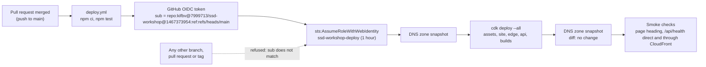
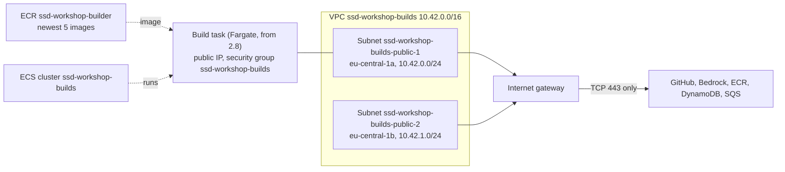

# Infrastructure

AWS CDK app (TypeScript). Nothing is deployed from a session: stacks deploy from `main` only,
through the deploy workflow (see "How deploys work"). `infra/access/access-stack.yaml` is applied by Franck only.

## Stacks

| Stack | Region | What | Synthesizer |
| --- | --- | --- | --- |
| `ssd-workshop-cdk-assets` | eu-central-1 | `ssd-workshop-cdk-assets-<account>` bucket for CDK file assets | inline template (`LegacyStackSynthesizer`) |
| `ssd-workshop-site` | eu-central-1 | private `ssd-workshop-site-<account>` bucket, pages from `platform/web` (BucketDeployment) | `CliCredentialsStackSynthesizer`, assets bucket |
| `ssd-workshop-edge` | us-east-1 | ACM certificate, CloudFront (Origin Access Control `ssd-workshop-site`, managed security headers; `/api/*` to the HTTP API, uncached), A/AAAA records for `workshop.rankly.games` | inline template (`LegacyStackSynthesizer`) |
| `ssd-workshop-api` | eu-central-1 | DynamoDB table `ssd-workshop-data` (on demand, point-in-time recovery, retained), HTTP API `ssd-workshop-api` (`GET /api/health`, `POST /api/sign-in/code`, `POST /api/sign-in/verify`, `GET /api/me`, `POST /api/me/nickname`, `GET /api/participants/{id}`), Lambdas `ssd-workshop-api-health`, `ssd-workshop-api-sign-in-code` (DynamoDB GetItem/PutItem in `EMAIL#*` partitions only, 512 MB, SES sends from `ssd-workshop@rankly.games`), `ssd-workshop-api-sign-in-verify` (codes, participant link, profile, session; 512 MB) and `ssd-workshop-api-participant` (session check, own record, nickname) bundled by esbuild from `platform/api/handlers` | `CliCredentialsStackSynthesizer`, assets bucket |
| `ssd-workshop-builds` | eu-central-1 | build network (VPC `ssd-workshop-builds`, two public subnets, no NAT gateway), security group `ssd-workshop-builds` (HTTPS out only), ECS cluster `ssd-workshop-builds`, ECR repository `ssd-workshop-builder` (newest 5 images, scan on push); see "Build network (ticket 2.1)" | inline template (`LegacyStackSynthesizer`) |

Deploy order: cdk-assets, then site, then edge; api after cdk-assets (it needs the assets
bucket for its Lambda code, and nothing from site or edge); builds on its own (no file assets, nothing
from the other stacks). Nothing is passed between regions: the edge
stack finds the site bucket by its fixed name, and the site bucket policy lets this account's
CloudFront distributions read it.

```sh
npm run synth   # cdk synth, no AWS credentials needed
npm test        # template assertions (infra/lib/app.test.ts)
```

## How deploys work (ticket 0.5)



- `.github/workflows/deploy.yml` runs only on a push to `main`, one run at a time (a running
  deploy is never cancelled; the next one waits).
- It asks GitHub for an OIDC token (`id-token: write`) and exchanges it for the
  `ssd-workshop-deploy` role. The role ARN and region come from `infra/lib/config.ts`
  (`DEPLOY_ROLE_ARN`, `REGION`), printed by `infra/bin/print-deploy-settings.ts`, so moving to
  another AWS account changes only that file. No AWS keys are stored in GitHub and the workflow
  reads no secrets (both checked by `infra/lib/deploy-workflow.test.ts`).
- The role's trust policy (`infra/access/access-stack.yaml`) only accepts the subject of the
  `main` branch, once the ticket 0.3 update is applied (see criterion 2 below). The workflow
  uses no GitHub environment, because a job with `environment:` gets the subject
  `repo:<owner>/<repo>:environment:<name>` instead.
- After `cdk deploy --all`, the smoke step fetches `https://workshop.rankly.games/` and fails
  unless it answers 200 with the `<h1>` text of `platform/web/index.html` (retries for about
  five minutes). Pages are uploaded with `Cache-Control: public, max-age=60`, so a merged text
  change is live within minutes of the merge, well inside 10 minutes.
- Then it reads the `ApiEndpoint` output of `ssd-workshop-api` and fails unless
  `GET /api/health` on that endpoint answers 200 with `{"ok":true}` (ticket 1.1 criterion 3).
- Then it requires `https://workshop.rankly.games/api/health` (through CloudFront) to answer
  200 with `{"ok":true}`, retrying for about five minutes (ticket 1.2 criterion 1).
- Around `cdk deploy`, it saves the rankly.games zone's records (sorted with `jq`, in
  `$RUNNER_TEMP`) before and after, and fails if `diff` finds any change (ticket 1.2
  criterion 3). This check also runs when the deploy itself failed.
- To redeploy the same commit: Actions, Deploy, the run, "Re-run all jobs".

### No AWS keys in GitHub (criterion 3)

```sh
gh secret list --repo kifbv/ssd-workshop
gh variable list --repo kifbv/ssd-workshop
# expect: no AWS_ACCESS_KEY_ID, AWS_SECRET_ACCESS_KEY or other AWS key
```

Or in the browser: Settings, Secrets and variables, Actions (repository and environment
secrets). The workflow itself references no `secrets.` value (tested).

### Other refs cannot assume the role (criterion 2)

Once the ticket 0.3 access stack update is applied, the trust policy's `sub` condition allows
only `repo:kifbv@7999713/ssd-workshop@1467373954:ref:refs/heads/main`; ticket 0.3's test "trusts only GitHub
Actions of kifbv/ssd-workshop on main (no GitHub environments)" checks the template.

Until that update is applied, the live role also trusts `repo:kifbv/ssd-workshop:environment:*`,
that is any GitHub environment. A workflow on any branch can name an environment (GitHub creates
it on first use unless deployment branch rules stop it), so today any branch could assume the
deploy role. The update must therefore be applied before ticket 0.5 is merged (checklist step 1).

To see another ref refused after the update, Franck can run any workflow with `id-token: write`
and `aws-actions/configure-aws-credentials` from another branch (not committed to this
repository), with and without `environment:`: both fail at "Configure AWS credentials" with
`Not authorized to perform sts:AssumeRoleWithWebIdentity`.

### First deploy checklist (Franck)

1. Apply the `ssd-workshop-access` stack update from ticket 0.3 (removes the `environment:*`
   subject). Until then any branch could assume the deploy role (see above).
2. Merge ticket 0.3.
3. Take the zone "before" snapshot (`/tmp/zone-before.json`, below).
4. Merge ticket 0.4, then ticket 0.5. The 0.5 merge is the first run of the deploy workflow
   (merging 0.4 alone deploys nothing, since the workflow does not exist yet).
5. Watch the run in Actions, Deploy. The first run takes 15 to 30 minutes (certificate
   validation and CloudFront creation); "Smoke check the live page" must be green.
6. Run the post-deploy checks below, and `gh secret list` above.

## Checks after the first deploy (ticket 0.4 criteria 1, 2, 4, 5)

Read-only; run them after the deploy workflow has finished on `main`. Set the account and zone
first, copied from `infra/lib/config.ts` (`ACCOUNT`, `HOSTED_ZONE_ID`), the one place that holds
them:

```sh
ACCOUNT=<ACCOUNT from infra/lib/config.ts>
ZONE_ID=<HOSTED_ZONE_ID from infra/lib/config.ts>
```

**Before ticket 0.5 is merged** (that merge is the first deploy), snapshot the zone once for
criterion 5. Franck takes it, or a session with the read-only command below. Write it outside the
repository (here `/tmp/`) so it is never committed; the same goes for `zone-after.json`.

```sh
aws route53 list-resource-record-sets --region us-east-1 \
  --hosted-zone-id "$ZONE_ID" --output json > /tmp/zone-before.json
```

1. HTTPS answers 200 with the site's page (the placeholder until ticket 1.6, the sign-in page since):

   ```sh
   curl -sS -o /dev/null -w '%{http_code} %{ssl_verify_result}\n' https://workshop.rankly.games/
   # expect: 200 0
   curl -sS https://workshop.rankly.games/ | grep -c '<h1>SSD Workshop</h1>'
   # expect: 1
   ```

2. The bucket refuses direct requests (only CloudFront can read it):

   ```sh
   curl -sS -o /dev/null -w '%{http_code}\n' \
     "https://ssd-workshop-site-$ACCOUNT.s3.eu-central-1.amazonaws.com/index.html"
   # expect: 403
   aws s3api get-bucket-policy-status --region eu-central-1 \
     --bucket "ssd-workshop-site-$ACCOUNT" --query PolicyStatus.IsPublic
   # expect: false
   aws s3api get-public-access-block --region eu-central-1 \
     --bucket "ssd-workshop-site-$ACCOUNT"
   # expect: all four settings true
   ```

4. HTTP redirects to HTTPS:

   ```sh
   curl -sS -o /dev/null -w '%{http_code} %{redirect_url}\n' http://workshop.rankly.games/
   # expect: 301 https://workshop.rankly.games/
   ```

5. Only the workshop records changed in the rankly.games zone:

   ```sh
   aws route53 list-resource-record-sets --region us-east-1 \
     --hosted-zone-id "$ZONE_ID" --output json > /tmp/zone-after.json
   diff /tmp/zone-before.json /tmp/zone-after.json
   # expect: only added records named workshop.rankly.games. (A, AAAA)
   # and _<hash>.workshop.rankly.games. (CNAME, certificate validation)
   ```

   The deploy policy also refuses any record outside `workshop.rankly.games` and
   `*.workshop.rankly.games`.

Criterion 3 (tags and boundary) is proven by `npm test` on the synthesized templates.

## Checks after the API deploy (ticket 1.1 criterion 3)

Read-only. The deploy workflow runs the same check after every deploy ("Smoke check the API
health"). The endpoint is the API's own (`https://<api id>.execute-api.eu-central-1.amazonaws.com`);
from ticket 1.2 the API is also reachable at `https://workshop.rankly.games/api/` ("Smoke check
the API through CloudFront"):

```sh
curl -sS -w '\n%{http_code}\n' https://workshop.rankly.games/api/health
# expect: {"ok":true}
#         200
```

The edge stack reaches the API by its id, a constant in `infra/lib/config.ts` (`API_ID`): if
`ssd-workshop-api` is ever recreated, update it.

```sh
ENDPOINT=$(aws cloudformation describe-stacks --region eu-central-1 --stack-name ssd-workshop-api \
  --query "Stacks[0].Outputs[?OutputKey=='ApiEndpoint'].OutputValue" --output text)
curl -sS -w '\n%{http_code}\n' "$ENDPOINT/api/health"
# expect: {"ok":true}
#         200
```

### If the first API deploy fails

The table `ssd-workshop-data` is retained and has deletion protection, so a failed first deploy
of `ssd-workshop-api` rolls back everything except the table, and the next deploy fails with
"already exists". Only while the table is still empty (nothing has written to it yet), Franck
removes it, then re-runs the deploy:

```sh
aws dynamodb scan --region eu-central-1 --table-name ssd-workshop-data --select COUNT
# expect: "Count": 0
aws dynamodb update-table --region eu-central-1 --table-name ssd-workshop-data \
  --no-deletion-protection-enabled
aws dynamodb delete-table --region eu-central-1 --table-name ssd-workshop-data
```

Criteria 1, 2 and 4 (names, tags, role path and boundary, no account-wide CloudWatch role,
Lambda permissions scoped to the API, table settings) are proven by `npm test` on the
synthesized templates (`infra/lib/app.test.ts`). The table, its settings and its tags can also be
read live:

```sh
aws dynamodb describe-table --region eu-central-1 --table-name ssd-workshop-data \
  --query 'Table.[BillingModeSummary.BillingMode,DeletionProtectionEnabled]'
# expect: ["PAY_PER_REQUEST", true]
aws dynamodb describe-continuous-backups --region eu-central-1 --table-name ssd-workshop-data \
  --query 'ContinuousBackupsDescription.PointInTimeRecoveryDescription.PointInTimeRecoveryStatus'
# expect: "ENABLED"
```

## Check after the sign-in code deploy (ticket 1.4 criterion 6)

From Franck's machine, with his own address (it must be on the allow-list, ticket 1.3):

```sh
npm run -s smoke -- signin <address>
# expect: Status: 202, the neutral answer, and an email "Your SSD Workshop sign-in code: ......"
#         from "SSD Workshop" <ssd-workshop@rankly.games> within a minute (check Junk too)
```

If no email arrives, the function's log group `ssd-workshop-api-sign-in-code` has one JSON line per
request with its outcome (`sent`, `not-listed`, `rate-limited`, `conflict`, `failed` with the step and
the AWS error name, or `Timeout` when the work was still running at the 3-second answer time); it never holds the address or the code.

## Check after the sign-in deploy (ticket 1.5)

The first live sign-in proves the new roles' DynamoDB rights (IAM attribute conditions are only
checked by AWS), and a second one proves that a returning person is sent back to their step. From
Franck's machine, with his own address, after `smoke signin` sent a code. The address and the code
go to `curl` on stdin (`--data @-`), never as an argument (which other processes can see), and the
cookie jar is a private temporary file removed at the end:

```sh
JAR=$(mktemp); trap 'rm -f "$JAR"' EXIT
read -r -p 'Address: ' ADDRESS
verify() { # reads a code, sends {"email","code"} on stdin
  read -r -p 'Code: ' CODE
  printf '{"email":"%s","code":"%s"}' "$ADDRESS" "$CODE" |
    curl -sS -c "$JAR" -H 'content-type: application/json' --data @- -w '\n%{http_code}\n' \
      https://workshop.rankly.games/api/sign-in/verify
}
verify
# expect: {"next":"nickname"} (or the step he is at) and 200, after about 3 seconds
curl -sS -b "$JAR" -w '\n%{http_code}\n' https://workshop.rankly.games/api/me
# expect: {"id":"...","nickname":null,"role":"<role from the allow-list>",...} and 200
# A nickname is set once and cannot be changed later: replace Franck with the one you want to keep.
curl -sS -b "$JAR" -H 'content-type: application/json' --data '{"nickname":"Franck"}' \
  -w '\n%{http_code}\n' https://workshop.rankly.games/api/me/nickname
# expect: {...,"nickname":"Franck","step":"clarify"} and 200 (409 "already-set" if he has one)
curl -sS -w '\n%{http_code}\n' https://workshop.rankly.games/api/me
# expect: {"message":"Please sign in."} and 401
# now ask for a second code (`npm run -s smoke -- signin <address>` in another terminal), then:
verify
# expect: {"next":"clarify"} and 200 (the returning sign-in keeps his step)
rm -f "$JAR"; unset ADDRESS CODE
```

On a refusal, the log groups `ssd-workshop-api-sign-in-verify` and `ssd-workshop-api-participant` have
one JSON line per request with its outcome (and the AWS error name, e.g. `AccessDeniedException`, on a
failure); they never hold the address, the code, the token or the nickname.

## Check after the sign-in pages deploy (ticket 1.6)

The pages carry the Content-Security-Policy of the `ssd-workshop-pages-v1` headers policy, and
`/api/*` keeps the managed security headers:

```sh
curl -sSI https://workshop.rankly.games/ | grep -i -E '^(content-security-policy|strict-transport-security|x-frame-options|x-content-type-options|referrer-policy):'
# expect: content-security-policy: default-src 'self'; script-src 'self'; style-src 'self'; img-src 'self' data:;
#           connect-src 'self'; frame-ancestors 'none'; base-uri 'self'; form-action 'self'; object-src 'none'
#         strict-transport-security: max-age=31536000, x-frame-options: DENY, x-content-type-options: nosniff,
#         referrer-policy: strict-origin-when-cross-origin
curl -sS -o /dev/null -w '%{http_code} %{content_type}\n' https://workshop.rankly.games/app.js
# expect: 200 text/javascript (or application/javascript)
curl -sSI https://workshop.rankly.games/api/health | grep -i -c '^content-security-policy:'
# expect: 0 (the API keeps the managed SecurityHeadersPolicy)
```

Then open https://workshop.rankly.games/ on a phone: the email screen shows, a code arrives, the code
screen leads to the nickname screen (first sign-in) or straight to step 1, and the browser console shows
no "Refused to ..." message.

The headers policy cannot be changed in place (the deploy rights create custom policies but cannot
update or delete them): to change a header, bump `PAGES_HEADERS_POLICY_VERSION` in `infra/lib/config.ts`
(new name and new logical id, so CloudFormation creates a replacement); the old one stays behind, unused,
until Franck deletes it.

If the first deploy of this policy fails and rolls back, the retained `ssd-workshop-pages-v1` stays behind
and the retry fails on its name: delete it in the CloudFront console (Policies, Response headers) or bump
`PAGES_HEADERS_POLICY_VERSION`, then re-run the deploy.

## Check after the conversation deploy (ticket 1.7)

The first live message proves the new roles' rights (DynamoDB attribute conditions, the queue, the event
source mapping and Bedrock through the EU profile are only checked by AWS). From Franck's machine, signed
in as in the 1.5 check (same `JAR` cookie jar, before it is removed), until ticket 1.8's page exists:

```sh
curl -sS -b "$JAR" -H 'content-type: application/json' --data '{"text":"I would like a habit tracker for my runs"}' \
  -w '\n%{http_code}\n' https://workshop.rankly.games/api/conversation/messages
# expect: {"id":"2026-...Z-<16 hex>"} and 202, at once
ID=<the id above>
curl -sS -b "$JAR" -w '\n%{http_code}\n' "https://workshop.rankly.games/api/conversation/messages/$ID"
# expect: {"id":"...","status":"pending"} and 200 at first; within about 30 seconds
#         {"id":"...","status":"done","reply":"<a short question about the idea>"} and 200
curl -sS -b "$JAR" -w '\n%{http_code}\n' "https://workshop.rankly.games/api/conversation/messages/2026-01-01T00:00:00.000Z-0000000000000000"
# expect: {"message":"Not found."} and 404
```

Then, with Franck's own AWS credentials, the guardrail eval against the live model (about $0.05):

```sh
npm run eval -- guardrails
# expect: one PASS line per example, "Guardrails: 20/20 passed", exit code 0
npm run flags -- list
# expect: "Waiting for a decision: 0" (or each flagged participant's nickname, message and the guardrail's reason)
```

A flagged message (e.g. "an app that tells people which medicine to take") shows `"status":"flagged"`;
`npm run flags -- approve <nickname>` lets it through to the AI, `npm run flags -- reject <nickname>`
declines it politely; either way the participant can write again.

On a failure, the log groups `ssd-workshop-api-conversation` and `ssd-workshop-api-ai-worker` have one
JSON line per request or job with its outcome and the AWS error name (e.g. `AccessDeniedException`); they
never hold the message, the prompt, the reply, an id or the nickname. A job the worker throws back
(`"outcome":"error"`, e.g. after the final write failed 3 times) is delivered again by SQS about 5.5 minutes
later (visibility timeout 330 s); one that failed three times lands in `ssd-workshop-ai-messages-dlq`
(14 days), and the participant sees the message as failed after 20 minutes and can send it again. At most
5 workers run at once; more messages wait in the queue.

## Check after the step 1 deploy (ticket 1.8)

The first live page load proves the conversation function's new `dynamodb:Query` right and the first
Write my spec its update of `step` (both only checked by AWS). On `https://workshop.rankly.games`, signed in
at step 1 on a phone or a narrow window:

1. Send an idea (e.g. "a tracker for my runs"). A typing indicator shows and "Safety check" and "Claude on
   Bedrock" are highlighted in the Behind the scenes box; within about 30 seconds a reply with 3 to 5
   numbered questions appears and the indicator goes away.
2. Reload the page: the conversation is shown again. **Write my spec** shows under it after the first reply.
3. Answer the questions until the AI says it has enough: **Write my spec** turns into the main button.
4. Press **Write my spec**: the page shows "Step 2: Spec"; a reload stays there.

Or with `curl`, signed in as in the 1.5 check (same `JAR`):

```sh
curl -sS -b "$JAR" -w '\n%{http_code}\n' https://workshop.rankly.games/api/conversation
# expect: {"step":"clarify","state":"open","messages":[...]} and 200 (the caller's own messages only)
curl -sS -b "$JAR" -H 'content-type: application/json' --data '{"step":"spec"}' \
  -w '\n%{http_code}\n' https://workshop.rankly.games/api/conversation/step
# expect: {"step":"spec"} and 200 after at least one answered message; 409 "too-early" before
```

With Franck's own AWS credentials, the step 1 eval against the live model (about $0.02):

```sh
npm run eval -- clarify
# expect: one PASS line per example with the reply below it, "Clarify: 5/5 passed", exit code 0
```

On a failure, `ssd-workshop-api-conversation`'s log has `"route":"history"` or `"route":"step"` lines with the
outcome and the AWS error name (e.g. `AccessDeniedException`).

## Check after the step 2 deploy (ticket 1.9)

The first live spec proves the AI worker's new attribute rights (`specVersion`, `messageId`,
`latestSpecVersion`) and the first approval the conversation function's (`approvedSpecVersion`,
`approvedAt`); both are only checked by AWS. On `https://workshop.rankly.games`, signed in at step 1 with an
answered idea, once on a laptop and once on a phone:

1. Press **Write my spec**. "Step 2: Spec" shows "The AI is writing your spec…"; within about a minute the
   spec appears: "Version 1", the title, the diagram drawn as a picture (not text), then "What it does",
   "Screens" and "Data it keeps". The browser console shows no Content-Security-Policy error.
2. Ask a question ("What does the cylinder mean?"): an answer appears and the spec stays "Version 1".
3. Ask for a change ("Add a screen with my longest run"): the spec becomes "Version 2" with the change.
4. Press **Approve spec**: "Spec approved. Next comes the build…" shows, the message box and the button go
   away, and the spec reads "Version 2 (approved)"; a reload shows the same.

Or with `curl`, signed in as in the 1.5 check (same `JAR`), after step 1 above:

```sh
curl -sS -b "$JAR" -w '\n%{http_code}\n' https://workshop.rankly.games/api/conversation/spec
# expect: {"version":1,"text":"# ...","createdAt":"...","approved":false} and 200 (404 before the first version)
curl -sS -b "$JAR" -w '\n%{http_code}\n' 'https://workshop.rankly.games/api/conversation/spec?version=99'
# expect: {"message":"Not found."} and 404
curl -sS -b "$JAR" -H 'content-type: application/json' --data '{"version":1}' \
  -w '\n%{http_code}\n' https://workshop.rankly.games/api/conversation/spec/approve
# expect: {"step":"approved","version":1} and 200 (409 "stale" when a newer version exists)
curl -sS -b "$JAR" -H 'content-type: application/json' --data '{"text":"Add a monthly total"}' \
  -w '\n%{http_code}\n' https://workshop.rankly.games/api/conversation/messages
# expect after the approval: {"message":"Your spec is approved, ...","reason":"approved"} and 409
```

With Franck's own AWS credentials, the step 2 eval against the live model (about $0.05; it builds the pages
and draws each diagram with Mermaid in Playwright's Chromium, so `npx playwright install chromium` once on a
new machine):

```sh
npm run eval -- spec
# expect: one PASS line per example with the answer below it, "Spec: 6/6 passed", exit code 0
```

On a failure, `ssd-workshop-api-ai-worker`'s log has `"outcome":"failed"` lines with the error name
(`MalformedSpec` or `MissingSpec` for a spec of the wrong shape, `AccessDeniedException` for a missing right),
and `ssd-workshop-api-conversation`'s `"route":"spec"` or `"route":"approve"` lines.

## Build network (ticket 2.1)



Build tasks get a public IP in `RunTask` (`assignPublicIp`), which replaces a NAT gateway (about $40 a
month). The security group lets only TCP 443 out and nothing in, so a task can be reached from nowhere.
No VPC endpoint, no flow logs, no Container Insights; the VPC's default security group is left as AWS
creates it (untagged, so the deploy rights cannot change it) and nothing uses it.

After the deploy (criterion 4), read-only:

```sh
aws ec2 describe-subnets --region eu-central-1 --filters Name=tag:project,Values=ssd-workshop \
  --query 'Subnets[].[SubnetId,AvailabilityZone,CidrBlock,Tags[?Key==`Name`]|[0].Value]' --output table
# expect: exactly two rows, e.g.
#   subnet-0abc...  eu-central-1a  10.42.0.0/24  ssd-workshop-builds-public-1
#   subnet-0def...  eu-central-1b  10.42.1.0/24  ssd-workshop-builds-public-2
```

Then the two subnet ids go into `infra/lib/config.ts` as constants (where the comment after
`BUILDER_IMAGES_KEPT` says) for ticket 2.2, which pins `ecs:RunTask` to them. If the stack is ever
recreated, the subnets get new ids: update the constants and the access stack.

## Start a participant's conversation over

For tests and dry runs, with Franck's own AWS credentials (it reads and deletes items of one participant
in `ssd-workshop-data`):

```sh
npm run conversation -- reset <nickname>
# expect: "<nickname> is at step ..., with N messages and replies and M spec versions." and "Nothing changed. ..."
npm run conversation -- reset <nickname> --yes
# expect: "Reset <nickname>: deleted ...; back at step 1 (Clarify). AI usage totals kept."
```

The participant's messages, the AI's replies, every spec version (an approved one included) and the
conversation state are deleted, and their step goes back to Clarify; their profile, nickname, sign-in and
AI usage totals stay. A reload of their page shows an empty step 1. Errors print only the AWS error's name, never a key or a text. The command refuses while the AI is
answering their last message (try again a minute later; after a worker crash, up to 20 minutes); a message waiting for a facilitator is cleared
too. If it stops part way (an AWS error), run it again: the second run finishes.
