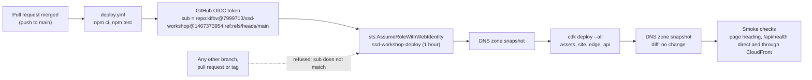

# Infrastructure

AWS CDK app (TypeScript). Nothing is deployed from a session: stacks deploy from `main` only,
through the deploy workflow (see "How deploys work"). `infra/access/access-stack.yaml` is applied by Franck only.

## Stacks

| Stack | Region | What | Synthesizer |
| --- | --- | --- | --- |
| `ssd-workshop-cdk-assets` | eu-central-1 | `ssd-workshop-cdk-assets-<account>` bucket for CDK file assets | inline template (`LegacyStackSynthesizer`) |
| `ssd-workshop-site` | eu-central-1 | private `ssd-workshop-site-<account>` bucket, pages from `platform/web` (BucketDeployment) | `CliCredentialsStackSynthesizer`, assets bucket |
| `ssd-workshop-edge` | us-east-1 | ACM certificate, CloudFront (Origin Access Control `ssd-workshop-site`, managed security headers; `/api/*` to the HTTP API, uncached), A/AAAA records for `workshop.rankly.games` | inline template (`LegacyStackSynthesizer`) |
| `ssd-workshop-api` | eu-central-1 | DynamoDB table `ssd-workshop-data` (on demand, point-in-time recovery, retained), HTTP API `ssd-workshop-api` (`GET /api/health`), Lambda `ssd-workshop-api-health` bundled by esbuild from `platform/api/handlers` | `CliCredentialsStackSynthesizer`, assets bucket |

Deploy order: cdk-assets, then site, then edge; api after cdk-assets (it needs the assets
bucket for its Lambda code, and nothing from site or edge). Nothing is passed between regions: the edge
stack finds the site bucket by its fixed name, and the site bucket policy lets this account's
CloudFront distributions read it.

```sh
npm run synth   # cdk synth, no AWS credentials needed
npm test        # template assertions (infra/lib/app.test.ts)
```

## How deploys work (ticket 0.5)



- `.github/workflows/deploy.yml` runs only on a push to `main`, one run at a time (a running
  deploy is never cancelled; the next one waits).
- It asks GitHub for an OIDC token (`id-token: write`) and exchanges it for the
  `ssd-workshop-deploy` role. The role ARN and region come from `infra/lib/config.ts`
  (`DEPLOY_ROLE_ARN`, `REGION`), printed by `infra/bin/print-deploy-settings.ts`, so moving to
  another AWS account changes only that file. No AWS keys are stored in GitHub and the workflow
  reads no secrets (both checked by `infra/lib/deploy-workflow.test.ts`).
- The role's trust policy (`infra/access/access-stack.yaml`) only accepts the subject of the
  `main` branch, once the ticket 0.3 update is applied (see criterion 2 below). The workflow
  uses no GitHub environment, because a job with `environment:` gets the subject
  `repo:<owner>/<repo>:environment:<name>` instead.
- After `cdk deploy --all`, the smoke step fetches `https://workshop.rankly.games/` and fails
  unless it answers 200 with the `<h1>` text of `platform/web/index.html` (retries for about
  five minutes). Pages are uploaded with `Cache-Control: public, max-age=60`, so a merged text
  change is live within minutes of the merge, well inside 10 minutes.
- Then it reads the `ApiEndpoint` output of `ssd-workshop-api` and fails unless
  `GET /api/health` on that endpoint answers 200 with `{"ok":true}` (ticket 1.1 criterion 3).
- Then it requires `https://workshop.rankly.games/api/health` (through CloudFront) to answer
  200 with `{"ok":true}`, retrying for about five minutes (ticket 1.2 criterion 1).
- Around `cdk deploy`, it saves the rankly.games zone's records (sorted with `jq`, in
  `$RUNNER_TEMP`) before and after, and fails if `diff` finds any change (ticket 1.2
  criterion 3). This check also runs when the deploy itself failed.
- To redeploy the same commit: Actions, Deploy, the run, "Re-run all jobs".

### No AWS keys in GitHub (criterion 3)

```sh
gh secret list --repo kifbv/ssd-workshop
gh variable list --repo kifbv/ssd-workshop
# expect: no AWS_ACCESS_KEY_ID, AWS_SECRET_ACCESS_KEY or other AWS key
```

Or in the browser: Settings, Secrets and variables, Actions (repository and environment
secrets). The workflow itself references no `secrets.` value (tested).

### Other refs cannot assume the role (criterion 2)

Once the ticket 0.3 access stack update is applied, the trust policy's `sub` condition allows
only `repo:kifbv@7999713/ssd-workshop@1467373954:ref:refs/heads/main`; ticket 0.3's test "trusts only GitHub
Actions of kifbv/ssd-workshop on main (no GitHub environments)" checks the template.

Until that update is applied, the live role also trusts `repo:kifbv/ssd-workshop:environment:*`,
that is any GitHub environment. A workflow on any branch can name an environment (GitHub creates
it on first use unless deployment branch rules stop it), so today any branch could assume the
deploy role. The update must therefore be applied before ticket 0.5 is merged (checklist step 1).

To see another ref refused after the update, Franck can run any workflow with `id-token: write`
and `aws-actions/configure-aws-credentials` from another branch (not committed to this
repository), with and without `environment:`: both fail at "Configure AWS credentials" with
`Not authorized to perform sts:AssumeRoleWithWebIdentity`.

### First deploy checklist (Franck)

1. Apply the `ssd-workshop-access` stack update from ticket 0.3 (removes the `environment:*`
   subject). Until then any branch could assume the deploy role (see above).
2. Merge ticket 0.3.
3. Take the zone "before" snapshot (`/tmp/zone-before.json`, below).
4. Merge ticket 0.4, then ticket 0.5. The 0.5 merge is the first run of the deploy workflow
   (merging 0.4 alone deploys nothing, since the workflow does not exist yet).
5. Watch the run in Actions, Deploy. The first run takes 15 to 30 minutes (certificate
   validation and CloudFront creation); "Smoke check the live page" must be green.
6. Run the post-deploy checks below, and `gh secret list` above.

## Checks after the first deploy (ticket 0.4 criteria 1, 2, 4, 5)

Read-only; run them after the deploy workflow has finished on `main`. Set the account and zone
first, copied from `infra/lib/config.ts` (`ACCOUNT`, `HOSTED_ZONE_ID`), the one place that holds
them:

```sh
ACCOUNT=<ACCOUNT from infra/lib/config.ts>
ZONE_ID=<HOSTED_ZONE_ID from infra/lib/config.ts>
```

**Before ticket 0.5 is merged** (that merge is the first deploy), snapshot the zone once for
criterion 5. Franck takes it, or a session with the read-only command below. Write it outside the
repository (here `/tmp/`) so it is never committed; the same goes for `zone-after.json`.

```sh
aws route53 list-resource-record-sets --region us-east-1 \
  --hosted-zone-id "$ZONE_ID" --output json > /tmp/zone-before.json
```

1. HTTPS answers 200 with the placeholder page:

   ```sh
   curl -sS -o /dev/null -w '%{http_code} %{ssl_verify_result}\n' https://workshop.rankly.games/
   # expect: 200 0
   curl -sS https://workshop.rankly.games/ | grep -c 'SSD Workshop, coming soon'
   # expect: 2 or more (title and heading)
   ```

2. The bucket refuses direct requests (only CloudFront can read it):

   ```sh
   curl -sS -o /dev/null -w '%{http_code}\n' \
     "https://ssd-workshop-site-$ACCOUNT.s3.eu-central-1.amazonaws.com/index.html"
   # expect: 403
   aws s3api get-bucket-policy-status --region eu-central-1 \
     --bucket "ssd-workshop-site-$ACCOUNT" --query PolicyStatus.IsPublic
   # expect: false
   aws s3api get-public-access-block --region eu-central-1 \
     --bucket "ssd-workshop-site-$ACCOUNT"
   # expect: all four settings true
   ```

4. HTTP redirects to HTTPS:

   ```sh
   curl -sS -o /dev/null -w '%{http_code} %{redirect_url}\n' http://workshop.rankly.games/
   # expect: 301 https://workshop.rankly.games/
   ```

5. Only the workshop records changed in the rankly.games zone:

   ```sh
   aws route53 list-resource-record-sets --region us-east-1 \
     --hosted-zone-id "$ZONE_ID" --output json > /tmp/zone-after.json
   diff /tmp/zone-before.json /tmp/zone-after.json
   # expect: only added records named workshop.rankly.games. (A, AAAA)
   # and _<hash>.workshop.rankly.games. (CNAME, certificate validation)
   ```

   The deploy policy also refuses any record outside `workshop.rankly.games` and
   `*.workshop.rankly.games`.

Criterion 3 (tags and boundary) is proven by `npm test` on the synthesized templates.

## Checks after the API deploy (ticket 1.1 criterion 3)

Read-only. The deploy workflow runs the same check after every deploy ("Smoke check the API
health"). The endpoint is the API's own (`https://<api id>.execute-api.eu-central-1.amazonaws.com`);
from ticket 1.2 the API is also reachable at `https://workshop.rankly.games/api/` ("Smoke check
the API through CloudFront"):

```sh
curl -sS -w '\n%{http_code}\n' https://workshop.rankly.games/api/health
# expect: {"ok":true}
#         200
```

The edge stack reaches the API by its id, a constant in `infra/lib/config.ts` (`API_ID`): if
`ssd-workshop-api` is ever recreated, update it.

```sh
ENDPOINT=$(aws cloudformation describe-stacks --region eu-central-1 --stack-name ssd-workshop-api \
  --query "Stacks[0].Outputs[?OutputKey=='ApiEndpoint'].OutputValue" --output text)
curl -sS -w '\n%{http_code}\n' "$ENDPOINT/api/health"
# expect: {"ok":true}
#         200
```

### If the first API deploy fails

The table `ssd-workshop-data` is retained and has deletion protection, so a failed first deploy
of `ssd-workshop-api` rolls back everything except the table, and the next deploy fails with
"already exists". Only while the table is still empty (nothing has written to it yet), Franck
removes it, then re-runs the deploy:

```sh
aws dynamodb scan --region eu-central-1 --table-name ssd-workshop-data --select COUNT
# expect: "Count": 0
aws dynamodb update-table --region eu-central-1 --table-name ssd-workshop-data \
  --no-deletion-protection-enabled
aws dynamodb delete-table --region eu-central-1 --table-name ssd-workshop-data
```

Criteria 1, 2 and 4 (names, tags, role path and boundary, no account-wide CloudWatch role,
Lambda permissions scoped to the API, table settings) are proven by `npm test` on the
synthesized templates (`infra/lib/app.test.ts`). The table, its settings and its tags can also be
read live:

```sh
aws dynamodb describe-table --region eu-central-1 --table-name ssd-workshop-data \
  --query 'Table.[BillingModeSummary.BillingMode,DeletionProtectionEnabled]'
# expect: ["PAY_PER_REQUEST", true]
aws dynamodb describe-continuous-backups --region eu-central-1 --table-name ssd-workshop-data \
  --query 'ContinuousBackupsDescription.PointInTimeRecoveryDescription.PointInTimeRecoveryStatus'
# expect: "ENABLED"
```
