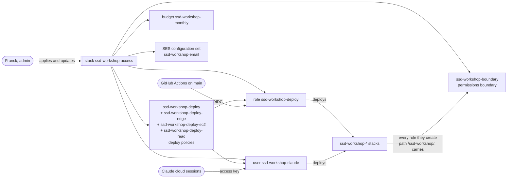
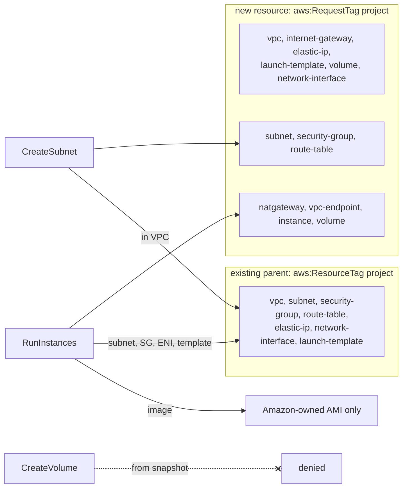

# Access stack

`access-stack.yaml` gives the workshop the least AWS access it needs in the rankly.games account,
which it shares with other projects (rankly.games, www, play, letters). Franck applies and
updates it by hand in the CloudFormation console. CI and Claude sessions never apply it, and the
deploy rights it grants cannot change it, the deploy role, the Claude user or the five managed
policies (explicit denies `ProtectThisStack` and `ProtectAccessIdentities`; every role the deploy
rights may touch lives under the IAM path `/ssd-workshop/`, which the deploy role, on path `/`, is
not). The deploy principals are the deploy role (GitHub Actions on `main`) and the user
`ssd-workshop-claude`. Participants get no AWS keys of their own, but code they write for the
advanced track runs under workshop roles (ECS tasks, k3s nodes) and can use those roles'
credentials, within the boundary (accepted risk 10). What IAM cannot close is listed under
[Accepted risks](#accepted-risks).



## Apply it (first time)

1. Sign in to the AWS console as an admin, region **eu-central-1 (Frankfurt)**.
2. CloudFormation, Create stack, With new resources, Upload a template file:
   `infra/access/access-stack.yaml` from `main`.
3. Stack name: **`ssd-workshop-access`**. Use exactly this name: the self-protection deny is
   written for it.
4. Parameters:

   | Parameter | Value |
   | --- | --- |
   | `HostedZoneId` | the Route53 hosted zone of `rankly.games` |
   | `CreateGitHubOidcProvider` | `yes`, or `no` if IAM already lists the provider `token.actions.githubusercontent.com` |
   | `GitHubRepo` | keep `kifbv@7999713/ssd-workshop@1467373954` (the ID form GitHub sends for this repository) |
   | `BudgetEmail` | the address that should get budget alerts |
   | `MonthlyBudgetUsd` | keep `100` |

5. Tick "I acknowledge that AWS CloudFormation might create IAM resources with custom names",
   then Submit and wait for `CREATE_COMPLETE`.
6. IAM, Users, `ssd-workshop-claude`, Security credentials, Create access key (use case: "Third-party
   service"). Store the key id and secret as **network secrets of the project's cloud environment**
   (Project settings, Cloud environment, the gear beside the environment, Network secrets). Do not
   paste them into a chat. New sessions pick them up.
7. Deactivate the admin access keys used so far (IAM, your user, Security credentials, Deactivate),
   so the only long-lived key the workshop uses is the least-privilege one.
8. Nothing to set up in GitHub: the role trusts only the OIDC subject
   `repo:kifbv@7999713/ssd-workshop@1467373954:ref:refs/heads/main` (GitHub sends this repository's
   subject in the ID form `owner@ownerId/repo@repoId`; the plain `kifbv/ssd-workshop` form is
   refused, as the first deploy showed). The deploy workflow (ticket 0.5) must not use a
   GitHub environment, because a job with an environment gets the subject
   `repo:kifbv@7999713/ssd-workshop@1467373954:environment:<name>`, which the role refuses.

## Update it

1. A Claude session hits `AccessDenied` and reports the missing permission (action and resource).
2. Claude changes `access-stack.yaml` in a pull request, keeping the new right scoped to
   `ssd-workshop-*` names, the `project=ssd-workshop` tag or `workshop.rankly.games`, and
   explains it in the table below. The tests in `access-stack.test.ts` fail if a new write is not
   scoped or listed as an exception.
3. Franck reviews and merges.
4. Franck opens the `ssd-workshop-access` stack in the console, Update, Replace existing template,
   uploads the merged `access-stack.yaml`, keeps the parameters, and submits.

## Why each statement exists

**`ssd-workshop-boundary`** (the ceiling for every role the workshop stacks create):

| Sid | Why |
| --- | --- |
| `WorkshopData` | Lambda, ECS and EC2 roles read and write only `ssd-workshop-*` tables, queues, secrets and parameters, and the log groups `ssd-workshop-*`, `/aws/lambda/ssd-workshop-*` and `/ecs/ssd-workshop-*`. |
| `GitHubKeyForTheLauncherOnly` | Deny `GetSecretValue` on the GitHub App's key (`secret:ssd-workshop-github-*`, ticket 2.6) to every workload role but `ssd-workshop-builds-launcher` (with and without its path), whatever the role's own policy says: a session cannot read the key through a role and function it creates. |
| `WorkshopBuckets` | `ssd-workshop-*` buckets, only in this account (`aws:ResourceAccount`: bucket names are global, so someone else could own a bucket with a matching name). |
| `Bedrock` | The platform calls Claude on Bedrock (Anthropic models and `eu.anthropic.*` inference profiles only). |
| `SendCodes` | Sign-in codes go out by SES, only through the identities `ssd-workshop@rankly.games` and `rankly.games` (SES authorizes the domain identity when the address itself is not verified) and only from `ssd-workshop@rankly.games` (`ses:FromAddress`), naming the configuration set `ssd-workshop-email` (created by this stack) so SES never falls back to the domain's default set `rankly-dev`. |
| `RunBuilds` | Start build tasks only from `ssd-workshop-*` task definitions on `ssd-workshop-*` clusters (`ecs:cluster`), and only as the build launcher role `role/ssd-workshop/ssd-workshop-builds-launcher` (`aws:PrincipalArn`, ticket 2.9): a task role (participant code) or any other workload role cannot start tasks, even if a CDK policy grants it. |
| `TagBuildsOnStart` | `ecs:TagResource` on `task/ssd-workshop-*/*`, which ECS also checks when `RunTask` passes tags or `propagateTags`; only as part of `RunTask` (`ecs:CreateAction`) and only for the launcher role. |
| `WatchBuilds` | Stop and describe tasks on `ssd-workshop-*` clusters. |
| `PullImages` | Pull images only from `ssd-workshop-*` repositories. |
| `InvalidateWorkshopSite` | Invalidate only distributions tagged `project=ssd-workshop`. |
| `AccountWideServiceCalls` | ECR login token and X-Ray traces; neither has a resource scope. |
| `WorkshopMetrics` | Metrics only in the CloudWatch namespace `ssd-workshop`. |
| `PassWorkshopRoles` | A role may hand only `/ssd-workshop/` roles, and only to ECS tasks. |
| `ServicesInWorkshopSubnetsOnly` | Deny, as in the deploy policies: ECS services (Express Gateway services included) only in the two workshop subnets. The boundary grants no service rights today; the deny keeps it so if it ever does. |
| `NoStartTask` | Deny `ecs:StartTask` (tasks on EC2 container instances), as in the deploy policies. |
| `K3sNodeHeartbeat` | Advanced-track k3s nodes report to Systems Manager, only for instances tagged with the project. |
| `K3sNodeChannels` | Session Manager and Run Command channels of the calling instance, and reading instance tags. |
| `NoExternalSharing` | Deny, for workload roles too: the same sharing and egress actions as the deploy policies' `NoExternalSharing`, except `s3:PutBucketNotification`, which CDK's bucket notifications handler (a workshop role) needs (accepted risk 12). |

**`ssd-workshop-deploy`** (deploy rights, part 1: stacks, named resources, IAM, and the denies that guard them):

| Sid | Why |
| --- | --- |
| `WorkshopStacks` | Create, update, delete and read `ssd-workshop-*` stacks (change sets authorize against the stack). CDK names the stack when it calls `DescribeStacks`. |
| `NoResourceImport` | Deny: CloudFormation change sets that import existing resources (`cloudformation:ImportResourceTypes`), so a workshop stack cannot adopt, tag or change another project's resource. |
| `ProtectThisStack` | Deny: every non-read CloudFormation action on `ssd-workshop-access` (update, delete, change sets, cancel, rollback, stack policy), so the deploy rights cannot raise themselves. |
| `NamedWorkshopResources` | Full control of the workshop's own DynamoDB, Lambda, logs (`ssd-workshop-*`, `/aws/lambda/ssd-workshop-*`, `/ecs/ssd-workshop-*`), SQS, ECR, Secrets Manager, SSM, EventBridge, Scheduler, Step Functions, SNS and ECS resources, by `ssd-workshop-*` name. ECS service and task ARNs hold the cluster name, so they are limited to `ssd-workshop-*` clusters. |
| `WorkshopBuckets` | Full control of `ssd-workshop-*` buckets in this account only (`aws:ResourceAccount`). |
| `ActionsWithoutResourceScope` | Actions AWS cannot limit by name or tag: ECR login token, task definition deregistration and reads (`DescribeTaskDefinition`, which CloudFormation calls with the caller's rights for every task definition it manages; accepted risk 15), vended log deliveries. Each one is listed with its reason in the test. |
| `WorkshopEventSourceMappings` | Create, change and delete event source mappings only for `ssd-workshop-*` functions (`lambda:FunctionArn`). |
| `TagEventSourceMappings` | CloudFormation tags the mappings it creates; mapping ids are generated, and a tag on a mapping grants nothing. |
| `WorkshopRolesWithBoundaryOnly` | Create roles on the path `/ssd-workshop/` and change their policies only when the role carries `ssd-workshop-boundary`. |
| `WorkshopRolesHousekeeping` | Delete, tag, update (also the trust policy, which CloudFormation changes in place) and wire instance profiles for roles and instance profiles on `/ssd-workshop/`. |
| `PassWorkshopRolesToWorkshopServices` | Hand `/ssd-workshop/` roles only to Lambda, ECS tasks, EC2, Step Functions, EventBridge Scheduler and EventBridge (`iam:PassedToService`). |
| `ProtectAccessIdentities` | Deny: every IAM action except `Get*`/`List*` on the role `ssd-workshop-deploy`, the user `ssd-workshop-claude` and the five managed policies. |
| `WorkshopServiceLinkedRoles` | Let ECS create its AWS-defined service-linked role the first time it is used (`iam:AWSServiceName` `ecs.amazonaws.com` only). |
| `NoBoundaryEscape` | Deny removing or replacing a boundary, creating users or access keys, and rewriting managed policies. |
| `NoSelfAssume` | Deny `sts:AssumeRole`, `TagSession` and `SetSourceIdentity`: a role elsewhere in the account whose trust policy names the account or these principals cannot be assumed. |
| `TasksOnWorkshopClustersOnly` | Deny `ecs:RunTask` unless `ecs:cluster` is an `ssd-workshop-*` cluster: a workshop task definition on another project's cluster could read that cluster's container-instance role. |
| `ServicesInWorkshopSubnetsOnly` | Deny every action that carries `ecs:subnet` (`CreateService`/`UpdateService` and `CreateExpressGatewayService`/`UpdateExpressGatewayService`; never `RunTask`/`StartTask`) when any subnet is not one of the two workshop subnets (`BUILDS_SUBNET_IDS` in `infra/lib/config.ts`; a test keeps them in step, and checks it against the list copied from the Service Authorization Reference on 2026-11-24 (`ECS_SUBNET_ACTIONS`)). `ForAnyValue`: an update that leaves the network alone carries no subnet and passes. |
| `NoStartTask` | Deny `ecs:StartTask` everywhere: it places tasks on EC2 container instances, which the workshop never uses, and like `RunTask` it has no subnet key. |
| `RulesOnWorkshopSourcesOnly` | Deny `events:PutRule` when the event pattern names a source other than `ssd-workshop.*` (`events:source`): a rule on the default bus could otherwise match other projects' events (ECS task state changes carry environment variables). |
| `RulesNeedASource` | Deny `events:PutRule` without a source (`Null` `events:source`): a pattern that filters only on `detail` or `account` matches every project's events. Schedules use EventBridge Scheduler, not schedule rules. |

**`ssd-workshop-deploy-edge`** (deploy rights, part 2: CloudFront, certificates, API Gateway, DNS, Bedrock, SES, and the denies that keep workshop data in the account):

| Sid | Why |
| --- | --- |
| `CloudFrontTaggedCreate` | Create CloudFront distributions only with the `project=ssd-workshop` tag. |
| `TagOnCreateThroughCloudFormation` | `cloudfront:TagResource` and `acm:AddTagsToCertificate`, which AWS also checks when CloudFormation creates a distribution or requests a certificate with tags. Only with the project tag in the request, no project tag on the resource yet, and the call made through CloudFormation (`aws:CalledVia`), whose resource import is denied (`NoResourceImport`): so an existing resource of another project cannot be tagged and then taken over. |
| `CloudFrontTaggedChange` | Change, delete, invalidate, tag or untag only distributions already tagged `project=ssd-workshop` (a tag right with only a request tag would let the role tag, then take over, any distribution). |
| `CloudFrontUntaggableParts` | Origin access controls and cache, origin-request and response-headers policies have generated ids and no tags: create and read only, so the rankly.games distributions' existing ones cannot be changed or deleted. |
| `CloudFrontWorkshopFunctions` | CloudFront functions named `ssd-workshop-*`. |
| `CertificatesTagged` | Request ACM certificates only with the project tag and only for `workshop.rankly.games` and names under it (`acm:DomainNames`, with a `Null` guard because `ForAllValues` is true when the key is missing). |
| `CertificatesThroughCloudFormation` | The same names without a request tag, only through CloudFormation (`aws:CalledVia`): CloudFormation requests the certificate without tags and then tags it (`TagOnCreateThroughCloudFormation`). |
| `CertificatesChange` | Change, delete, tag or untag only certificates already tagged with the project. |
| `ApiGatewayTaggedCreate` | Create REST and HTTP APIs (`POST /restapis`, `POST /apis`) only with the project tag. |
| `ApiGatewayTaggedChange` | Write anything under an API or change and delete it only when the API is tagged with the project; child resources inherit the API's tag for authorization. |
| `ApiGatewayTagOnCreateThroughCloudFormation` | `POST`/`PUT` on the API Gateway tags endpoint (`/tags/*`), which CloudFormation's API Gateway v2 handler calls when it creates an API or stage with tags. Only with the project tag in the request and only through CloudFormation (`aws:CalledVia`), whose resource import is denied (`NoResourceImport`), so only APIs a workshop stack created itself. The tags resource has no resource-tag key, so there is no `Null` guard as in `TagOnCreateThroughCloudFormation`. |
| `ApiGatewayTagStagesOnCreate` | `apigateway:TagResource` on `/apis/*`, which AWS also checks when CloudFormation creates a tagged stage (not yet in the Service Authorization Reference). Only with the project tag in the request, on an API already tagged with the project (stages inherit it), and only through CloudFormation. |
| `DnsOnlyWorkshopSubdomain` | Change records in rankly.games only for `workshop.rankly.games` and names under it, only `A`, `AAAA` and `CNAME` (alias and certificate validation), with a `Null` guard because `ForAllValues` is true when a key is missing. |
| `Bedrock` | Claude sessions test the platform's Bedrock calls. |
| `SesForTesting` | Claude sessions test code emails, only through the identities `ssd-workshop@rankly.games` and `rankly.games`, only from `ssd-workshop@rankly.games`. |
| `NoExternalSharing` | Deny S3 ACLs, bucket logging, inventory, analytics export, replication and notifications, Secrets Manager, ECR, DynamoDB, SSM and CloudWatch Logs resource policies, Lambda function URLs and layer sharing, SQS and SNS `AddPermission`, DynamoDB exports, log subscription filters and log export tasks: none is needed by this spec, each could send workshop data to another account, and none can be pinned to this account by a condition key. |
| `InvokePermissionsForServicesOnly` | Deny `lambda:AddPermission` unless the principal is API Gateway, EventBridge, SNS or S3, so no account or the public can be allowed to invoke a function. |
| `EventTargetsInAccount` | Deny EventBridge targets outside this account (`events:TargetArn`). |
| `SubscriptionsInWorkshop` | Deny SNS subscriptions except to `ssd-workshop-*` Lambda functions and queues of this account (no e-mail or HTTP endpoints). |

**`ssd-workshop-deploy-ec2`** (deploy rights, part 3: EC2 for networks and the advanced track's k3s nodes).
A request tag is true for every resource a call names, also the existing ones it only refers
to. So each request-tag statement lists only ARN types that are new in every call of its
actions, and the existing parents (VPC, subnet, security group, route table, Elastic IP, network
interface, launch template) need the project tag. Resource types per action come from the AWS
Service Authorization Reference.



| Sid | Why |
| --- | --- |
| `Ec2NewTopLevel` | Create VPCs, internet gateways, Elastic IPs, launch templates, volumes and network interfaces with the project tag (none of these actions names an existing VPC, subnet or security group). |
| `Ec2NewInVpc` | Create subnets, security groups and route tables with the project tag. |
| `Ec2NewAttached` | Create NAT gateways, VPC endpoints and instances (with their new volumes) with the project tag. |
| `Ec2ParentsTagged` | The VPC, subnet, security groups, route tables, Elastic IP, network interface and launch template a create names must carry the project tag: no subnet in another project's VPC, no gateway endpoint in its route tables, no instance on its interfaces. |
| `Ec2RunInstancesAmazonImages` | Only images owned by Amazon (`ec2:Owner` `amazon`, e.g. Amazon Linux 2023). |
| `Ec2NoVolumesFromSnapshots` | Deny creating a volume from any snapshot (another project's snapshot could be read that way). |
| `Ec2TagOnCreate` | Tag EC2 resources only as part of creating them. |
| `Ec2ChangeTaggedOnly` | Start, stop, change, attach and delete only EC2 resources tagged with the project. |

**`ssd-workshop-deploy-read`** (deploy rights, part 4: reads):

| Sid | Why |
| --- | --- |
| `ReadsWithoutSecrets` | Account-wide reads that CDK or Claude need and whose answers hold no secrets: stack list, template validation, EC2 and ECS listings, certificates, hosted zone list, Bedrock models and inference profiles, service quotas, the SES send quota and identities, bucket names, a random password (`secretsmanager:GetRandomPassword`, which CloudFormation calls to fill a new secret such as `ssd-workshop-github`; no resource scope, and it reads nothing), log group names, costs. |
| `NoGitHubKey` | Deny every Secrets Manager action on the GitHub App's private key (`secret:ssd-workshop-github-*`, ticket 2.6) except creating, describing, tagging and reading its policy or version ids (a `NotAction` list, so new actions are denied too): only Franck loads it and only the build launcher (2.9) reads it. CloudFormation still creates the secret; any later change of it (settings or tags: CloudFormation's update handler reads the value) and drift detection on it go through Franck. In this policy because `ssd-workshop-deploy` is too close to its size limit. |
| `WorkshopZoneReads` | The rankly.games zone and its records. |
| `WorkshopIamReads` | Read roles and instance profiles on `/ssd-workshop/` and `ssd-workshop-*` policies (not `GetAccountAuthorizationDetails` or other projects' roles). |
| `WorkshopApiReads` | Read APIs tagged with the project (other APIs' stage variables and configuration stay hidden). |
| `WorkshopDistributionReads` | Read distributions tagged with the project (other distributions' origins and custom headers stay hidden). |
| `WorkshopBudgetRead` | Read the `ssd-workshop-monthly` budget. Changing it is not granted. |
| `NoUserDataReads` | Deny instance attributes, launch template versions and spot requests (they hold user data) outside the project tag. Launch template versions and spot requests have no resource tag in IAM, so they are denied for every resource. |
| `NoApiKeyReads` | Deny reading API Gateway keys. |
| `NoVpnKeyReads` | Deny `ec2:DescribeVpnConnections` everywhere: it returns the VPN pre-shared keys. |

Not granted on purpose: `lambda:List*` (returns every function's environment variables),
`cloudformation:Describe*`, `GetTemplate` and `ListExports` on other
stacks (outputs and parameters), `iam:Get*`/`List*` account-wide, `cloudfront:List*`
(distribution summaries carry origin headers), `ses:List*` (contact lists hold e-mail addresses),
`ses:GetAccount` (returns the account's contact addresses), `ssm:DescribeParameters`,
`budgets:ModifyBudget`.

## Accepted risks

The workshop shares the rankly.games account with other projects. These are the holes IAM cannot
close (or that this spec needs open); Franck accepts each one by merging. Each has a check or a
follow-up.

1. **ECS network placement (narrowed in ticket 2.2, still open).** For `awsvpc` tasks and
   services, IAM has no tag key for the subnets and security groups a call names, only `ecs:subnet`
   by id, and per the AWS Service Authorization Reference
   (`servicereference.us-east-1.amazonaws.com/v1/ecs/ecs.json`, read 2026-11-24) `ecs:subnet` exists
   on CreateService/UpdateService and CreateExpressGatewayService/UpdateExpressGatewayService; never
   on RunTask/StartTask. `RunTask` and `StartTask` carry no subnet key, so no policy
   can pin them to subnets (a negated condition on the missing key would deny every `RunTask`; a
   `ForAnyValue` one would deny none).

   ```mermaid
   flowchart LR
     subgraph Closed["closed by IAM"]
       S[Create/UpdateService and<br/>Create/UpdateExpressGatewayService<br/>only the two workshop subnets<br/>ecs:subnet]
       ST[StartTask<br/>denied everywhere]
       RB[RunTask by a workload role<br/>only the launcher role<br/>boundary RunBuilds]
       RC[RunTask on another cluster<br/>denied, ecs:cluster]
     end
     subgraph Open["still open: no subnet key on RunTask"]
       L[launcher role] -->|RunTask, any subnet| T[workshop task]
       D[deploy role, Claude user] -->|RunTask, any subnet| T
     end
     T -.->|could sit in| O[another project's subnet<br/>and reach its private endpoints]
   ```

   Closed: services, Express Gateway services included, only in the two workshop subnets
   (`ServicesInWorkshopSubnetsOnly`, deploy policies and boundary); `StartTask` denied for both principals and in the boundary
   (`NoStartTask`); under the boundary only the build launcher role starts tasks, and only from
   `ssd-workshop-*` task definitions on `ssd-workshop-*` clusters (`RunBuilds`), so participant code
   running under a task role cannot start any. Open: the launcher role and the two deploy principals
   can still start a workshop task in another project's subnet with `RunTask`. Impact: that task
   could reach the other project's private endpoints. Mitigation: the launcher names the two subnets
   from `BUILDS_SUBNET_IDS` (tested in ticket 2.9). For ticket 2.9: the launcher-only `RunTask`
   rule does not stop a confused deputy, so task roles get no write access to the launcher's
   trigger, the launcher validates what it runs, and the launcher role trusts only
   `lambda.amazonaws.com`. Check (run by Franck as admin; event history keeps 90 days), in every
   enabled region, since nothing limits the deploy principals to eu-central-1 (they can create
   `ssd-workshop-*` clusters anywhere), every `RunTask` whose subnets are not the workshop's two,
   or that names none:

   ```sh
   for r in $(aws ec2 describe-regions --query 'Regions[].RegionName' --output text); do
   aws cloudtrail lookup-events --region "$r" \
     --lookup-attributes AttributeKey=EventName,AttributeValue=RunTask --output json \
   | jq -r '.Events[].CloudTrailEvent | fromjson
       | select((.requestParameters.networkConfiguration.awsvpcConfiguration.subnets // ["none"])
           | map(select(. != "subnet-05229d71b1e0b41ff" and . != "subnet-0965bcee41d455dba")) | length > 0)
       | [.eventTime, .userIdentity.arn, .requestParameters.cluster, .errorCode // "ok",
          ((.requestParameters.networkConfiguration.awsvpcConfiguration.subnets // ["none"]) | join(","))] | @tsv'
   done
   # expect: no output (a line with an errorCode is an attempt IAM refused)
   ```
2. **Trust and resource policies that name outside principals.** IAM cannot inspect the content of
   a role trust policy, a bucket policy (`s3:PutBucketPolicy`, needed by CDK for the CloudFront
   origin access control) or an SQS/SNS policy set as an attribute (`SetQueueAttributes`,
   `SetTopicAttributes`). Impact: an outside account, or any web-identity principal (a
   `/ssd-workshop/` role could trust the GitHub OIDC provider with the subject `repo:*`, so any
   GitHub repository's workflow could assume it), could use a `/ssd-workshop/` role (still capped
   by the boundary: workshop data, Bedrock, SES from the workshop sender) or read a workshop
   bucket. A deny on `iam:CreateRole` or `UpdateAssumeRolePolicy` cannot tell a safe trust policy
   from an unsafe one, and CDK needs both. Check: **enable the free IAM Access Analyzer
   external-access analyzer** for the account (IAM, Access analyzer, Create analyzer, zone of
   trust: current account); it reports every role, bucket, queue, topic, key and secret shared
   outside the account (also federated trust), for the other projects too. Keep S3 Block Public
   Access on at account level if the other projects allow it.
3. **`logs:CreateLogDelivery` / `logs:DeleteLogDelivery` and `ecs:DeregisterTaskDefinition` on
   every resource** (AWS offers no resource scope). Impact: the deploy rights could delete another
   project's vended log delivery (its API Gateway or Step Functions logs stop) or mark another
   project's task definition revision inactive (running tasks and services keep it; new launches of
   that revision fail until it is registered again). Check: CloudTrail for these calls by the two
   workshop principals.
4. **Long-lived access key of `ssd-workshop-claude`.** Impact: a leaked key carries all deploy rights
   until it is deactivated. Mitigation: it lives only as a network secret of the cloud
   environment; rotate it every 90 days and after any suspected leak (IAM, Users, Security
   credentials).
5. **SES sends from `ssd-workshop@rankly.games` to any recipient.** Participants' addresses are not
   known to IAM, and `ses:FromAddress` checks the envelope sender: with `SendRawEmail` the
   message's `From:` header can show another name or address. Impact: misuse could send mail in
   rankly.games' name and hurt the sending reputation that the other rankly.games projects share.
   Check: SES sending statistics and bounce/complaint rates; follow-up: a workshop configuration
   set with event publishing when the platform sends real codes.
6. **Account-wide reads without secrets.** EC2 and ECS listings (network layout, instance and
   cluster names of other projects), stack names, certificates, the hosted zone, service quotas
   and costs are readable account-wide.
7. **CloudFront parts without tags.** The deploy rights can create origin access controls and cache,
   origin-request and response-headers policies without limit (account quotas are shared with the
   other distributions), and cannot change or delete them: a stack update that would change one
   fails, and changing one needs Franck or a replacement under a new name.
8. **Channels without a resource scope in the boundary:** `ssmmessages:*`, `ec2messages:*`
   (Session Manager and Run Command of the calling k3s node), `xray:PutTraceSegments`,
   `ecr:GetAuthorizationToken`.
9. **Code that runs with a workshop role can send the data it may read anywhere on the internet.**
   IAM does not control network egress.
10. **Participant code runs under workshop roles.** Advanced-track apps run as ECS tasks or on k3s
    nodes, so participant code can read the task role or instance role credentials (task metadata
    endpoint, instance metadata) and use everything that role may do within the boundary.
    Follow-up (Kubernetes phase): IMDSv2 with hop limit 1 on k3s nodes so pods cannot reach the
    node role, and one minimal role per workload instead of the boundary's full set.
11. **CloudFront origins and aliases.** A workshop distribution with an origin access control can
    name another project's bucket or Lambda function URL as its origin; it gets their content if
    their bucket or function policy trusts `cloudfront.amazonaws.com` with only `AWS:SourceAccount`
    (any distribution of this account then matches). IAM sees neither the origin nor the
    certificate a distribution uses, so a workshop distribution could also use an existing
    certificate of the account (for example one for `*.rankly.games`) to claim a rankly.games
    alias that no distribution uses yet; DNS still points elsewhere, but the project that later
    needs that alias would find it taken. Check: the other projects' bucket and function URL
    policies pin `AWS:SourceArn` to their own distribution ARN; Franck confirms this once, outside
    the workshop's rights, and `aws cloudfront list-distributions` (as admin) shows no workshop
    distribution with an alias outside `workshop.rankly.games`.
12. **Bucket notifications from workload roles.** CDK's S3 event notifications use a handler Lambda
    (a workshop role) that calls `PutBucketNotificationConfiguration`, which has no condition key
    for the destination. Impact: a workshop role could send event metadata of workshop buckets
    (bucket, object key, size) to an SNS topic, SQS queue or Lambda function of another account
    that accepts it. The deploy principals are denied it. Check: IAM Access Analyzer (risk 2)
    and the bucket's notification configuration in the stack output.
13. **GitHub OIDC subject.** The deploy role trusts `repo:kifbv@7999713/ssd-workshop@1467373954:ref:refs/heads/main`,
    which every job that runs on `main` gets, also jobs started by `pull_request_target`,
    `workflow_run`, `issue_comment` or `schedule`. Check: the test lets only `deploy.yml` request
    `id-token: write` (or `write-all`), and `deploy.yml` may only run on `push` to `main`; review
    every workflow change. Follow-up: a custom OIDC subject that includes `job_workflow_ref`, so
    the role trusts only the deploy workflow file.
14. **`lambda:AddPermission` for service principals.** IAM cannot require `SourceAccount` or
    `SourceArn` in the permission the role adds for API Gateway, EventBridge, SNS or S3. Without
    them, another account's API, rule, topic or bucket could invoke a workshop function. Check:
    CDK always sets `sourceArn` or `sourceAccount` (rule in `.claude/rules/infra.md`); IAM Access
    Analyzer reports function policies open to other accounts.
15. **`ecs:DescribeTaskDefinition` on every resource** (Franck, 2026-11-23). AWS offers it only on
    `Resource *`, and CloudFormation calls it with the caller's rights for every task definition a
    workshop stack manages (ticket 2.9). Impact: the two deploy principals can read every task
    definition in the account, other projects' included, with their container environment
    variables (secrets passed as plain environment values would show). The boundary does not grant
    it, so no workload role can. Check (run by Franck as admin), in every enabled region, since
    the grant has no region limit, every call by a workshop principal on a task definition that is
    not the workshop's:

    ```sh
    for r in $(aws ec2 describe-regions --query 'Regions[].RegionName' --output text); do
    aws cloudtrail lookup-events --region "$r" \
      --lookup-attributes AttributeKey=EventName,AttributeValue=DescribeTaskDefinition --output json \
    | jq -r '.Events[].CloudTrailEvent | fromjson
        | select(.userIdentity.arn | test("ssd-workshop"))
        | select((.requestParameters.taskDefinition // "") | test("(^|/)ssd-workshop-") | not)
        | [.eventTime, .userIdentity.arn, .requestParameters.taskDefinition] | @tsv'
    done
    # expect: no output
    ```

Not granted, so a later ticket brings it to Franck before it is needed:
`ec2:DescribeLaunchTemplateVersions` (no resource scope; needed for k3s launch templates).

## What the tests prove, and what only AWS can

`access-stack.test.ts` (run by `npm test`) parses the template and checks the four deploy
policies and the boundary with the same rules: every write is scoped by a resource name that
starts with `ssd-workshop-` (with the dash), the project resource tag, the workshop DNS names
(with record types and a `Null` guard) or an `ssd-workshop-*` function, or is on a commented
exception list. A request tag alone counts only for creates: never for a tag-adding action, never
for API Gateway writes under existing APIs, never on `Resource *` unless the action authorizes no
existing resource (a commented list: CloudFront distributions, ACM certificates), and for EC2
never on an ARN type that the action names as an existing parent (a table from the Service
Authorization Reference). Further checks: no read that returns secrets or full configuration
(environment variables, user data, stack outputs, API keys, IAM documents, secret and parameter
values, origin headers, contact addresses, VPN keys) is allowed on every resource unless an
explicit deny keeps it to the project tag; CloudFront parts without tags are create-only;
`RunInstances` takes only Amazon images and project-tagged network interfaces; volumes from
snapshots are denied; tasks run only on `ssd-workshop-*` clusters, `StartTask` is denied,
services only in the two workshop subnets (the same ids as `infra/lib/config.ts`), and under the
boundary only the launcher role starts tasks (a small evaluator checks these per request);
`ecs:DescribeTaskDefinition` is granted only on its own, to the deploy principals; EventBridge rules need an
`ssd-workshop.*` source; certificates only for workshop names; SES only through the workshop
sender's identities; every bucket grant needs this account; the sharing and egress denies,
`NoSelfAssume` and the identity denies cover both principals, and the sharing denies also the
boundary; no IAM write reaches the deploy role; `iam:PassRole` names its services; roles can only
be created with the boundary; the boundary cannot be removed; the deploy role trusts only this
repository's `main`; only `deploy.yml`, on push to `main`, may request an OIDC token; each
managed policy stays under 6,144 characters. Each check also runs against the old, loose pattern
to prove it fails. `cfn-lint` checks the template itself.

Only a live account can prove that AWS evaluates these policies as written: that the deploy role
really gets `AccessDenied` on `UpdateStack` of `ssd-workshop-access`, that `CreateRole` without
the boundary is refused, and that the scoped rights are enough for a real `cdk deploy`
(tickets 0.4 and 0.5). Points that wait for a live deploy: that CloudFront accepts
`cloudfront:TagResource` with `aws:ResourceTag/project` when it creates a tagged distribution,
that `lambda:FunctionArn` matches when CloudFormation passes a function name, that
`ssm:UpdateInstanceInformation` sees the instance's project tag (k3s ticket), that
`RunInstances` from an Amazon AMI needs no `snapshot` resource, that `RunInstances` works with a
pre-created network interface (a new interface created by `RunInstances` has no resource tag, so
the k3s ticket creates the interface first), that SES authorizes the identities listed (and no
configuration set), that `events:source` holds the plain source strings of a pattern (a
pattern with `prefix` matching is untested), that `aws:PrincipalArn` of the launcher's session is
the role ARN with its path `/ssd-workshop/` (ticket 2.9's first build), and that `ecs:subnet` holds
subnet ids (no workshop stack creates an ECS service yet).
