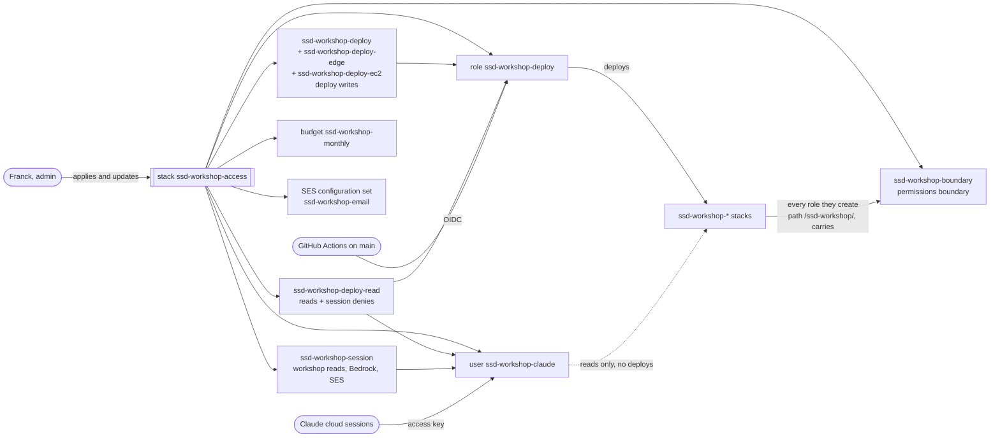
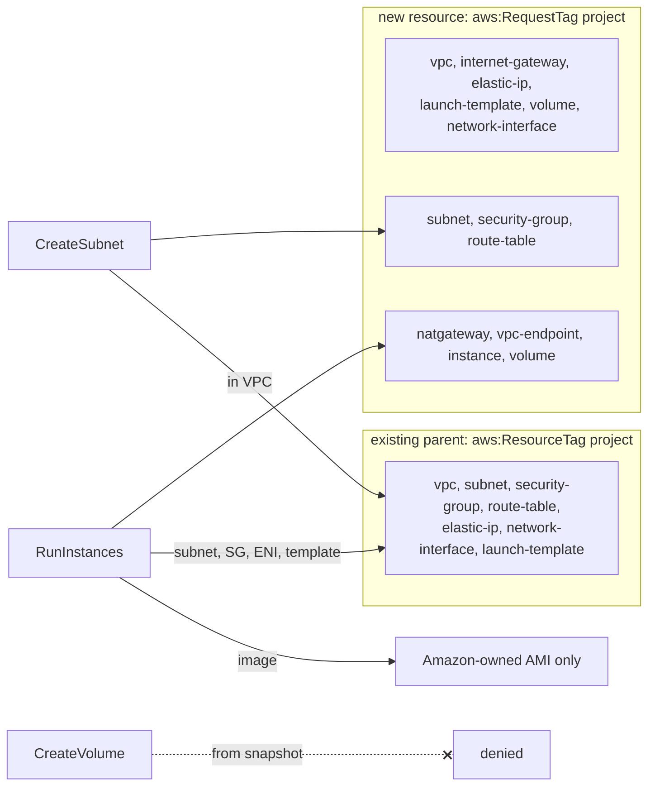
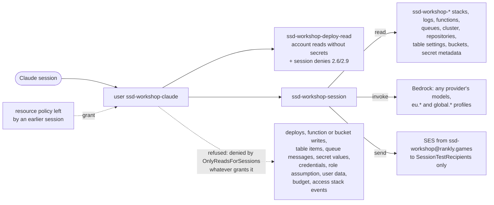

# Access stack

`access-stack.yaml` gives the workshop the least AWS access it needs in the rankly.games account,
which it shares with other projects (rankly.games, www, play, letters). Franck applies and
updates it by hand in the CloudFormation console. CI and Claude sessions never apply it, and the
deploy rights it grants cannot change it, the deploy role, the Claude user or the six managed
policies (explicit denies `ProtectThisStack` and `ProtectAccessIdentities`; every role the deploy
rights may touch lives under the IAM path `/ssd-workshop/`, which the deploy role, on path `/`, is
not). Only the deploy role (GitHub Actions on `main`) deploys. Since ticket 2.12 the user
`ssd-workshop-claude` (Claude's cloud sessions) carries no deploy rights: `ssd-workshop-deploy-read`
(reads, with the session denies of tickets 2.6 and 2.9) and `ssd-workshop-session` (reads of the
workshop's own resources, Bedrock, test emails from the workshop sender), so only deploys from
`main` change live apps. Participants get no AWS keys of their own, but code they write for the
advanced track runs under workshop roles (ECS tasks, k3s nodes) and can use those roles'
credentials, within the boundary (accepted risk 10). What IAM cannot close is listed under
[Accepted risks](#accepted-risks).



## Apply it (first time)

1. Sign in to the AWS console as an admin, region **eu-central-1 (Frankfurt)**.
2. CloudFormation, Create stack, With new resources, Upload a template file:
   `infra/access/access-stack.yaml` from `main`.
3. Stack name: **`ssd-workshop-access`**. Use exactly this name: the self-protection deny is
   written for it.
4. Parameters:

   | Parameter | Value |
   | --- | --- |
   | `HostedZoneId` | the Route53 hosted zone of `rankly.games` |
   | `CreateGitHubOidcProvider` | `yes`, or `no` if IAM already lists the provider `token.actions.githubusercontent.com` |
   | `GitHubRepo` | keep `kifbv@7999713/ssd-workshop@1467373954` (the ID form GitHub sends for this repository) |
   | `BudgetEmail` | the address that should get budget alerts |
   | `MonthlyBudgetUsd` | keep `100` |
   | `SessionTestRecipients` | the only addresses Claude sessions may send test emails to, comma-separated: keep `success@simulator.amazonses.com` (the SES mailbox simulator) and add your own test inbox if you want real test mails. Sessions can read these addresses (in `ssd-workshop-session`), so enter only test addresses, never a participant's |

5. Tick "I acknowledge that AWS CloudFormation might create IAM resources with custom names",
   then Submit and wait for `CREATE_COMPLETE`.
6. IAM, Users, `ssd-workshop-claude`, Security credentials, Create access key (use case: "Third-party
   service"). Store the key id and secret as **network secrets of the project's cloud environment**
   (Project settings, Cloud environment, the gear beside the environment, Network secrets). Do not
   paste them into a chat. New sessions pick them up.
7. Deactivate the admin access keys used so far (IAM, your user, Security credentials, Deactivate),
   so the only long-lived key the workshop uses is the least-privilege one.
8. Nothing to set up in GitHub: the role trusts only the OIDC subject
   `repo:kifbv@7999713/ssd-workshop@1467373954:ref:refs/heads/main` (GitHub sends this repository's
   subject in the ID form `owner@ownerId/repo@repoId`; the plain `kifbv/ssd-workshop` form is
   refused, as the first deploy showed). The deploy workflow (ticket 0.5) must not use a
   GitHub environment, because a job with an environment gets the subject
   `repo:kifbv@7999713/ssd-workshop@1467373954:environment:<name>`, which the role refuses.

## Update it

1. A deploy from `main` (or a Claude session's read) hits `AccessDenied`, and Claude reports the
   missing permission (action and resource). A deploy right goes on the deploy policies (deploy
   role only); a session gets only reads (on `ssd-workshop-deploy-read` or `ssd-workshop-session`),
   never a write.
2. Claude changes `access-stack.yaml` in a pull request, keeping the new right scoped to
   `ssd-workshop-*` names, the `project=ssd-workshop` tag or `workshop.rankly.games`, and
   explains it in the table below. The tests in `access-stack.test.ts` fail if a new write is not
   scoped or listed as an exception.
3. Franck reviews and merges.
4. Franck opens the `ssd-workshop-access` stack in the console, Update, Replace existing template,
   uploads the merged `access-stack.yaml`, keeps the parameters, and submits. `BudgetEmail` is hidden
   (`NoEcho`, since ticket 2.12) and shows as `****`: leave it as it is (the existing value is kept);
   type the address again only to change it. `SessionTestRecipients` keeps its current value; to let sessions send
   a test email to another inbox, Update, Use current template, and change only that parameter (ticket 2.12 try 3).

## Why each statement exists

**`ssd-workshop-boundary`** (the ceiling for every role the workshop stacks create):

| Sid | Why |
| --- | --- |
| `WorkshopData` | Lambda, ECS and EC2 roles read and write only `ssd-workshop-*` tables, queues, secrets and parameters, and the log groups `ssd-workshop-*`, `/aws/lambda/ssd-workshop-*` and `/ecs/ssd-workshop-*`. |
| `NoDeployAssetWrites` | Deny every workload role everything but reads on the CDK assets bucket and its objects (Lambda code and templates, written only by deploys): a role a session creates could otherwise plant the launcher's next code, or open the bucket to anyone with a bucket policy (ticket 2.6). |
| `GitHubKeyForTheLauncherOnly` | Deny `GetSecretValue` on the GitHub App's key (`secret:ssd-workshop-github-*`, ticket 2.6) to every workload role but `ssd-workshop-builds-launcher` (with and without its path), whatever the role's own policy says: no other role, created by a session or a deploy, can read the key. |
| `WorkshopBuckets` | `ssd-workshop-*` buckets, only in this account (`aws:ResourceAccount`: bucket names are global, so someone else could own a bucket with a matching name). |
| `Bedrock` | The platform calls Claude on Bedrock (Anthropic models and `eu.anthropic.*` inference profiles only). |
| `SendCodes` | Sign-in codes go out by SES, only through the identities `ssd-workshop@rankly.games` and `rankly.games` (SES authorizes the domain identity when the address itself is not verified) and only from `ssd-workshop@rankly.games` (`ses:FromAddress`), naming the configuration set `ssd-workshop-email` (created by this stack) so SES never falls back to the domain's default set `rankly-dev`. |
| `RunBuilds` | Start build tasks only from `ssd-workshop-*` task definitions on `ssd-workshop-*` clusters (`ecs:cluster`), and only as the build launcher role `role/ssd-workshop/ssd-workshop-builds-launcher` (`aws:PrincipalArn`, ticket 2.9): a task role (participant code) or any other workload role cannot start tasks, even if a CDK policy grants it. |
| `TagBuildsOnStart` | `ecs:TagResource` on `task/ssd-workshop-*/*`, which ECS also checks when `RunTask` passes tags or `propagateTags`; only as part of `RunTask` (`ecs:CreateAction`) and only for the launcher role. |
| `WatchBuilds` | Stop and describe tasks on `ssd-workshop-*` clusters. |
| `WatchBuildsLauncherOnly` | Ticket 2.9 try 2 (Franck's yes, 2026-11-24). Deny `ecs:DescribeTasks` and `ecs:StopTask` on `task/ssd-workshop-builds/*` to every workload role but `ssd-workshop-builds-launcher`, whatever its own policy says: a running build's task override holds the build's GitHub token (accepted risk 16), and a role a session creates could otherwise read it. `ArnNotLike` on `aws:PrincipalArn` `role*/<name>` covers the role with and without its path (a role name is unique in an account; a look-alike such as `x-ssd-workshop-builds-launcher` does not match, tested). |
| `DeploysFromTheBuilderOnly` | Ticket 2.9 try 2 (Franck's yes, 2026-11-24). Deny `sqs:SendMessage` on `ssd-workshop-deploys*` to every workload role but the builder's task role `ssd-workshop-builder`: a deploy message makes the deployer publish the build's `pushedCommit`. Same `role*/<name>` form. |
| `BuildsFromTheirSendersOnly` | Ticket 2.9 try 2 (Franck's yes, 2026-11-24). Deny `sqs:SendMessage` on `ssd-workshop-builds*` (launch queue, its dead-letter queue, check queue) to every workload role but the AI worker (`ssd-workshop-api-ai-worker`, the launch queue's sender) and the check's scheduler role (`ssd-workshop-builds-check-scheduler`, the check queue's sender): a launch message makes the launcher mint a token and start a task. |
| `PullImages` | Pull images only from `ssd-workshop-*` repositories. |
| `InvalidateWorkshopSite` | Invalidate only distributions tagged `project=ssd-workshop`. |
| `AccountWideServiceCalls` | ECR login token and X-Ray traces; neither has a resource scope. |
| `WorkshopMetrics` | Metrics only in the CloudWatch namespace `ssd-workshop`. |
| `PassWorkshopRoles` | A role may hand only `/ssd-workshop/` roles, and only to ECS tasks. |
| `ServicesInWorkshopSubnetsOnly` | Deny, as in the deploy policies: ECS services (Express Gateway services included) only in the two workshop subnets. The boundary grants no service rights today; the deny keeps it so if it ever does. |
| `NoStartTask` | Deny `ecs:StartTask` (tasks on EC2 container instances), as in the deploy policies. |
| `K3sNodeHeartbeat` | Advanced-track k3s nodes report to Systems Manager, only for instances tagged with the project. |
| `K3sNodeChannels` | Session Manager and Run Command channels of the calling instance, and reading instance tags. |
| `NoExternalSharing` | Deny, for workload roles too: the same sharing and egress actions as the deploy policies' `NoExternalSharing`, except `s3:PutBucketNotification`, which CDK's bucket notifications handler (a workshop role) needs (accepted risk 12). Also (access review follow-up) `sqs:SetQueueAttributes`, `sqs:DeleteQueue` and `sqs:PurgeQueue`: a role a session creates could otherwise set a queue `Policy` opening `ssd-workshop-deploys*` or `ssd-workshop-builds*` to outside senders, or delete or purge them. No workload role uses them; CloudFormation changes queues as the deploy role, which has no boundary. |

**`ssd-workshop-deploy`** (deploy rights, part 1: stacks, named resources, IAM, and the denies that guard them):

| Sid | Why |
| --- | --- |
| `WorkshopStacks` | Create, update, delete and read `ssd-workshop-*` stacks (change sets authorize against the stack). CDK names the stack when it calls `DescribeStacks`. |
| `NoResourceImport` | Deny: CloudFormation change sets that import existing resources (`cloudformation:ImportResourceTypes`), so a workshop stack cannot adopt, tag or change another project's resource. |
| `ProtectThisStack` | Deny: every non-read CloudFormation action on `ssd-workshop-access` (update, delete, change sets, cancel, rollback, stack policy), so the deploy rights cannot raise themselves. |
| `NamedWorkshopResources` | Full control of the workshop's own DynamoDB, Lambda, logs (`ssd-workshop-*`, `/aws/lambda/ssd-workshop-*`, `/ecs/ssd-workshop-*`), SQS, ECR, Secrets Manager, SSM, EventBridge, Scheduler, Step Functions, SNS and ECS resources, by `ssd-workshop-*` name. ECS service and task ARNs hold the cluster name, so they are limited to `ssd-workshop-*` clusters. |
| `WorkshopBuckets` | Full control of `ssd-workshop-*` buckets in this account only (`aws:ResourceAccount`). |
| `ActionsWithoutResourceScope` | Actions AWS cannot limit by name or tag: ECR login token, task definition deregistration and reads (`DescribeTaskDefinition`, which CloudFormation calls with the caller's rights for every task definition it manages; accepted risk 15), vended log deliveries. Each one is listed with its reason in the test. |
| `WorkshopEventSourceMappings` | Create, change and delete event source mappings only for `ssd-workshop-*` functions (`lambda:FunctionArn`). |
| `TagEventSourceMappings` | CloudFormation tags the mappings it creates; mapping ids are generated, and a tag on a mapping grants nothing. |
| `WorkshopRolesWithBoundaryOnly` | Create roles on the path `/ssd-workshop/` and change their policies only when the role carries `ssd-workshop-boundary`. |
| `WorkshopRolesHousekeeping` | Delete, tag, update (also the trust policy, which CloudFormation changes in place) and wire instance profiles for roles and instance profiles on `/ssd-workshop/`. |
| `PassWorkshopRolesToWorkshopServices` | Hand `/ssd-workshop/` roles only to Lambda, ECS tasks, EC2, Step Functions, EventBridge Scheduler and EventBridge (`iam:PassedToService`). |
| `ProtectAccessIdentities` | Deny: every IAM action except `Get*`/`List*` on the role `ssd-workshop-deploy`, the user `ssd-workshop-claude` and the six managed policies (named one by one; `ssd-workshop-session` added in ticket 2.12). |
| `WorkshopServiceLinkedRoles` | Let ECS create its AWS-defined service-linked role the first time it is used (`iam:AWSServiceName` `ecs.amazonaws.com` only). |
| `NoBoundaryEscape` | Deny removing or replacing a boundary, creating users or access keys, and rewriting managed policies. |
| `NoSelfAssume` | Deny `sts:AssumeRole`, `TagSession` and `SetSourceIdentity`: a role elsewhere in the account whose trust policy names the account or these principals cannot be assumed. |
| `TasksOnWorkshopClustersOnly` | Deny `ecs:RunTask` unless `ecs:cluster` is an `ssd-workshop-*` cluster: a workshop task definition on another project's cluster could read that cluster's container-instance role. |
| `ServicesInWorkshopSubnetsOnly` | Deny every action that carries `ecs:subnet` (`CreateService`/`UpdateService` and `CreateExpressGatewayService`/`UpdateExpressGatewayService`; never `RunTask`/`StartTask`) when any subnet is not one of the two workshop subnets (`BUILDS_SUBNET_IDS` in `infra/lib/config.ts`; a test keeps them in step, and checks it against the list copied from the Service Authorization Reference on 2026-11-24 (`ECS_SUBNET_ACTIONS`)). `ForAnyValue`: an update that leaves the network alone carries no subnet and passes. |
| `NoStartTask` | Deny `ecs:StartTask` everywhere: it places tasks on EC2 container instances, which the workshop never uses, and like `RunTask` it has no subnet key. |
| `RulesOnWorkshopSourcesOnly` | Deny `events:PutRule` when the event pattern names a source other than `ssd-workshop.*` (`events:source`): a rule on the default bus could otherwise match other projects' events (ECS task state changes carry environment variables). |
| `RulesNeedASource` | Deny `events:PutRule` without a source (`Null` `events:source`): a pattern that filters only on `detail` or `account` matches every project's events. Schedules use EventBridge Scheduler, not schedule rules. |

**`ssd-workshop-deploy-edge`** (deploy rights, part 2: CloudFront, certificates, API Gateway, DNS, and the denies that keep workshop data in the account; Bedrock and SES moved to `ssd-workshop-session` in ticket 2.12):

| Sid | Why |
| --- | --- |
| `CloudFrontTaggedCreate` | Create CloudFront distributions only with the `project=ssd-workshop` tag. |
| `TagOnCreateThroughCloudFormation` | `cloudfront:TagResource` and `acm:AddTagsToCertificate`, which AWS also checks when CloudFormation creates a distribution or requests a certificate with tags. Only with the project tag in the request, no project tag on the resource yet, and the call made through CloudFormation (`aws:CalledVia`), whose resource import is denied (`NoResourceImport`): so an existing resource of another project cannot be tagged and then taken over. |
| `CloudFrontTaggedChange` | Change, delete, invalidate, tag or untag only distributions already tagged `project=ssd-workshop` (a tag right with only a request tag would let the role tag, then take over, any distribution). |
| `CloudFrontUntaggableParts` | Origin access controls and cache, origin-request and response-headers policies have generated ids and no tags: create and read only, so the rankly.games distributions' existing ones cannot be changed or deleted. |
| `CloudFrontWorkshopFunctions` | CloudFront functions named `ssd-workshop-*`. |
| `CertificatesTagged` | Request ACM certificates only with the project tag and only for `workshop.rankly.games` and names under it (`acm:DomainNames`, with a `Null` guard because `ForAllValues` is true when the key is missing). |
| `CertificatesThroughCloudFormation` | The same names without a request tag, only through CloudFormation (`aws:CalledVia`): CloudFormation requests the certificate without tags and then tags it (`TagOnCreateThroughCloudFormation`). |
| `CertificatesChange` | Change, delete, tag or untag only certificates already tagged with the project. |
| `ApiGatewayTaggedCreate` | Create REST and HTTP APIs (`POST /restapis`, `POST /apis`) only with the project tag. |
| `ApiGatewayTaggedChange` | Write anything under an API or change and delete it only when the API is tagged with the project; child resources inherit the API's tag for authorization. |
| `ApiGatewayTagOnCreateThroughCloudFormation` | `POST`/`PUT` on the API Gateway tags endpoint (`/tags/*`), which CloudFormation's API Gateway v2 handler calls when it creates an API or stage with tags. Only with the project tag in the request and only through CloudFormation (`aws:CalledVia`), whose resource import is denied (`NoResourceImport`), so only APIs a workshop stack created itself. The tags resource has no resource-tag key, so there is no `Null` guard as in `TagOnCreateThroughCloudFormation`. |
| `ApiGatewayTagStagesOnCreate` | `apigateway:TagResource` on `/apis/*`, which AWS also checks when CloudFormation creates a tagged stage (not yet in the Service Authorization Reference). Only with the project tag in the request, on an API already tagged with the project (stages inherit it), and only through CloudFormation. |
| `DnsOnlyWorkshopSubdomain` | Change records in rankly.games only for `workshop.rankly.games` and names under it, only `A`, `AAAA` and `CNAME` (alias and certificate validation), with a `Null` guard because `ForAllValues` is true when a key is missing. |
| `NoExternalSharing` | Deny S3 ACLs, bucket logging, inventory, analytics export, replication and notifications, Secrets Manager, ECR, DynamoDB, SSM and CloudWatch Logs resource policies, Lambda function URLs and layer sharing, SQS and SNS `AddPermission`, DynamoDB exports, log subscription filters and log export tasks: none is needed by this spec, each could send workshop data to another account, and none can be pinned to this account by a condition key. |
| `InvokePermissionsForServicesOnly` | Deny `lambda:AddPermission` unless the principal is API Gateway, EventBridge, SNS or S3, so no account or the public can be allowed to invoke a function. |
| `EventTargetsInAccount` | Deny EventBridge targets outside this account (`events:TargetArn`). |
| `SubscriptionsInWorkshop` | Deny SNS subscriptions except to `ssd-workshop-*` Lambda functions and queues of this account (no e-mail or HTTP endpoints). |

**`ssd-workshop-deploy-ec2`** (deploy rights, part 3: EC2 for networks and the advanced track's k3s nodes; also the
ECR Public login and the session denies on build tasks, which have room here).
A request tag is true for every resource a call names, also the existing ones it only refers
to. So each request-tag statement lists only ARN types that are new in every call of its
actions, and the existing parents (VPC, subnet, security group, route table, Elastic IP, network
interface, launch template) need the project tag. Resource types per action come from the AWS
Service Authorization Reference.



| Sid | Why |
| --- | --- |
| `Ec2NewTopLevel` | Create VPCs, internet gateways, Elastic IPs, launch templates, volumes and network interfaces with the project tag (none of these actions names an existing VPC, subnet or security group). |
| `Ec2NewInVpc` | Create subnets, security groups and route tables with the project tag. |
| `Ec2NewAttached` | Create NAT gateways, VPC endpoints and instances (with their new volumes) with the project tag. |
| `Ec2ParentsTagged` | The VPC, subnet, security groups, route tables, Elastic IP, network interface and launch template a create names must carry the project tag: no subnet in another project's VPC, no gateway endpoint in its route tables, no instance on its interfaces. |
| `Ec2RunInstancesAmazonImages` | Only images owned by Amazon (`ec2:Owner` `amazon`, e.g. Amazon Linux 2023). |
| `Ec2NoVolumesFromSnapshots` | Deny creating a volume from any snapshot (another project's snapshot could be read that way). |
| `Ec2TagOnCreate` | Tag EC2 resources only as part of creating them. |
| `Ec2ChangeTaggedOnly` | Start, stop, change, attach and delete only EC2 resources tagged with the project. |
| `EcrPublicLogin` | Ticket 2.9 follow-up: `ecr-public:GetAuthorizationToken` (no resource type, so `Resource "*"`), for the deploy workflow's `docker login` to `public.ecr.aws` before it builds the builder image: anonymous pulls from GitHub's shared runners got `429 Too Many Requests`. The token only pulls public images (no ECR Public repository write is granted). The Claude user gets it too (same policy); harmless. |
| `ReadEventSourceMappings` | 2.9 follow-up: `lambda:GetEventSourceMapping` on `*` (CloudFormation reads a mapping by UUID, which Lambda checks on `*` without a function ARN). Read only. |
| `ChangeTaggedEventSourceMappings` | 2.9 follow-up: delete or update an event source mapping tagged `project=ssd-workshop` (rollbacks and updates by UUID). Sessions stay denied (`NoEventSourcesForSessions`). |
| `EcrPublicBearerToken` | Ticket 2.9 follow-up: `sts:GetServiceBearerToken`, which the ECR Public login needs, without a condition: with `sts:AWSServiceName` `ecr-public.amazonaws.com` the live login was denied (2026-11-24); a bearer token alone grants nothing (actions per the Service Authorization Reference, ecr-public.json and sts.json, read 2026-11-24). Not in the boundary. |

**`ssd-workshop-deploy-read`** (deploy rights, part 4: reads; carried by the deploy role and the Claude user):

| Sid | Why |
| --- | --- |
| `ReadsWithoutSecrets` | Account-wide reads that CDK or Claude need and whose answers hold no secrets: stack list, template validation, EC2 and ECS listings, certificates, hosted zone list, Bedrock models and inference profiles, service quotas, the SES send quota and identities, bucket names, a random password (`secretsmanager:GetRandomPassword`, which CloudFormation calls to fill a new secret such as `ssd-workshop-github`; no resource scope, and it reads nothing), log group names, costs. |
| `NoLauncherForSessions` | For the Claude user only (`aws:PrincipalArn`): deny everything but reads on the build launcher's role (`ssd-workshop-builds-launcher`, both ARN forms) and function (with versions and aliases; invoking included), and on the CDK assets bucket and its objects, so a session can never reach the GitHub App's key through the one role allowed to read it (ticket 2.6, Franck's choice: block sessions, trust deploys from `main`). Ticket 2.9 try 3 (Franck's yes, 2026-11-24): the same for the roles the boundary's denies let through by name (`role/ssd-workshop/ssd-workshop-builder`, `-builder-execution`, `-api-ai-worker`, `-builds-check-scheduler`) and the apps deployer's role (`role/ssd-workshop/ssd-workshop-apps-deployer`, the apps bucket's only writer), each with its path: IAM rejects `role*/<name>` in a `Resource` (the access stack update after 2.9 failed on it), and the path-less form needs no deny since neither principal may create, pass or change a role outside `role/ssd-workshop/`, and the functions `ssd-workshop-api-ai-worker` and `ssd-workshop-apps-deployer` (with versions and aliases): a session cannot pass one of these roles to its own task or function (`iam:PassRole` is denied too), change it, or rewrite or invoke that code. |
| `NoBuildQueueForSessions` | For the Claude user only (`aws:PrincipalArn`): deny `sqs:SendMessage`, `sqs:SetQueueAttributes` and `sqs:PurgeQueue` on `ssd-workshop-builds*` (the launch queue, its dead-letter queue and the check queue), so a session cannot start, redirect or empty builds: a launch message makes the launcher mint a repository token and start a task (ticket 2.9, Franck's choice, 2026-11-24). Retries run from Franck's machine (`AWS_PROFILE=franck npm run builds -- retry <nickname>`, infra/README.md). Deploys from `main` still manage the queues. Ticket 2.9 try 2 (Franck's yes, 2026-11-24): also `sqs:ReceiveMessage`, `sqs:DeleteMessage` and `sqs:DeleteQueue`, and the same six actions on `ssd-workshop-deploys*` (the deploy queue and its dead-letter queue): a session cannot send a deploy message, nor take or drop one. |
| `NoEventSourcesForSessions` | Ticket 2.9 try 3 (Franck's yes, 2026-11-24; replaces try 2's `NoLauncherSourcesForSessions`). For the Claude user only: deny `lambda:CreateEventSourceMapping`, `UpdateEventSourceMapping` and `DeleteEventSourceMapping`, with no other condition: no condition key names a mapping's queue (Service Authorization Reference, read 2026-11-24), and a call by mapping UUID may carry no function ARN. A session cannot feed the launch or deploy queue to its own function, nor feed the launcher from another queue or cut off its check. Reading a mapping stays allowed; deploys from `main` still manage mappings. |
| `NoBuildCheckScheduleForSessions` | Ticket 2.9 try 3 (Franck's yes, 2026-11-24). For the Claude user only: deny `scheduler:Create*`, `Update*` and `Delete*` on `schedule/*/ssd-workshop-builds-check`, so a session cannot stop or redirect the stuck-build check. |
| `NoGitHubKey` | Deny every Secrets Manager action on the GitHub App's private key (`secret:ssd-workshop-github-*`, ticket 2.6) except creating, describing, tagging and reading its policy or version ids (a `NotAction` list, so new actions are denied too): only Franck loads it and only the build launcher (2.9) reads it. CloudFormation still creates the secret; any later change of it (settings or tags: CloudFormation's update handler reads the value) and drift detection on it go through Franck. In this policy because `ssd-workshop-deploy` is too close to its size limit. |
| `WorkshopZoneReads` | The rankly.games zone and its records. |
| `WorkshopIamReads` | Read roles and instance profiles on `/ssd-workshop/` and `ssd-workshop-*` policies (not `GetAccountAuthorizationDetails` or other projects' roles). |
| `WorkshopApiReads` | Read APIs tagged with the project (other APIs' stage variables and configuration stay hidden). |
| `WorkshopDistributionReads` | Read distributions tagged with the project (other distributions' origins and custom headers stay hidden). |
| `WorkshopBudgetRead` | Read the `ssd-workshop-monthly` budget. Changing it is not granted. |
| `NoUserDataReads` | Deny instance attributes, launch template versions and spot requests (they hold user data) outside the project tag. Launch template versions and spot requests have no resource tag in IAM, so they are denied for every resource. |
| `NoApiKeyReads` | Deny reading API Gateway keys. |
| `NoVpnKeyReads` | Deny `ec2:DescribeVpnConnections` everywhere: it returns the VPN pre-shared keys. |

**`ssd-workshop-session`** (ticket 2.12, the Claude user only: reads of the workshop's own resources, Bedrock and
test emails; no deploy rights). Every Allow is a read except Bedrock invoke, SES `SendEmail` and the log reads
`FilterLogEvents`, `StartQuery` and `StartLiveTail` (tested, with a mutation). Its denies need no principal
condition (only the Claude user carries it). Since try 3 the catch-all `OnlyReadsForSessions` denies the user every
action but those reads and exceptions, so a resource policy left from the sessions that had deploy rights cannot
grant a write either. Reads name `${AWS::Region}` (eu-central-1), except stacks (the edge stack is in us-east-1).



| Sid | Why |
| --- | --- |
| `Bedrock` | Sessions test the platform's Bedrock calls (`npm run smoke -- bedrock`, the evals) and benchmark other models for the builder (Franck, 2026-11-25): any provider's foundation model, and inference profiles only with EU (`eu.*`) or global (`global.*`) routing. The platform's own roles stay on Claude (the boundary's `Bedrock` statement is unchanged). |
| `SesForTesting` | Sessions test code emails (`npm run -s smoke -- ses <address>`), only `ses:SendEmail` (SESv2 `SendEmail` with simple content, as the smoke test and the mailer send; no `SendRawEmail`, whose `From:` header is free), only through the identities `ssd-workshop@rankly.games` and `rankly.games`, only from `ssd-workshop@rankly.games` (`ses:FromAddress`), with the configuration set `ssd-workshop-email`, and only to the addresses of the parameter `SessionTestRecipients` (`ForAllValues:StringLike` on `ses:Recipients`, which holds To, Cc and Bcc, plus a `Null` guard so a send without the key is refused; try 3). |
| `WorkshopStackReads` | `cloudformation:Describe*`, `Get*`, `List*` on `stack/ssd-workshop-*/*` (outputs, events, templates; `cdk diff` falls back to a template diff, since creating a change set is a write). |
| `WorkshopLogReads` | Read the log groups `ssd-workshop-*`, `/aws/lambda/ssd-workshop-*` and `/ecs/ssd-workshop-*`: streams, events, filters, Logs Insights queries (`StartQuery`, `GetQueryResults`) and live tails (`StartLiveTail`). `StopQuery` (Resource `*` only) is not granted. |
| `WorkshopResourceReads` | Settings, never data: Lambda function configuration, policy, aliases, versions and tags (no `lambda:List*`, no invoke); SQS attributes, URL, tags and dead-letter sources (never `ReceiveMessage`); ECS clusters, services and tasks (build tasks stay denied by `NoBuildTasksForSessions`); ECR repositories and image lists (no pulls); DynamoDB table description, backups, TTL and tags (never an item: the table holds participants' email addresses); Secrets Manager description and version ids (never a value); Scheduler schedules and groups. All on `ssd-workshop-*` names. |
| `WorkshopEventSourceMappingReads` | `lambda:GetEventSourceMapping` for `ssd-workshop-*` functions (`lambda:FunctionArn`; mapping ids are generated). |
| `WorkshopBucketReads` | `s3:GetObject*`, `GetBucket*`, `Get*Configuration` and `List*` on `ssd-workshop-*` buckets and their objects, in this account only (`aws:ResourceAccount`). The site and apps files are public anyway; the assets bucket holds deploy code. Not `s3:Get*`, which would also name `s3:GetDataAccess` (S3 Access Grants credentials; tested). |
| `NoAssumeForSessions` | Deny `sts:AssumeRole`, `TagSession`, `SetSourceIdentity` and `GetFederationToken` on every resource. The user no longer carries `ssd-workshop-deploy`'s `NoSelfAssume`, and in the same account a role whose trust policy names `user/ssd-workshop-claude` needs no identity-based Allow: a role an earlier session (with deploy rights) left behind could otherwise still be assumed. |
| `OnlyReadsForSessions` | Deny every action not in its `NotAction` list, on every resource (try 3). The list holds the user's reads as wildcard groups per service (`cloudformation:Describe*`, `logs:Get*`, `s3:GetObject*`, ...: each fixed part starts with `Describe`, `Get`, `List`, `View` or `Validate`, so no write fits; each checked against the Service Authorization Reference, 2026-11-24) and the exceptions by name (`bedrock:InvokeModel`, `InvokeModelWithResponseStream`, `ses:SendEmail`, `logs:FilterLogEvents`, `StartQuery`, `StartLiveTail`). In the same account a resource policy (bucket, queue, topic, function, role trust) naming the user needs no identity Allow; this deny wins over it. Left out on purpose, so denied although `-deploy-read` allows them: `budgets:ViewBudget` (its subscribers hold the budget address) and `ses:GetEmailIdentity`/`ListEmailIdentities` (other projects' identities; no session code uses them). No credential-returning read fits a pattern (tested). |
| `NoAccessStackEventsForSessions` | Deny `cloudformation:DescribeStackEvents`, `DescribeEvents` and `DescribeStackResourceDrifts` on `stack/ssd-workshop-access/*` (old events and drift results may show the budget address) and on every `changeSet/*` (a change set's ARN does not name its stack). `DescribeStacks` stays (the address parameter is `NoEcho`). |
| `NoVerifiedAccessForSessions` | Deny `ec2:DescribeVerifiedAccess*`: `ec2:Describe*` (on `-deploy-read`) also covers Verified Access trust providers, which may hold other projects' OIDC client secrets. |
| `NoUserDataForSessions` | Deny `ec2:DescribeInstanceAttribute`, `DescribeLaunchTemplateVersions`, `DescribeSpotFleetRequests` and `DescribeSpotInstanceRequests` on every resource: `ec2:Describe*` (on `-deploy-read`) would return the project's own instances' user data and launch template versions (`NoUserDataReads` there denies them only outside the project tag). Sessions do not need them; the deploy role keeps them on project-tagged resources. |
| `NoBuildTasksForSessions` | Ticket 2.9 try 2 (Franck's yes, 2026-11-24; moved to `-deploy-ec2` after 2.9 for its size, and to `ssd-workshop-session`, the user's own policy, in 2.12). deny `ecs:DescribeTasks`, `ecs:RunTask`, `ecs:StopTask` and `ecs:ExecuteCommand` on `task/ssd-workshop-builds/*` and `task-definition/ssd-workshop-builder:*`. A running build's task override holds its GitHub token (accepted risk 16); with it and the table rights a session could push, write `pushedCommit` and (before `NoBuildQueueForSessions` covered the deploy queue) send a deploy message, so the live app would change. `ecs:ListTasks` (no override) stays allowed. |
| `NoBuildsClusterTasksForSessions` | Ticket 2.9 try 3 (Franck's yes, 2026-11-24). deny `ecs:RunTask` of any task definition where `ecs:cluster` is `cluster/ssd-workshop-builds` (the builder's own definition is already denied by `NoBuildTasksForSessions`). |
| `NoBuildsClusterServicesForSessions` | Access review follow-up to ticket 2.9 (Franck's yes, 2026-11-24). deny `ecs:CreateService`, `ecs:UpdateService` and `ecs:CreateTaskSet` on `service/ssd-workshop-builds/*` and `task-set/ssd-workshop-builds/*`, so a session cannot run tasks on the builds cluster through a service or task set either (no deploy policy grants task sets today). |

Not granted to sessions on purpose (ticket 2.12): every deploy right, `ecs:DescribeTaskDefinition`,
`ecr:GetAuthorizationToken` and the other credential-returning reads (`sts:GetFederationToken`/`GetSessionToken`,
`sso:GetRoleCredentials`, `s3:GetDataAccess`, `ec2:GetPasswordData`/`GetConsoleOutput`/`GetConsoleScreenshot`/`GetLaunchTemplateData`,
`lightsail:GetInstanceAccessDetails`, `redshift:GetClusterCredentials`/`GetClusterCredentialsWithIAM`,
`cognito-identity:GetCredentialsForIdentity`/`GetOpenIdToken`, package login tokens; tested, wildcards expanded,
and a new wildcard Allow on the user fails the tests until it is pinned in `SESSION_WILDCARDS`), `dynamodb:GetItem`/`BatchGetItem`/`Query`/`Scan`/`PartiQLSelect`/exports/stream
records, `sqs:ReceiveMessage`, `secretsmanager:GetSecretValue`, `ssm:GetParameter*`, `lambda:InvokeFunction`.

Not granted on purpose: `lambda:List*` (returns every function's environment variables),
`cloudformation:Describe*`, `GetTemplate` and `ListExports` on other
stacks (outputs and parameters), `iam:Get*`/`List*` account-wide, `cloudfront:List*`
(distribution summaries carry origin headers), `ses:List*` (contact lists hold e-mail addresses),
`ses:GetAccount` (returns the account's contact addresses), `ssm:DescribeParameters`,
`budgets:ModifyBudget`.

## Accepted risks

The workshop shares the rankly.games account with other projects. These are the holes IAM cannot
close (or that this spec needs open); Franck accepts each one by merging. Each has a check or a
follow-up.

1. **ECS network placement (narrowed in ticket 2.2, still open).** For `awsvpc` tasks and
   services, IAM has no tag key for the subnets and security groups a call names, only `ecs:subnet`
   by id, and per the AWS Service Authorization Reference
   (`servicereference.us-east-1.amazonaws.com/v1/ecs/ecs.json`, read 2026-11-24) `ecs:subnet` exists
   on CreateService/UpdateService and CreateExpressGatewayService/UpdateExpressGatewayService; never
   on RunTask/StartTask. `RunTask` and `StartTask` carry no subnet key, so no policy
   can pin them to subnets (a negated condition on the missing key would deny every `RunTask`; a
   `ForAnyValue` one would deny none).

   ```mermaid
   flowchart LR
     subgraph Closed["closed by IAM"]
       S[Create/UpdateService and<br/>Create/UpdateExpressGatewayService<br/>only the two workshop subnets<br/>ecs:subnet]
       ST[StartTask<br/>denied everywhere]
       RB[RunTask by a workload role<br/>only the launcher role<br/>boundary RunBuilds]
       RC[RunTask on another cluster<br/>denied, ecs:cluster]
     end
     subgraph Open["still open: no subnet key on RunTask"]
       L[launcher role] -->|RunTask, any subnet| T[workshop task]
       D[deploy role] -->|RunTask, any subnet| T
     end
     T -.->|could sit in| O[another project's subnet<br/>and reach its private endpoints]
   ```

   Closed: services, Express Gateway services included, only in the two workshop subnets
   (`ServicesInWorkshopSubnetsOnly`, deploy policies and boundary); `StartTask` denied for the deploy role (the Claude user has no `ecs` write since ticket 2.12) and in the boundary
   (`NoStartTask`); under the boundary only the build launcher role starts tasks, and only from
   `ssd-workshop-*` task definitions on `ssd-workshop-*` clusters (`RunBuilds`), so participant code
   running under a task role cannot start any, and since ticket 2.12 Claude sessions have no
   `RunTask` at all. Open: the launcher role and the deploy role
   can still start a workshop task in another project's subnet with `RunTask`. Impact: that task
   could reach the other project's private endpoints. Mitigation: the launcher names the two subnets
   from `BUILDS_SUBNET_IDS` (tested in ticket 2.9). For ticket 2.9: the launcher-only `RunTask`
   rule does not stop a confused deputy, so task roles get no write access to the launcher's
   trigger, the launcher validates what it runs, and the launcher role trusts only
   `lambda.amazonaws.com`. Check (run by Franck as admin; event history keeps 90 days), in every
   enabled region, since nothing limits the deploy role to eu-central-1 (it can create
   `ssd-workshop-*` clusters anywhere), every `RunTask` whose subnets are not the workshop's two,
   or that names none:

   ```sh
   for r in $(aws ec2 describe-regions --query 'Regions[].RegionName' --output text); do
   aws cloudtrail lookup-events --region "$r" \
     --lookup-attributes AttributeKey=EventName,AttributeValue=RunTask --output json \
   | jq -r '.Events[].CloudTrailEvent | fromjson
       | select((.requestParameters.networkConfiguration.awsvpcConfiguration.subnets // ["none"])
           | map(select(. != "subnet-05229d71b1e0b41ff" and . != "subnet-0965bcee41d455dba")) | length > 0)
       | [.eventTime, .userIdentity.arn, .requestParameters.cluster, .errorCode // "ok",
          ((.requestParameters.networkConfiguration.awsvpcConfiguration.subnets // ["none"]) | join(","))] | @tsv'
   done
   # expect: no output (a line with an errorCode is an attempt IAM refused)
   ```
2. **Trust and resource policies that name outside principals.** IAM cannot inspect the content of
   a role trust policy, a bucket policy (`s3:PutBucketPolicy`, needed by CDK for the CloudFront
   origin access control) or an SQS/SNS policy set as an attribute (`SetQueueAttributes`,
   `SetTopicAttributes`). Impact: an outside account, or any web-identity principal (a
   `/ssd-workshop/` role could trust the GitHub OIDC provider with the subject `repo:*`, so any
   GitHub repository's workflow could assume it), could use a `/ssd-workshop/` role (still capped
   by the boundary: workshop data, Bedrock, SES from the workshop sender) or read a workshop
   bucket. A deny on `iam:CreateRole` or `UpdateAssumeRolePolicy` cannot tell a safe trust policy
   from an unsafe one, and CDK needs both. Check: **enable the free IAM Access Analyzer
   external-access analyzer** for the account (IAM, Access analyzer, Create analyzer, zone of
   trust: current account); it reports every role, bucket, queue, topic, key and secret shared
   outside the account (also federated trust), for the other projects too. Keep S3 Block Public
   Access on at account level if the other projects allow it.
3. **`logs:CreateLogDelivery` / `logs:DeleteLogDelivery` and `ecs:DeregisterTaskDefinition` on
   every resource** (AWS offers no resource scope). Impact: the deploy rights could delete another
   project's vended log delivery (its API Gateway or Step Functions logs stop) or mark another
   project's task definition revision inactive (running tasks and services keep it; new launches of
   that revision fail until it is registered again). Check: CloudTrail for these calls by the
   deploy role (since ticket 2.12 the Claude user has none of them).
4. **Long-lived access key of `ssd-workshop-claude`.** Impact: a leaked key carries the user's
   rights until it is deactivated: since ticket 2.12 reads (with the account-wide reads of risk 6),
   Bedrock calls (cost), Logs Insights queries and live tails on workshop log groups (cost per GB
   scanned and per minute) and emails from the workshop sender (risk 5); no deploy rights, no role
   assumption or federation token (`NoAssumeForSessions`), and since try 3 no write through a resource policy
   (`OnlyReadsForSessions`). What IAM cannot undo: resources an earlier session (with deploy rights) may have
   left, and resource policies naming the user (reads they grant are still possible); `infra/README.md`
   ("After applying ticket 2.12's access stack") has Franck's one-time audit. Mitigation: it lives only as a network secret of the cloud
   environment; rotate it every 90 days and after any suspected leak (IAM, Users, Security
   credentials).
5. **SES sends from `ssd-workshop@rankly.games` to any recipient (workload roles).** Participants' addresses are not
   known to IAM, and `ses:FromAddress` checks the envelope sender: with `SendRawEmail` the
   message's `From:` header can show another name or address. Since ticket 2.12 try 3 the Claude user
   may send only `SendEmail` and only to `SessionTestRecipients`; the sign-in code role (boundary `SendCodes`)
   still sends to anyone, as it must. Impact: misuse could send mail in
   rankly.games' name and hurt the sending reputation that the other rankly.games projects share.
   Check: SES sending statistics and bounce/complaint rates; follow-up: a workshop configuration
   set with event publishing when the platform sends real codes.
6. **Account-wide reads without secrets.** EC2 and ECS listings (network layout, instance and
   cluster names of other projects), stack names, certificates, the hosted zone, service quotas
   and costs are readable account-wide. Since ticket 2.12 they are readable by Claude sessions too (through
   `-deploy-read`); accepted in try 3: costs, the rankly.games zone and the other EC2 describes. Not for sessions:
   Verified Access (`NoVerifiedAccessForSessions`), SES identities and the budget (`OnlyReadsForSessions`).
7. **CloudFront parts without tags.** The deploy rights can create origin access controls and cache,
   origin-request and response-headers policies without limit (account quotas are shared with the
   other distributions), and cannot change or delete them: a stack update that would change one
   fails, and changing one needs Franck or a replacement under a new name.
8. **Channels without a resource scope in the boundary:** `ssmmessages:*`, `ec2messages:*`
   (Session Manager and Run Command of the calling k3s node), `xray:PutTraceSegments`,
   `ecr:GetAuthorizationToken`.
9. **Code that runs with a workshop role can send the data it may read anywhere on the internet.**
   IAM does not control network egress.
10. **Participant code runs under workshop roles.** Advanced-track apps run as ECS tasks or on k3s
    nodes, so participant code can read the task role or instance role credentials (task metadata
    endpoint, instance metadata) and use everything that role may do within the boundary.
    Follow-up (Kubernetes phase): IMDSv2 with hop limit 1 on k3s nodes so pods cannot reach the
    node role, and one minimal role per workload instead of the boundary's full set.
11. **CloudFront origins and aliases.** A workshop distribution with an origin access control can
    name another project's bucket or Lambda function URL as its origin; it gets their content if
    their bucket or function policy trusts `cloudfront.amazonaws.com` with only `AWS:SourceAccount`
    (any distribution of this account then matches). IAM sees neither the origin nor the
    certificate a distribution uses, so a workshop distribution could also use an existing
    certificate of the account (for example one for `*.rankly.games`) to claim a rankly.games
    alias that no distribution uses yet; DNS still points elsewhere, but the project that later
    needs that alias would find it taken. Check: the other projects' bucket and function URL
    policies pin `AWS:SourceArn` to their own distribution ARN; Franck confirms this once, outside
    the workshop's rights, and `aws cloudfront list-distributions` (as admin) shows no workshop
    distribution with an alias outside `workshop.rankly.games`.
12. **Bucket notifications from workload roles.** CDK's S3 event notifications use a handler Lambda
    (a workshop role) that calls `PutBucketNotificationConfiguration`, which has no condition key
    for the destination. Impact: a workshop role could send event metadata of workshop buckets
    (bucket, object key, size) to an SNS topic, SQS queue or Lambda function of another account
    that accepts it. The deploy principals are denied it. Check: IAM Access Analyzer (risk 2)
    and the bucket's notification configuration in the stack output.
13. **GitHub OIDC subject.** The deploy role trusts `repo:kifbv@7999713/ssd-workshop@1467373954:ref:refs/heads/main`,
    which every job that runs on `main` gets, also jobs started by `pull_request_target`,
    `workflow_run`, `issue_comment` or `schedule`. Check: the test lets only `deploy.yml` request
    `id-token: write` (or `write-all`), and `deploy.yml` may only run on `push` to `main`; review
    every workflow change. Follow-up: a custom OIDC subject that includes `job_workflow_ref`, so
    the role trusts only the deploy workflow file.
14. **`lambda:AddPermission` for service principals.** IAM cannot require `SourceAccount` or
    `SourceArn` in the permission the role adds for API Gateway, EventBridge, SNS or S3. Without
    them, another account's API, rule, topic or bucket could invoke a workshop function. Check:
    CDK always sets `sourceArn` or `sourceAccount` (rule in `.claude/rules/infra.md`); IAM Access
    Analyzer reports function policies open to other accounts.
15. **`ecs:DescribeTaskDefinition` on every resource** (Franck, 2026-11-23). AWS offers it only on
    `Resource *`, and CloudFormation calls it with the caller's rights for every task definition a
    workshop stack manages (ticket 2.9). Impact: the deploy role (since ticket 2.12 no longer the
    Claude user) can read every task definition in the account, other projects' included, with their container environment
    variables (secrets passed as plain environment values would show). The boundary does not grant
    it, so no workload role can. Check (run by Franck as admin), in every enabled region, since
    the grant has no region limit, every call by a workshop principal on a task definition that is
    not the workshop's:

    ```sh
    for r in $(aws ec2 describe-regions --query 'Regions[].RegionName' --output text); do
    aws cloudtrail lookup-events --region "$r" \
      --lookup-attributes AttributeKey=EventName,AttributeValue=DescribeTaskDefinition --output json \
    | jq -r '.Events[].CloudTrailEvent | fromjson
        | select(.userIdentity.arn | test("ssd-workshop"))
        | select((.requestParameters.taskDefinition // "") | test("(^|/)ssd-workshop-") | not)
        | [.eventTime, .userIdentity.arn, .requestParameters.taskDefinition] | @tsv'
    done
    # expect: no output
    ```

16. **The builder's GitHub token is visible to some account readers for its hour** (Franck,
    2026-11-24, ticket 2.9; wording and the session and boundary denies of tries 2 and 3 pending
    Franck's yes, and Franck applies this template after the merge). The launcher passes the build's
    one-repository token (`contents: write` on that participant's repository only, valid one hour)
    to the builder task as a RunTask container override (`BUILDER_GITHUB_TOKEN`). The task
    definition holds no secret, and the App's key and the organization-wide token never leave the
    launcher.

    Who can still read it: Franck, and admins of the shared account (other projects' principals)
    with `ecs:DescribeTasks` on the builds cluster or `cloudtrail:LookupEvents` (RunTask
    `requestParameters`). Claude sessions cannot: since ticket 2.12 the Claude user has no deploy rights
    at all (below), and `NoBuildTasksForSessions` still denies it
    `DescribeTasks`, `RunTask` and `StopTask` on build tasks, the user has no CloudTrail rights,
    under the boundary only the launcher role may describe build tasks (`WatchBuildsLauncherOnly`),
    and a session cannot borrow the launcher's role (`NoLauncherForSessions`). Try 2 stated this
    too early: a session could still pass the roles the boundary's denies let through by name to
    its own task or function, or rewrite the AI worker's code. Since try 3 `NoLauncherForSessions`
    also covers the builder's task and execution roles, the AI worker's and the check scheduler's
    roles, the apps deployer's role, and the AI worker's and deployer's functions.

    What a holder can do: push to that one participant repository until the token expires. That
    does not change the live app by itself: the runner builds only from the commit the launcher
    prepared (`BUILDER_BASE_COMMIT`; a `main` that moved fails the build), its writes hold only
    under its launch's `attemptId`, and the deployer publishes only the commit stored as
    `pushedCommit` and named in a deploy message. Changing the live app also needs writing
    `pushedCommit` on the build AND sending a deploy message. Since ticket 2.12 the Claude user may
    neither write nor read the table's items, and before it the user could write it but not send to `ssd-workshop-deploys*` (`NoBuildQueueForSessions`);
    under the boundary only the builder's task role may (`DeploysFromTheBuilderOnly`), and since try
    3 a session can neither pass that role nor run any task on the builds cluster
    (`NoBuildsClusterTasksForSessions`, and through a service or task set
    `NoBuildsClusterServicesForSessions`), nor map a queue to a function (`NoEventSourcesForSessions`),
    nor change the check's schedule (`NoBuildCheckScheduleForSessions`). An account admin with both
    table and SQS rights could. Sessions could still change served files outside the pipeline until
    ticket 2.12 (see below).

    **(2.9) live-app residual, closed for sessions by ticket 2.12** (once Franck applied it): the
    Claude user now holds no write at all (only reads, Bedrock invoke, SES send from the workshop
    sender and log queries, tested), so none of the paths below is open to a session any more. They
    stay listed as history, and as what the deploy role (trusted: Franck reviews what merges) can do.
    What sessions still could after try 3 (by design or for lack of boundary room):
    - Change what is served without the build pipeline, through their deploy rights: the apps
      bucket's policy (then a plain `PutObject`), the CloudFront distribution or the apps-index
      function. Franck's choice (2026-11-24): accepted for now; a follow-up access ticket (2.12)
      cuts Claude sessions to read-only plus narrow rights, so only deploys from `main` change live
      apps. Done by 2.12.
    - Write the workshop table directly. Through the build pipeline alone that changes no live
      app (it needs a deploy message, which no session can send or make a borrowed role send).
    - Drive the normal pipeline as a participant could: records a session writes plus a message
      on the AI queue (open to sessions) can make the AI worker queue a build of a spec the
      session wrote, which the platform's own roles build and publish. The session never sees
      that build's token.
    - Create its own function (with its own boundary role) and invoke it to receive and delete
      launch or deploy messages (the boundary allows `sqs:ReceiveMessage` and `DeleteMessage` on
      workshop queues and has 166 characters left, too few for a receive deny; it denies queue
      attribute writes, deletes and purges). A denial of service only: a swallowed deploy
      message fails the build after the check's grace, a swallowed launch leaves it `queued`
      until `retry`.
    - Deregister the builder's task definition (`ecs:DeregisterTaskDefinition` has Resource `*`
      only) or delete images in `ssd-workshop-*` ECR repositories (their deploy rights). Also a
      denial of service only: new builds fail to start until the next deploy from `main`
      registers and pushes them again; nothing live changes.

    Accepted residual (IAM cannot pin a build id): the builder's task role may update any
    `BUILD#*` item within `BUILDER_BUILD_UPDATE_ATTRIBUTES`, so a compromised builder task (the
    coding agent has no way to use its credentials, decisions "(2.8) Agent's environment" and "(2.8)
    Residual risk of the proxy") could hand over
    another build of `building` status if it knew its id and `attemptId`.

    Check (run by Franck as admin): every `DescribeTasks` on the builds cluster by anyone other than
    the launcher role, and every read of RunTask events (`LookupEvents`) by anyone, should be
    explained. Franck's own `npm run builds -- retry` calls (`DescribeTasks`, `ListTasks`) appear
    under his user; the launcher's under its role:

    ```sh
    aws cloudtrail lookup-events --region eu-central-1 \
      --lookup-attributes AttributeKey=EventName,AttributeValue=DescribeTasks --output json \
    | jq -r '.Events[].CloudTrailEvent | fromjson
        | select((.requestParameters.cluster // "") | test("ssd-workshop-builds"))
        | select(.userIdentity.arn | test("ssd-workshop-builds-launcher") | not)
        | [.eventTime, .userIdentity.arn] | @tsv'
    # expect: only Franck's own reads (his retry calls)
    aws cloudtrail lookup-events --region eu-central-1 \
      --lookup-attributes AttributeKey=EventName,AttributeValue=LookupEvents --output json \
    | jq -r '.Events[].CloudTrailEvent | fromjson | [.eventTime, .userIdentity.arn] | @tsv'
    # expect: only Franck's own lookups (this check included); CloudTrail records LookupEvents as a
    # management read event only when the trail logs read events, so an empty answer can also mean
    # it is not logged: then look in the trail's S3 copy, or note that this part cannot be checked.
    ```

Not granted, so a later ticket brings it to Franck before it is needed:
`ec2:DescribeLaunchTemplateVersions` (no resource scope; needed for k3s launch templates).

## What the tests prove, and what only AWS can

`access-stack.test.ts` (run by `npm test`) parses the template and checks the four deploy
policies and the boundary with the same rules (and, since ticket 2.12, that the Claude user carries
only `ssd-workshop-deploy-read` and `ssd-workshop-session` and no other IAM resource could give it rights (no
inline policy, group, `Users`/`Groups`/`Roles` on a managed policy, and no IAM resource types besides the six
policies, the deploy role, the user and the OIDC provider), every Allow of it a read or one of six
listed exceptions (Bedrock invoke, SES `SendEmail`, three log reads), no table item, queue message, secret value,
parameter or credential read, no new wildcard Allow, no role assumption, the session reads named `ssd-workshop-*`,
the catch-all deny sparing only reads and those exceptions (checked per `NotAction` entry, and per request with a
loose `Allow *` standing for a resource policy), test emails only to `SessionTestRecipients`, and no budget or
access stack events): every write is scoped by a resource name that
starts with `ssd-workshop-` (with the dash), the project resource tag, the workshop DNS names
(with record types and a `Null` guard) or an `ssd-workshop-*` function, or is on a commented
exception list. A request tag alone counts only for creates: never for a tag-adding action, never
for API Gateway writes under existing APIs, never on `Resource *` unless the action authorizes no
existing resource (a commented list: CloudFront distributions, ACM certificates), and for EC2
never on an ARN type that the action names as an existing parent (a table from the Service
Authorization Reference). Further checks: no read that returns secrets or full configuration
(environment variables, user data, stack outputs, API keys, IAM documents, secret and parameter
values, origin headers, contact addresses, VPN keys) is allowed on every resource unless an
explicit deny keeps it to the project tag; CloudFront parts without tags are create-only;
`RunInstances` takes only Amazon images and project-tagged network interfaces; volumes from
snapshots are denied; tasks run only on `ssd-workshop-*` clusters, `StartTask` is denied,
services only in the two workshop subnets (the same ids as `infra/lib/config.ts`), and under the
boundary only the launcher role starts tasks (a small evaluator checks these per request);
`ecs:DescribeTaskDefinition` is granted only on its own, to the deploy role; EventBridge rules need an
`ssd-workshop.*` source; certificates only for workshop names; SES only through the workshop
sender's identities; every bucket grant needs this account; the sharing and egress denies,
`NoSelfAssume` and the identity denies cover the deploy role (the Claude user holds no write they
would limit, and its own `NoAssumeForSessions` denies role assumption and federation tokens, since a
trust policy naming the user needs no Allow), and the sharing denies also the boundary; no IAM write reaches the deploy role; `iam:PassRole` names its services; roles can only
be created with the boundary; the boundary cannot be removed; the deploy role trusts only this
repository's `main`; only `deploy.yml`, on push to `main`, may request an OIDC token; each
managed policy stays under 6,144 characters. Each check also runs against the old, loose pattern
to prove it fails. `cfn-lint` checks the template itself.

Only a live account can prove that AWS evaluates these policies as written: that the deploy role
really gets `AccessDenied` on `UpdateStack` of `ssd-workshop-access`, that `CreateRole` without
the boundary is refused, and that the scoped rights are enough for a real `cdk deploy`
(tickets 0.4 and 0.5). Points that wait for a live deploy: that CloudFront accepts
`cloudfront:TagResource` with `aws:ResourceTag/project` when it creates a tagged distribution,
that `lambda:FunctionArn` matches when CloudFormation passes a function name, that
`ssm:UpdateInstanceInformation` sees the instance's project tag (k3s ticket), that
`RunInstances` from an Amazon AMI needs no `snapshot` resource, that `RunInstances` works with a
pre-created network interface (a new interface created by `RunInstances` has no resource tag, so
the k3s ticket creates the interface first), that SES authorizes the identities listed (and no
configuration set), that `events:source` holds the plain source strings of a pattern (a
pattern with `prefix` matching is untested), that `aws:PrincipalArn` of the launcher's session is
the role ARN with its path `/ssd-workshop/` (ticket 2.9's first build), and that `ecs:subnet` holds
subnet ids (no workshop stack creates an ECS service yet).
