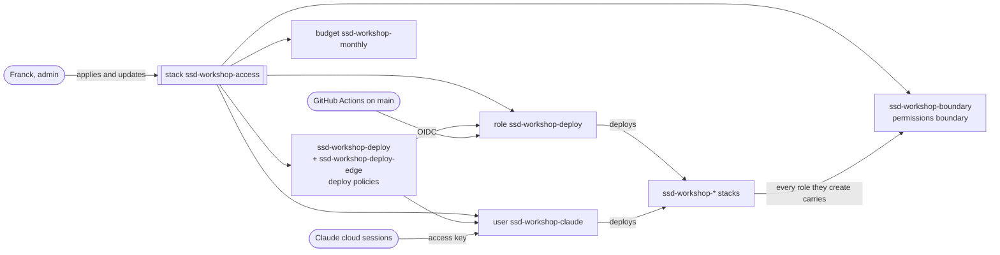

# Access stack

`access-stack.yaml` gives the workshop the least AWS access it needs in the rankly.games account.
Franck applies and updates it by hand in the CloudFormation console. CI and Claude sessions never
apply it, and the deploy rights it grants cannot change it.

## Apply it (first time)

1. Sign in to the AWS console as an admin, region **eu-central-1 (Frankfurt)**.
2. CloudFormation, Create stack, With new resources, Upload a template file:
   `infra/access/access-stack.yaml` from `main`.
3. Stack name: **`ssd-workshop-access`**. Use exactly this name: the self-protection deny is
   written for it.
4. Parameters:

   | Parameter | Value |
   | --- | --- |
   | `HostedZoneId` | the Route53 hosted zone of `rankly.games` |
   | `CreateGitHubOidcProvider` | `yes`, or `no` if IAM already lists the provider `token.actions.githubusercontent.com` |
   | `GitHubRepo` | keep `kifbv/ssd-workshop` |
   | `BudgetEmail` | the address that should get budget alerts |
   | `MonthlyBudgetUsd` | keep `100` |

5. Tick "I acknowledge that AWS CloudFormation might create IAM resources with custom names",
   then Submit and wait for `CREATE_COMPLETE`.
6. IAM, Users, `ssd-workshop-claude`, Security credentials, Create access key (use case: "Third-party
   service"). Store the key id and secret as **network secrets of the project's cloud environment**
   (Project settings, Cloud environment, the gear beside the environment, Network secrets). Do not
   paste them into a chat. New sessions pick them up.
7. Deactivate the admin access keys used so far (IAM, your user, Security credentials, Deactivate),
   so the only long-lived key the workshop uses is the least-privilege one.
8. Before ticket 0.5: in GitHub, give every environment the deploy workflow uses the deployment
   branch rule "main only". The role trusts `environment:*` of this repository, so the branch
   rule is what keeps it to `main`.

## Update it

1. A Claude session hits `AccessDenied` and reports the missing permission (action and resource).
2. Claude changes `access-stack.yaml` in a pull request, keeping the new right scoped to
   `ssd-workshop-*` names, the `project=ssd-workshop` tag or `workshop.rankly.games`, and
   explains it in the table below. The tests in `access-stack.test.ts` fail if a new write is not
   scoped or listed as an exception.
3. Franck reviews and merges.
4. Franck opens the `ssd-workshop-access` stack in the console, Update, Replace existing template,
   uploads the merged `access-stack.yaml`, keeps the parameters, and submits.

## Why each statement exists

**`ssd-workshop-boundary`** (the ceiling for every role the workshop stacks create):

| Sid | Why |
| --- | --- |
| `WorkshopData` | Lambda, ECS and EC2 roles read and write only `ssd-workshop-*` tables, buckets, queues, logs, secrets and parameters. |
| `Bedrock` | The platform calls Claude on Bedrock (Anthropic models and `eu.anthropic.*` inference profiles only). |
| `SendCodes` | Sign-in codes go out by SES, only from `ssd-workshop@rankly.games`. |
| `RunBuilds` | The platform starts build tasks on ECS, pulls images, invalidates CloudFront and sends metrics and traces. |
| `PassWorkshopRoles` | A role may hand only `ssd-workshop-*` roles to the services it starts. |
| `K3sNodeSelfManagement` | The advanced-track k3s nodes register with Systems Manager and read their own tags. |

**`ssd-workshop-deploy`** (deploy rights, part 1):

| Sid | Why |
| --- | --- |
| `ReadOnlyEverywhere` | CDK and Claude need to read stacks, network, certificates, DNS, quotas, costs and IAM to plan a deploy. Reads only. |
| `WorkshopStacks` | Create, update and delete `ssd-workshop-*` stacks (change sets authorize against the stack). |
| `ProtectThisStack` | Deny: every non-read CloudFormation action on `ssd-workshop-access` (update, delete, change sets, cancel, rollback, stack policy), so the deploy rights cannot raise themselves. |
| `NamedWorkshopResources` | Full control of the workshop's own S3, DynamoDB, Lambda, logs, SQS, ECR, Secrets Manager, SSM, EventBridge, Scheduler, Step Functions, SNS and ECS resources, by `ssd-workshop-*` name. |
| `ActionsWithoutResourceScope` | Actions AWS cannot limit by name (ECR login, task definitions, cluster create, event source mappings, log deliveries, schedule groups, bucket listing). Each one is listed with its reason in the test. |
| `ApiGatewayInRegion` | API Gateway ids are generated, so writes are limited to eu-central-1. |
| `WorkshopRolesWithBoundaryOnly` | Create roles and change their policies only when the role carries `ssd-workshop-boundary`. |
| `WorkshopRolesHousekeeping` | Delete, tag, pass and wire instance profiles for `ssd-workshop-*` roles. |
| `WorkshopServiceLinkedRoles` | Let a service (ECS, ELB, ...) create its AWS-defined service-linked role the first time it is used. |
| `NoBoundaryEscape` | Deny removing or replacing a boundary, creating users or access keys, and rewriting managed policies. |
| `Bedrock` | Claude sessions test the platform's Bedrock calls. |
| `SesForTesting` | Claude sessions test code emails, only from `ssd-workshop@rankly.games`. |
| `WorkshopBudget` | Adjust the `ssd-workshop*` budget. |

**`ssd-workshop-deploy-edge`** (deploy rights, part 2; IAM caps one managed policy at 6,144 characters):

| Sid | Why |
| --- | --- |
| `CloudFrontTaggedCreate` | Create CloudFront distributions only with the `project=ssd-workshop` tag. |
| `CloudFrontTaggedChange` | Change, delete or invalidate only distributions tagged `project=ssd-workshop`. |
| `CloudFrontUntaggableParts` | Origin access controls and cache, origin-request and response-headers policies have generated ids and no tags. |
| `CloudFrontWorkshopFunctions` | CloudFront functions named `ssd-workshop-*`. |
| `CertificatesTagged` | Request ACM certificates only with the project tag. |
| `CertificatesChange` | Change or delete only certificates tagged with the project. |
| `DnsOnlyWorkshopSubdomain` | Change records in rankly.games only for `workshop.rankly.games` and names under it (certificate validation). |
| `Ec2CreateTagged` | Create instances, networks and volumes only with the project tag. |
| `Ec2RunInstancesSupportingResources` | Starting an instance also authorizes the image, subnet, network interface, security group, key pair and launch template it uses. |
| `Ec2TagOnCreate` | Tag EC2 resources only as part of creating them. |
| `Ec2ChangeTaggedOnly` | Start, stop, change and delete only EC2 resources tagged with the project. |

## What the tests prove, and what only AWS can

`access-stack.test.ts` (run by `npm test`) parses the template and checks both deploy policies:
every write is scoped by name, tag or DNS name or is on the commented exception list; the stack
denies its own changes to both principals; roles can only be created with the boundary; the
boundary cannot be removed; the deploy role trusts only this repository's `main` and
environments. `cfn-lint` checks the template itself.

Only a live account can prove that AWS evaluates these policies as written: that the deploy role
really gets `AccessDenied` on `UpdateStack` of `ssd-workshop-access`, that `CreateRole` without
the boundary is refused, and that the scoped rights are enough for a real `cdk deploy`
(tickets 0.4 and 0.5).
