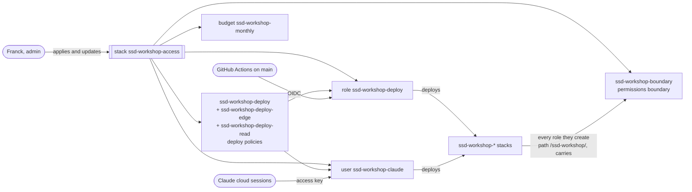

# Access stack

`access-stack.yaml` gives the workshop the least AWS access it needs in the rankly.games account,
which it shares with other projects (rankly.games, www, play, letters). Franck applies and
updates it by hand in the CloudFormation console. CI and Claude sessions never apply it, and the
deploy rights it grants cannot change it, the deploy role, the Claude user or the four managed
policies (explicit denies `ProtectThisStack` and `ProtectAccessIdentities`; every role the deploy
rights may touch lives under the IAM path `/ssd-workshop/`, which the deploy role, on path `/`, is
not). Workshop participants never get AWS credentials: the only principals are the deploy role
(GitHub Actions on `main`) and the user `ssd-workshop-claude`. What IAM cannot close is listed
under [Accepted risks](#accepted-risks).

## Apply it (first time)

1. Sign in to the AWS console as an admin, region **eu-central-1 (Frankfurt)**.
2. CloudFormation, Create stack, With new resources, Upload a template file:
   `infra/access/access-stack.yaml` from `main`.
3. Stack name: **`ssd-workshop-access`**. Use exactly this name: the self-protection deny is
   written for it.
4. Parameters:

   | Parameter | Value |
   | --- | --- |
   | `HostedZoneId` | the Route53 hosted zone of `rankly.games` |
   | `CreateGitHubOidcProvider` | `yes`, or `no` if IAM already lists the provider `token.actions.githubusercontent.com` |
   | `GitHubRepo` | keep `kifbv/ssd-workshop` |
   | `BudgetEmail` | the address that should get budget alerts |
   | `MonthlyBudgetUsd` | keep `100` |

5. Tick "I acknowledge that AWS CloudFormation might create IAM resources with custom names",
   then Submit and wait for `CREATE_COMPLETE`.
6. IAM, Users, `ssd-workshop-claude`, Security credentials, Create access key (use case: "Third-party
   service"). Store the key id and secret as **network secrets of the project's cloud environment**
   (Project settings, Cloud environment, the gear beside the environment, Network secrets). Do not
   paste them into a chat. New sessions pick them up.
7. Deactivate the admin access keys used so far (IAM, your user, Security credentials, Deactivate),
   so the only long-lived key the workshop uses is the least-privilege one.
8. Nothing to set up in GitHub: the role trusts only the OIDC subject
   `repo:kifbv/ssd-workshop:ref:refs/heads/main`. The deploy workflow (ticket 0.5) must not use a
   GitHub environment, because a job with an environment gets the subject
   `repo:kifbv/ssd-workshop:environment:<name>`, which the role refuses.

## Update it

1. A Claude session hits `AccessDenied` and reports the missing permission (action and resource).
2. Claude changes `access-stack.yaml` in a pull request, keeping the new right scoped to
   `ssd-workshop-*` names, the `project=ssd-workshop` tag or `workshop.rankly.games`, and
   explains it in the table below. The tests in `access-stack.test.ts` fail if a new write is not
   scoped or listed as an exception.
3. Franck reviews and merges.
4. Franck opens the `ssd-workshop-access` stack in the console, Update, Replace existing template,
   uploads the merged `access-stack.yaml`, keeps the parameters, and submits.

## Why each statement exists

**`ssd-workshop-boundary`** (the ceiling for every role the workshop stacks create):

| Sid | Why |
| --- | --- |
| `WorkshopData` | Lambda, ECS and EC2 roles read and write only `ssd-workshop-*` tables, queues, secrets and parameters, and the log groups `ssd-workshop-*`, `/aws/lambda/ssd-workshop-*` and `/ecs/ssd-workshop-*`. |
| `WorkshopBuckets` | `ssd-workshop-*` buckets, only in this account (`aws:ResourceAccount`: bucket names are global, so someone else could own a bucket with a matching name). |
| `Bedrock` | The platform calls Claude on Bedrock (Anthropic models and `eu.anthropic.*` inference profiles only). |
| `SendCodes` | Sign-in codes go out by SES, only from `ssd-workshop@rankly.games`. |
| `RunBuilds` | Start build tasks only from `ssd-workshop-*` task definitions on `ssd-workshop-*` clusters (`ecs:cluster`). |
| `WatchBuilds` | Stop and describe tasks on `ssd-workshop-*` clusters. |
| `PullImages` | Pull images only from `ssd-workshop-*` repositories. |
| `InvalidateWorkshopSite` | Invalidate only distributions tagged `project=ssd-workshop`. |
| `AccountWideServiceCalls` | ECR login token and X-Ray traces; neither has a resource scope. |
| `WorkshopMetrics` | Metrics only in the CloudWatch namespace `ssd-workshop`. |
| `PassWorkshopRoles` | A role may hand only `/ssd-workshop/` roles, and only to ECS tasks. |
| `K3sNodeHeartbeat` | Advanced-track k3s nodes report to Systems Manager, only for instances tagged with the project. |
| `K3sNodeChannels` | Session Manager and Run Command channels of the calling instance, and reading instance tags. |

**`ssd-workshop-deploy`** (deploy rights, part 1: stacks, named resources, IAM, and the denies that guard them):

| Sid | Why |
| --- | --- |
| `WorkshopStacks` | Create, update, delete and read `ssd-workshop-*` stacks (change sets authorize against the stack). CDK names the stack when it calls `DescribeStacks`. |
| `ProtectThisStack` | Deny: every non-read CloudFormation action on `ssd-workshop-access` (update, delete, change sets, cancel, rollback, stack policy), so the deploy rights cannot raise themselves. |
| `NamedWorkshopResources` | Full control of the workshop's own DynamoDB, Lambda, logs (`ssd-workshop-*`, `/aws/lambda/ssd-workshop-*`, `/ecs/ssd-workshop-*`), SQS, ECR, Secrets Manager, SSM, EventBridge, Scheduler, Step Functions, SNS and ECS resources, by `ssd-workshop-*` name. |
| `WorkshopBuckets` | Full control of `ssd-workshop-*` buckets in this account only (`aws:ResourceAccount`). |
| `ActionsWithoutResourceScope` | Actions AWS cannot limit by name or tag: ECR login token, task definition deregistration, vended log deliveries. Each one is listed with its reason in the test. |
| `WorkshopEventSourceMappings` | Create, change and delete event source mappings only for `ssd-workshop-*` functions (`lambda:FunctionArn`). |
| `TagEventSourceMappings` | CloudFormation tags the mappings it creates; mapping ids are generated, and a tag on a mapping grants nothing. |
| `WorkshopRolesWithBoundaryOnly` | Create roles on the path `/ssd-workshop/` and change their policies only when the role carries `ssd-workshop-boundary`. |
| `WorkshopRolesHousekeeping` | Delete, tag, update (also the trust policy, which CloudFormation changes in place) and wire instance profiles for roles and instance profiles on `/ssd-workshop/`. |
| `PassWorkshopRolesToWorkshopServices` | Hand `/ssd-workshop/` roles only to Lambda, ECS tasks, EC2, Step Functions, EventBridge Scheduler and EventBridge (`iam:PassedToService`). |
| `ProtectAccessIdentities` | Deny: every IAM action except `Get*`/`List*` on the role `ssd-workshop-deploy`, the user `ssd-workshop-claude` and the four managed policies. |
| `WorkshopServiceLinkedRoles` | Let ECS create its AWS-defined service-linked role the first time it is used (`iam:AWSServiceName` `ecs.amazonaws.com` only). |
| `NoBoundaryEscape` | Deny removing or replacing a boundary, creating users or access keys, and rewriting managed policies. |
| `NoSelfAssume` | Deny `sts:AssumeRole`, `TagSession` and `SetSourceIdentity`: a role elsewhere in the account whose trust policy names the account or these principals cannot be assumed. |
| `NoExternalSharing` | Deny S3 ACLs, Secrets Manager, ECR, DynamoDB, SSM and CloudWatch Logs resource policies, Lambda function URLs and layer sharing, SQS and SNS `AddPermission`, DynamoDB exports and log subscription filters: none is needed by this spec, and each could share workshop data outside the account. |
| `InvokePermissionsForServicesOnly` | Deny `lambda:AddPermission` unless the principal is API Gateway, EventBridge, SNS or S3, so no account or the public can be allowed to invoke a function. |
| `EventTargetsInAccount` | Deny EventBridge targets outside this account (`events:TargetArn`). |
| `SubscriptionsInWorkshop` | Deny SNS subscriptions except to `ssd-workshop-*` Lambda functions and queues of this account (no e-mail or HTTP endpoints). |

**`ssd-workshop-deploy-edge`** (deploy rights, part 2: CloudFront, certificates, API Gateway, DNS, EC2, Bedrock and SES):

| Sid | Why |
| --- | --- |
| `CloudFrontTaggedCreate` | Create CloudFront distributions only with the `project=ssd-workshop` tag. |
| `CloudFrontTaggedChange` | Change, delete, invalidate, tag or untag only distributions already tagged `project=ssd-workshop` (a tag right with only a request tag would let the role tag, then take over, any distribution). |
| `CloudFrontUntaggableParts` | Origin access controls and cache, origin-request and response-headers policies have generated ids and no tags: create and read only, so the rankly.games distributions' existing ones cannot be changed or deleted. |
| `CloudFrontWorkshopFunctions` | CloudFront functions named `ssd-workshop-*`. |
| `CertificatesTagged` | Request ACM certificates only with the project tag. |
| `CertificatesChange` | Change, delete, tag or untag only certificates already tagged with the project. |
| `ApiGatewayTaggedCreate` | Create REST and HTTP APIs (`POST /restapis`, `POST /apis`) only with the project tag. |
| `ApiGatewayTaggedChange` | Write anything under an API or change and delete it only when the API is tagged with the project; child resources inherit the API's tag for authorization. |
| `DnsOnlyWorkshopSubdomain` | Change records in rankly.games only for `workshop.rankly.games` and names under it, only `A`, `AAAA` and `CNAME` (alias and certificate validation), with a `Null` guard because `ForAllValues` is true when a key is missing. |
| `Ec2CreateTagged` | Create networks, launch templates and volumes only with the project tag. |
| `Ec2RunInstancesNewResources` | The instance, its volumes and new network interfaces only with the project tag in the request. |
| `Ec2RunInstancesTaggedNetwork` | Subnets, security groups, launch templates and existing network interfaces only when tagged with the project. |
| `Ec2RunInstancesAmazonImages` | Only images owned by Amazon (`ec2:Owner` `amazon`, e.g. Amazon Linux 2023). |
| `Ec2TagOnCreate` | Tag EC2 resources only as part of creating them. |
| `Ec2ChangeTaggedOnly` | Start, stop, change and delete only EC2 resources tagged with the project. |
| `Bedrock` | Claude sessions test the platform's Bedrock calls. |
| `SesForTesting` | Claude sessions test code emails, only from `ssd-workshop@rankly.games`. |

**`ssd-workshop-deploy-read`** (deploy rights, part 3: reads):

| Sid | Why |
| --- | --- |
| `ReadsWithoutSecrets` | Account-wide reads that CDK or Claude need and whose answers hold no secrets: stack list, template validation, EC2 and ECS listings, certificates, hosted zone list, Bedrock models and inference profiles, service quotas, the SES account and identities, bucket names, log group names, costs. |
| `WorkshopZoneReads` | The rankly.games zone and its records. |
| `WorkshopIamReads` | Read roles and instance profiles on `/ssd-workshop/` and `ssd-workshop-*` policies (not `GetAccountAuthorizationDetails` or other projects' roles). |
| `WorkshopApiReads` | Read APIs tagged with the project (other APIs' stage variables and configuration stay hidden). |
| `WorkshopDistributionReads` | Read distributions tagged with the project (other distributions' origins and custom headers stay hidden). |
| `WorkshopBudgetRead` | Read the `ssd-workshop-monthly` budget. Changing it is not granted. |
| `NoUserDataReads` | Deny instance attributes, launch template versions and spot requests (they hold user data) outside the project tag. Launch template versions and spot requests have no resource tag in IAM, so they are denied for every resource. |
| `NoApiKeyReads` | Deny reading API Gateway keys. |

Not granted on purpose: `lambda:List*` (returns every function's environment variables),
`ecs:DescribeTaskDefinition` (AWS allows only `Resource *`, and it returns every task definition's
environment variables), `cloudformation:Describe*`, `GetTemplate` and `ListExports` on other
stacks (outputs and parameters), `iam:Get*`/`List*` account-wide, `cloudfront:List*`
(distribution summaries carry origin headers), `ses:List*` (contact lists hold e-mail addresses),
`ssm:DescribeParameters`, `budgets:ModifyBudget`.

## Accepted risks

The workshop shares the rankly.games account with other projects. These are the holes IAM cannot
close (or that this spec needs open); Franck accepts each one by merging.

1. **ECS network placement.** For `awsvpc` tasks and services, IAM has no tag key for the subnets
   and security groups named in `RunTask`, `CreateService` or `UpdateService` (only `ecs:subnet`,
   by id; the workshop subnets do not exist yet). Impact: a workshop task could run inside another
   project's subnet and reach its private endpoints. Follow-up: pin the workshop subnet ids with
   `ecs:subnet` once the VPC exists.
2. **Trust and resource policies that name outside accounts.** IAM cannot inspect the content of a
   role trust policy, a bucket policy (`s3:PutBucketPolicy`, needed by CDK for the CloudFront
   origin access control) or an SQS/SNS policy set as an attribute (`SetQueueAttributes`,
   `SetTopicAttributes`). Impact: an outside account could assume a `/ssd-workshop/` role (still
   capped by the boundary: workshop data, Bedrock, SES from the workshop sender) or read a
   workshop bucket. Detection: **enable the free IAM Access Analyzer external-access analyzer**
   for the account (IAM, Access analyzer, Create analyzer, zone of trust: current account); it
   reports every role, bucket, queue, topic, key and secret shared outside the account, for the
   other projects too. Keep S3 Block Public Access on at account level if the other projects
   allow it.
3. **`logs:CreateLogDelivery` / `logs:DeleteLogDelivery` and `ecs:DeregisterTaskDefinition` on
   every resource** (AWS offers no resource scope). Impact: the deploy rights could delete another
   project's vended log delivery (its API Gateway or Step Functions logs stop) or mark another
   project's task definition revision inactive (running tasks and services keep it; new launches of
   that revision fail until it is registered again).
4. **Long-lived access key of `ssd-workshop-claude`.** Impact: a leaked key carries all deploy rights
   until it is deactivated. Mitigation: it lives only as a network secret of the cloud
   environment; rotate it every 90 days and after any suspected leak (IAM, Users, Security
   credentials).
5. **SES sends from `ssd-workshop@rankly.games` to any recipient.** Participants' addresses are not
   known to IAM. Impact: misuse could send mail in rankly.games' name and hurt the sending
   reputation that the other rankly.games projects share.
6. **Account-wide reads without secrets.** EC2 and ECS listings (network layout, instance and
   cluster names of other projects), stack names, certificates, the hosted zone, service quotas
   and costs are readable account-wide.
7. **CloudFront parts without tags.** The deploy rights can create origin access controls and cache,
   origin-request and response-headers policies without limit (account quotas are shared with the
   other distributions), and cannot change or delete them: a stack update that would change one
   fails, and changing one needs Franck or a replacement under a new name.
8. **Channels without a resource scope in the boundary:** `ssmmessages:*`, `ec2messages:*`
   (Session Manager and Run Command of the calling k3s node), `xray:PutTraceSegments`,
   `ecr:GetAuthorizationToken`.
9. **Code that runs with a workshop role can send the data it may read anywhere on the internet.**
   IAM does not control network egress.

Not granted, so a later ticket brings it to Franck before it is needed: `ecs:DescribeTaskDefinition`
(CloudFormation reads ECS task definitions with the caller's rights; options are granting it on
`Resource *`, which shows every project's task definition environment, or a CloudFormation service
role), `ec2:DescribeLaunchTemplateVersions` (no resource scope; needed for k3s launch templates).

## What the tests prove, and what only AWS can

`access-stack.test.ts` (run by `npm test`) parses the template and checks the three deploy
policies and the boundary with the same rules: every write is scoped by a resource name that
starts with `ssd-workshop-` (with the dash), the project tag, the workshop DNS names (with record
types and a `Null` guard) or an `ssd-workshop-*` function, or is on a commented exception list;
no tag-adding action is scoped by a request tag alone; no read that returns secrets or full
configuration (environment variables, user data, stack outputs, API keys, IAM documents, secret
and parameter values, origin headers, contact addresses) is allowed on every resource unless an
explicit deny keeps it to the project tag; CloudFront parts without tags are create-only;
`RunInstances` takes only Amazon images and project network interfaces; every bucket grant needs
this account; the sharing denies, `NoSelfAssume` and the identity denies cover both principals;
no IAM write reaches the deploy role; `iam:PassRole` names its services; roles can only be created
with the boundary; the boundary cannot be removed; the deploy role trusts only this repository's
`main`; each managed policy stays under 6,144 characters. Each check also runs against the old,
loose pattern to prove it fails. `cfn-lint` checks the template itself.

Only a live account can prove that AWS evaluates these policies as written: that the deploy role
really gets `AccessDenied` on `UpdateStack` of `ssd-workshop-access`, that `CreateRole` without
the boundary is refused, and that the scoped rights are enough for a real `cdk deploy`
(tickets 0.4 and 0.5). Points that wait for a live deploy: that CloudFront accepts
`cloudfront:TagResource` with `aws:ResourceTag/project` when it creates a tagged distribution,
that `lambda:FunctionArn` matches when CloudFormation passes a function name, that
`RunInstances` sees the request tag for the network interface it creates, and that
`ssm:UpdateInstanceInformation` sees the instance's project tag (k3s ticket).
